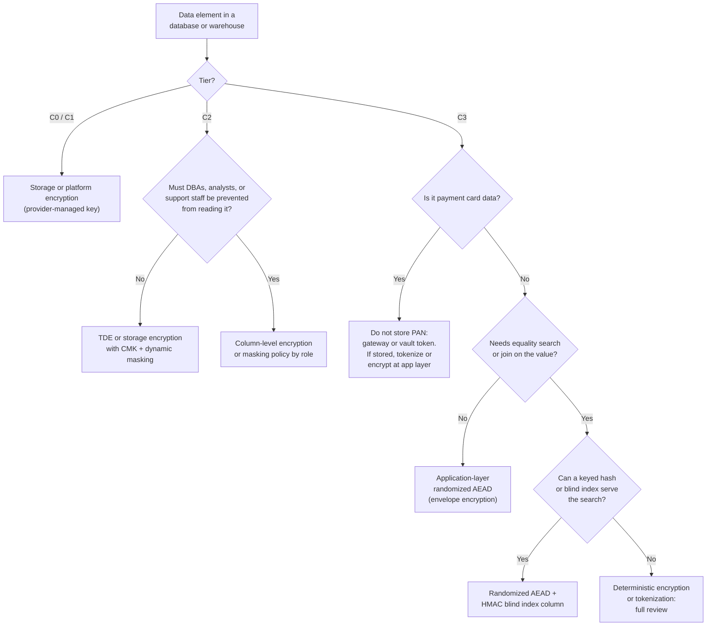
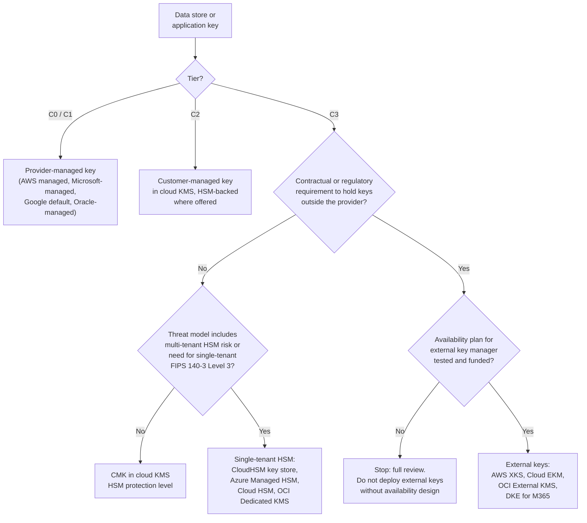
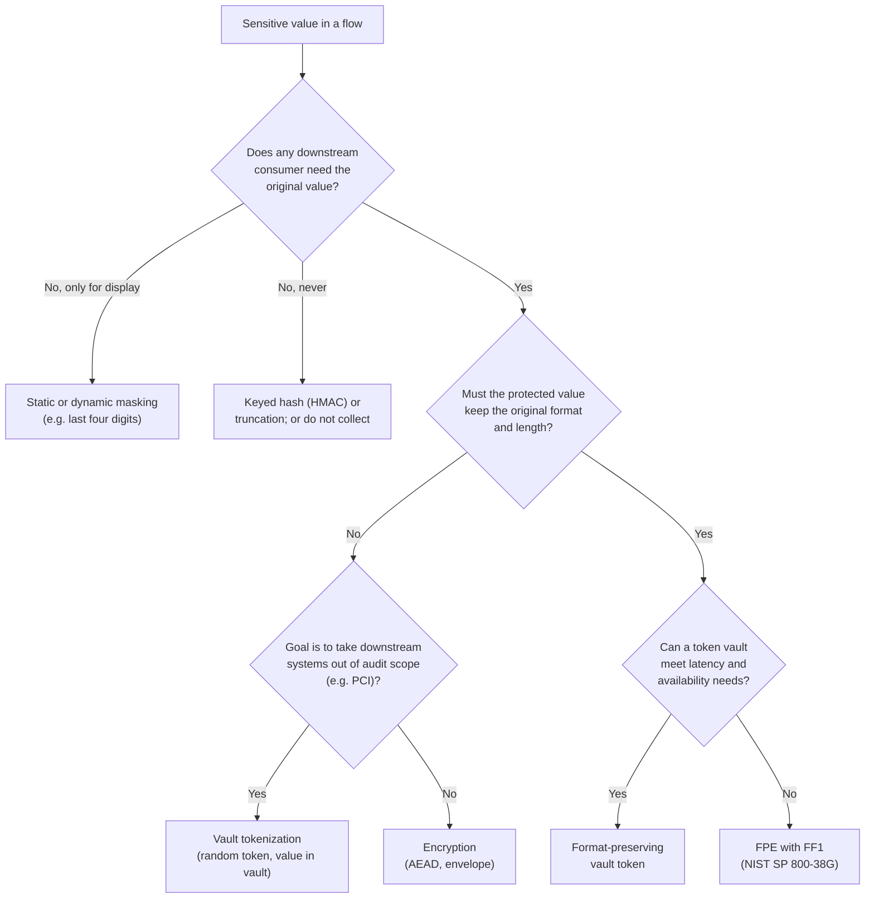
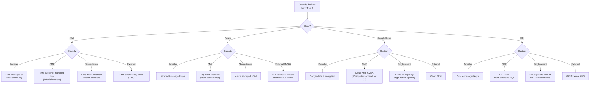
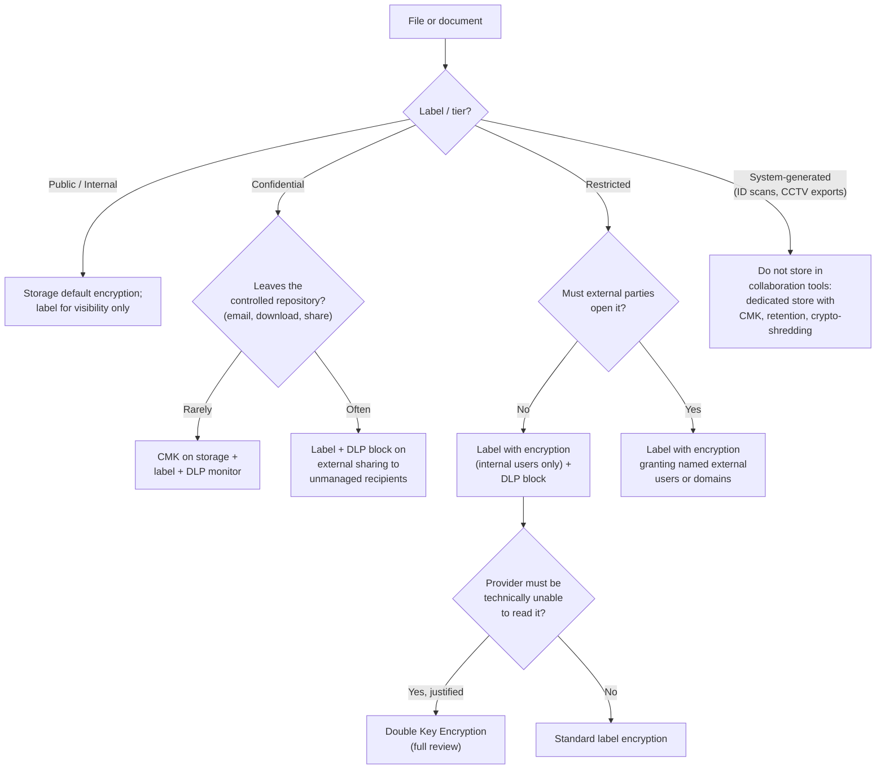
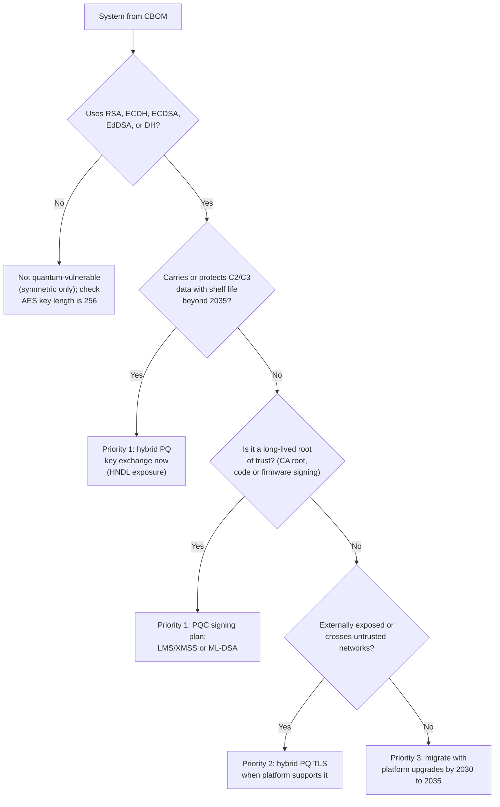

# Encryption decision trees
{: .no_toc }

**Phase 7: Engineering enablement and governance.** These flowcharts let an engineering team reach the same answer the architect would, for the six most common data protection decisions, without waiting for a meeting.
{: .fs-5 .fw-300 }

## On this page
{: .no_toc .text-delta }

1. TOC
{:toc}

---

## How to use these trees

Each tree starts from facts the team already has after the intake form: the data element, its tier (C0 to C3), who needs to read it, and where it is stored. Each ends at a recommendation that maps to a protection profile (PP-1, PP-2, or PP-3). If a tree ends at "full review", the choice has consequences that need an architect and the data owner.

The trees encode the profile model:

| Profile | Tier | Summary |
|---|---|---|
| PP-1 Baseline (Good) | C0, C1 | Provider-managed keys, platform encryption, TLS 1.2+ |
| PP-2 Enhanced (Better) | C2 | Customer-managed keys, TDE with CMK, masking, DLP, TLS 1.3 preferred |
| PP-3 Maximum (Best) | C3 | PP-2 plus application-layer protection, stronger key custody where justified, DLP block, mTLS, crypto-shredding |

{: .important }
A tree's answer is the default. A team can propose a different design in review. What it cannot do is choose a weaker control than the tree without an approved exception.

## Tree 1: Which encryption layer for a structured data element

Structured data can be encrypted at several layers. Each lower layer protects against fewer threats: storage encryption protects against lost disks and snapshots taken outside the account, while application-layer encryption also protects against database administrators, SQL injection that reads raw columns, and backup exposure.

| Outcome | What it protects against | What it costs | Example |
|---|---|---|---|
| Platform encryption, provider key | Physical media loss | Nothing noticeable | Published rate tables |
| TDE/storage with CMK plus masking | Media loss, snapshot theft across accounts, key revocation available; masking hides values from non-privileged roles | KMS cost; key availability dependency | Guest email and phone in the CRM database |
| Column-level encryption or role-based masking | Adds protection from analysts and support staff | Complexity in queries; masking policies to maintain | Loyalty points balance visible only to loyalty operations |
| App-layer randomized AEAD | DBAs, SQL injection reading raw columns, backups, replicas, data lake copies | No search, sort, or range queries on the field; application code change | Passport number, allergy data |
| AEAD plus HMAC blind index | As above, and allows exact-match lookup | Blind index leaks equality (same value, same index); key for HMAC must be managed separately | Lookup of a guest by national ID number at check-in |
| Deterministic encryption or tokenization | Allows joins across systems | Leaks equality and frequency; must be justified | Joining guest records across CRM and PMS by a protected identifier |

{: .warning }
Deterministic encryption of low-cardinality values (country, gender, loyalty tier) is close to useless: frequency analysis recovers the values. Use it only on high-cardinality identifiers.

## Tree 2: Which key custody option

Custody decides who can use the key and who can cut off access. More custody means more control and more operational risk.

| Option | Who can use the key | Availability dependency | Relative cost | When to choose |
|---|---|---|---|---|
| Provider-managed | Provider, on behalf of the service | Provider only | Included | C0/C1 |
| CMK in cloud KMS (software or HSM-backed) | Principals granted in the key policy; provider operates the HSM fleet | Provider only | Low per key plus per request | Default for C2; common for C3 |
| BYOK (imported key material) | As CMK; organization keeps a copy of the material | Provider; plus the organization's escrow process | Low, plus import process | When key material must be generated in the organization's HSM for policy reasons |
| Single-tenant HSM | Organization controls the HSM partition | Provider infrastructure plus organization-managed cluster sizing | High (per HSM hour) | Regulatory or contractual single-tenant requirement, PCI key custody for specific processes |
| External key store (HYOK) | Organization's external key manager must approve every use | Organization's key manager, network path, and provider | High, plus operational effort | Sovereignty requirements where the organization must be able to deny the provider access |

{: .verify }
Product names and tiers for single-tenant and external key options (for example Azure Cloud HSM as the successor to Dedicated HSM, OCI Dedicated KMS and External KMS) change over time. Confirm current availability in each region before committing.

## Tree 3: Tokenization, FPE, encryption, or masking

These four techniques are often confused. The deciding questions are whether any system needs the original value back, whether the protected value must fit the original format, and whether the goal is scope reduction.

| Technique | Reversible | Format preserved | Scope reduction | Key or vault to protect | Typical hospitality use |
|---|---|---|---|---|---|
| Masking (static) | No | Partially | Yes, for the masked copy | None | Test data from production reservation records |
| Masking (dynamic) | Data unchanged; view masked | Yes | No (data still stored) | Access policies | Call center sees `****1234` of a phone number |
| Keyed hash | No | No | Often, if the key is out of scope | HMAC key | Matching guests across systems without sharing identifiers |
| Vault tokenization | Yes, via detokenization API | Optional | Yes, strong (PCI tokenization guidance) | Vault and its keys | Card-on-file for returning guests |
| FPE (FF1) | Yes, with key | Yes | Weaker: anyone with key access is in scope | FPE key | Legacy PMS fields that require a 16-digit numeric value |
| Encryption (AEAD) | Yes, with key | No | Systems without key access may be out of scope, subject to assessor | KEK in KMS/HSM | Passport numbers, health data |

{: .note }
NIST SP 800-38G specifies FF1 and FF3-1. The 2025 draft revision proposes withdrawing FF3-1 and raising the minimum domain size (verify the current status). Use FF1 only, and do not apply FPE to short or low-cardinality fields.

## Tree 4: Which cloud KMS tier

This tree picks the specific service within a cloud once the custody decision is made.

| Cloud | PP-1 | PP-2 | PP-3 (default) | PP-3 (justified exception) |
|---|---|---|---|---|
| AWS | AWS owned or AWS managed key | Customer managed KMS key, one per domain and environment | Customer managed KMS key used by application-layer encryption; separate from the PP-2 key | CloudHSM custom key store or XKS |
| Azure | Microsoft-managed keys | Key Vault Premium key (HSM-backed) | Key Vault Premium or Managed HSM key for app-layer encryption | Managed HSM with organization-controlled security domain; DKE for M365 |
| Google Cloud | Default encryption | Cloud KMS key, HSM protection level recommended | Cloud KMS HSM key; Autokey can standardize creation | Cloud EKM, with Key Access Justifications where used |
| OCI | Oracle-managed keys | Vault key, HSM-protected | Vault key in a virtual private vault | OCI Dedicated KMS or External KMS |

{: .verify }
Google Cloud Autokey, Key Access Justifications, and OCI Dedicated KMS availability by region should be confirmed as of mid-2026.

## Tree 5: Unstructured file protection

Unstructured data is harder because files move. Storage encryption stops protecting a file the moment it is downloaded or emailed. Persistent protection travels with the file.

| Outcome | Tooling | Consequence |
|---|---|---|
| Label for visibility only | Purview sensitivity labels, no encryption | Users see the classification; DLP and analytics can key off it |
| CMK on storage plus DLP monitor | SharePoint/OneDrive with Customer Key, S3/Blob/GCS with CMK | Protects at rest in the service; no protection after download |
| DLP block on external sharing | Purview DLP, CASB | Stops the most common exfiltration channels; requires tuning |
| Label with encryption | Purview Information Protection (Azure Rights Management) | Encryption travels with the file; some apps and search features degrade |
| Double Key Encryption | Purview DKE with an organization-hosted key service | Microsoft cannot decrypt; breaks server-side features such as search, eDiscovery indexing, and Copilot processing for that content |
| Dedicated store | Object storage with PP-3 controls | ID scans and CCTV exports kept out of general collaboration tools |

## Tree 6: Is this system PQC-priority

This tree ranks systems for the Phase 6 migration. It applies Mosca's inequality: if the data's shelf life (X) plus migration time (Y) exceeds the time to a cryptographically relevant quantum computer (Z), the system is at risk now.

| Priority | Example hospitality systems | Action | Target |
|---|---|---|---|
| 1 (HNDL) | Guest identity document archive; M&A data rooms; HR records with long retention; site-to-site links carrying these | Hybrid key exchange (`X25519MLKEM768`) on transport; AES-256 at rest; re-wrap KEKs when PQC KEMs are available in KMS | As soon as supported |
| 1 (roots of trust) | Private CA roots; code signing for mobile app and property IoT firmware | Plan PQC or hybrid signing; evaluate LMS/XMSS for firmware (SP 800-208) | Plan by 2027; migrate by 2030 |
| 2 | Public booking site, guest app APIs, partner APIs | Enable hybrid PQ at CDN and load balancer | 2027 to 2028 |
| 3 | Internal operational tools with short-lived data | Migrate with standard platform upgrades | Before 2035 (NIST IR 8547 draft disallows quantum-vulnerable algorithms after 2035) |

{: .note }
Signatures are generally a lower priority than key exchange because forging a signature needs a quantum computer at the time of the attack, whereas recorded key exchanges can be broken later. Long-lived roots of trust are the exception because they remain valid for many years.

## Combining the trees

A typical C3 design uses several trees in sequence. For a passport number captured at check-in:

1. Tree 1: C3, not card data, needs exact-match lookup: randomized AEAD plus HMAC blind index.
2. Tree 2: no external custody requirement; single-tenant not required: CMK in cloud KMS, HSM protection level.
3. Tree 3: consumers need the original value only for regulatory reporting: encryption, not tokenization.
4. Tree 4: on Azure: Key Vault Premium key.
5. Tree 5: the scan image is system-generated: dedicated store with crypto-shredding.
6. Tree 6: retention is short in most jurisdictions: priority 2, unless a jurisdiction requires long retention.

## Key takeaways for engineering teams

- Start from the tier; the tier bounds the answer before any other question.
- Application-layer encryption is the default for C3 structured fields; plan for loss of search and joins.
- External key custody is never a default: it needs a tested availability plan.
- Choose tokenization for scope reduction, encryption for confidentiality, masking for display.
- Record which tree and outcome you used in the encryption design record.

## Related pages

- [Security design review process]()
- [Structured data protection patterns]()
- [Tokenization, FPE, and masking]()
- [Key custody: BYOK, HYOK, and external keys]()
- [Unstructured data protection patterns]()
- [PQC migration program]()
