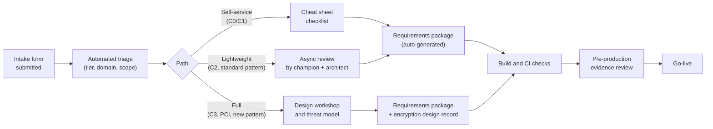
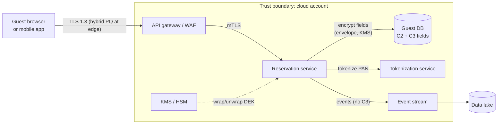

# Security design review process
{: .no_toc }

**Phase 7: Engineering enablement and governance.** This page defines how a project moves from "we are building something" to a signed-off set of data protection requirements, without making security review a bottleneck.
{: .fs-5 .fw-300 }

## On this page
{: .no_toc .text-delta }

1. TOC
{:toc}

---

## Purpose and principles

The design review is where the classification scheme, the protection profiles, and the crypto standard become specific decisions for one system. Its output is not an approval stamp. Its output is a **security requirements package**: a short, testable list of controls the team will build, the keys they will use, the trade-offs the data owner accepted, and the evidence the team will produce before go-live.

The process follows five principles:

| Principle | What it means in practice |
|---|---|
| Classification drives depth | The highest data tier in scope decides the review path. C0/C1 projects are self-service. |
| Early and cheap | Review happens at design, before code, when changing a key hierarchy costs a whiteboard session, not a migration. |
| Patterns over opinions | Reviewers point to a reference architecture or decision tree rather than inventing a design each time. |
| Testable requirements | Every requirement has a verification method: a guardrail, a CI check, a test, or a screenshot. |
| Time-bound | Published SLAs; reviews that exceed SLA escalate automatically. |

## Process overview



## Intake form

The intake form is short enough to complete in 15 minutes and structured enough to triage automatically. It is implemented as a ticket template (Jira, ServiceNow, or GitHub issue form) so the answers are machine-readable.

| Field | Type | Why it is asked |
|---|---|---|
| Project name and owning team | Text, team slug | Maps to `data-owner` tag |
| Business sponsor and data owner | Person | Accepts trade-offs and residual risk |
| Target go-live date | Date | Drives scheduling and SLA |
| Hosting | Multi-select: AWS, Azure, Google Cloud, OCI, on-prem data center, property on-prem, SaaS | Selects cloud playbook and guardrails |
| Data elements processed | Multi-select from the data catalog (guest name, email, loyalty ID, PAN, passport number, allergy data, etc.) | Derives the highest tier automatically |
| Highest data classification | Auto-computed, editable with reason | Chooses review path |
| Data domains | Multi-select: `guest`, `payment`, `loyalty`, `employee`, `finance`, `operations`, `property-iot`, `security` | Selects keys and owners |
| Regulatory scope | Multi-select: PCI, GDPR, CCPA, PIPL, LGPD, DPDP, none | Adds regulation-specific requirements |
| Data residency | Multi-select: `us`, `eu`, `uk`, `cn`, `apac`, `latam`, `mea`, `global` | Region and key locality requirements |
| Data subjects include children | Yes/No | Children's data is C3 |
| Volume | Records per day, total records | Performance and cost of field-level encryption |
| Data flows | Upload diagram or list: source, destination, protocol | Transit controls and threat model |
| Third parties | List vendors, franchisees, partners with access | Contract and sharing controls |
| Search and join requirements on sensitive fields | Text | Decides deterministic versus randomized protection |
| Non-production data needs | Synthetic, masked, or production copy (requires exception) | Test data controls |
| Retention | `r90d`, `r1y`, `r3y`, `r7y`, `r10y`, `legal-hold` | Deletion and crypto-shredding design |
| Uses a reference architecture | Select or "none" | Can shorten the review |
| New cryptographic libraries or algorithms | Yes/No, list | Crypto standard compliance and PQC agility |

## Triage by data classification

Triage is automated from the intake fields. A reviewer can override the path, but only upward without approval.

| Path | Trigger | Who reviews | Typical effort | Output |
|---|---|---|---|---|
| Self-service | Highest tier C0 or C1; no third-party sharing; standard hosting | Team self-attests against the [engineering cheat sheet]() | Under 1 hour | Auto-generated requirements package |
| Lightweight | Highest tier C2; uses a reference architecture; no new crypto | Security champion, then architect async | 1 to 3 days elapsed | Requirements package with pattern reference |
| Full | Any C3; any PCI scope; cross-border transfer to `cn`; new key custody model; new crypto library; franchise or partner data sharing | Architect-led workshop; threat model; privacy consulted | 1 to 3 weeks elapsed | Requirements package plus encryption design record |
| Re-review | Material change: new data element at higher tier, new region, new third party | Same as the new path | Varies | Updated package |

{: .note }
The C3 trigger is deliberately broad. Passport scans at the front desk, allergy data in dining reservations, and spa health questionnaires all look like minor features but carry the highest tier. The intake's data element picker catches these where a free-text description would not.

## Lightweight review

A lightweight review is asynchronous. The team's security champion completes a checklist, the architect reads it, and comments are resolved in the ticket.

Checklist items for C2:

1. Every data store is tagged with `data-classification=confidential` and `protection-profile=pp2`.
2. Storage uses customer-managed keys from the domain's key (for example, the guest domain production key), created through the paved-road module.
3. Key admin and key user roles are separate; the application's workload identity has encrypt and decrypt only.
4. TLS 1.2 minimum on all endpoints, TLS 1.3 preferred; no plaintext internal hops for C2 flows.
5. Dynamic masking applied for support and analytics roles on C2 columns.
6. No C2 values in logs (names, emails, phone numbers, reservation details beyond a confirmation number).
7. Non-production uses masked or synthetic data.
8. Retention class set and deletion job designed.
9. DLP policies cover any export or file generation feature.

## Full review

A full review adds a design workshop, a threat model, and an encryption design record.

### Threat modeling

The architect uses STRIDE applied to a data flow diagram, with emphasis on the information disclosure and tampering categories because they map directly to confidentiality and integrity controls.



For each element and flow crossing a trust boundary, the review records threats and the controls that address them:

| STRIDE category | Data protection question | Typical control |
|---|---|---|
| Spoofing | Can a caller impersonate the service that is allowed to decrypt? | Workload identity, mTLS, KMS key policy restricted to the service role |
| Tampering | Can stored ciphertext be swapped between records? | AEAD with the record ID in the encryption context or associated data |
| Repudiation | Can we prove who decrypted a record? | KMS audit logs (CloudTrail, Key Vault diagnostics, Cloud Audit Logs) retained and monitored |
| Information disclosure | Where does plaintext exist, and who can read it? | Field-level encryption, masking, log redaction, no C3 in events |
| Denial of service | What happens if the key is unavailable? | Key availability design, caching of data keys with bounded lifetime, runbook |
| Elevation of privilege | Can a DBA or cloud admin read C3 data? | Application-layer encryption with keys the DBA cannot use; separation of duties |

The architect also records a **plaintext map**: every place where a C3 value exists in plaintext (memory in the service, the browser form, the tokenization service), with justification. The goal is to keep that list short and explicit.

## The security requirements package

Every reviewed project receives a package. For self-service and lightweight reviews it is generated from a template using the intake fields; for full reviews the architect edits it. Each requirement has an ID, a statement, a verification method, and an owner.

| ID | Requirement | Verification |
|---|---|---|
| DP-01 | All data stores tagged per the tag schema | Guardrail (tag policy) and CI check |
| DP-02 | C2 stores encrypted with the domain CMK; C3 stores with the domain PP-3 key | Terraform plan check (OPA), AWS Config or Azure Policy compliance |
| DP-03 | C3 fields listed in the encryption design record are encrypted or tokenized in the application before persistence | Unit test that reads the raw column and asserts ciphertext format |
| DP-04 | Workload identity has encrypt/decrypt only; no key administration | IAM policy review; access analyzer output |
| DP-05 | TLS 1.2 minimum, TLS 1.3 preferred; mTLS for service-to-service C3 flows | TLS scan; mesh policy in strict mode |
| DP-06 | No C2/C3 values in logs | Log redaction test; DLP scan of a sample log stream |
| DP-07 | Non-production uses masked or synthetic data | Test data attestation |
| DP-08 | Retention and deletion implemented per `retention-class` | Deletion job test evidence |
| DP-09 | Crypto-agile: algorithm identifiers stored with ciphertext; no hard-coded algorithm choices | Code review |
| DP-10 | Key unavailability runbook documented and tested | Game day record |

## Encryption design record template

Full reviews produce an encryption design record (EDR), written in architecture decision record (ADR) format so it can be stored beside the code.

```markdown
# EDR-NNN: <title>

Status: Proposed | Accepted | Superseded by EDR-XXX
Date: YYYY-MM-DD
Owner: <team slug>
Data owner: <name>
Reviewers: <architect>, <privacy>, <champion>

## Context
System purpose, data elements and tiers, regulatory scope, residency, volumes.

## Decision
Per data element: protection method, layer, key, algorithm, library.

## Key design
Key names, hierarchy, custody, rotation, roles, region.

## Trade-offs accepted
What breaks (search, joins, analytics) and how it is handled.

## Alternatives considered
Options rejected and why.

## Residual risks
Risks accepted by the data owner.

## Verification
How each decision is tested and evidenced.

## PQC and agility
Quantum-vulnerable components and migration path.
```

### Worked example: guest preferences and accessibility service

The following is a filled example for a sample hospitality service.

**EDR-014: Field protection for the guest preferences and accessibility service**

**Status:** Accepted. **Owner:** `guest-platform`. **Data owner:** Director, Guest Data.

**Context.** The service stores guest room preferences (pillow type, floor level), dietary and allergy information, and accessibility needs (mobility, hearing) so properties can prepare rooms before arrival. It runs on Amazon EKS in `eu-west-1` and `us-east-1`, backed by Amazon Aurora PostgreSQL. It serves the guest mobile app, the CRS, and property PMS integrations. Roughly 40 million guest profiles; 2 million writes per day. Regulatory scope: GDPR (allergy and accessibility data are health data under Article 9), CCPA. Residency: EU guests' records stay in the EU region.

| Data element | Tier | Label |
|---|---|---|
| Guest ID, loyalty ID | C2 | `Confidential\Guest-PII` |
| Room preferences | C2 | `Confidential\Guest-PII` |
| Allergy and dietary data | C3 | `Restricted\Special-Category` |
| Accessibility needs | C3 | `Restricted\Special-Category` |

**Decision.**

| Element | Method | Layer | Key | Library |
|---|---|---|---|---|
| Room preferences | Aurora encryption at rest with CMK | Storage | `alias/guest-prod-eu-pp2` | Platform |
| Allergy and accessibility fields | AES-256-GCM envelope encryption per record | Application | `alias/guest-prod-eu-pp3` (KMS key in the EU region) | AWS Encryption SDK for Java with the caching materials manager disabled for C3 |
| Guest ID | Plaintext in the application, used as encryption context | n/a | n/a | n/a |

The encryption context for each C3 field includes `guest_id`, `field_name`, and `data-domain=guest`, so ciphertext cannot be moved between guests or fields without failing authentication.

**Key design.** Two KMS keys per region: a PP-2 key used by Aurora and a PP-3 key used only by the preferences service role for `kms:GenerateDataKey` and `kms:Decrypt`, constrained by `kms:EncryptionContext:data-domain`. Key administrators are a separate platform security group and cannot use the key. Automatic annual rotation is on. EU keys are created in the EU region; the US deployment has its own keys.

**Trade-offs accepted.** Properties cannot run SQL reports that filter on allergy type. The service instead exposes an API that returns, for a given arrival date and property, a list of arrivals with flagged needs, decrypted in the service and returned over mTLS to the PMS integration. Analytics receives only a boolean `has_accessibility_need` and no detail.

**Alternatives considered.** Tokenization was rejected because no downstream system needs a surrogate value; they need either the value or nothing. Aurora-only encryption was rejected because DBAs and anyone with snapshot restore rights could read health data. An external key store was rejected because the availability risk to arrival preparation was not justified by the threat model.

**Residual risks.** Plaintext exists in service memory and in the property-facing API response. Property staff see accessibility needs on arrival reports: controlled by role-based access in the PMS and by the retention of the arrival report (deleted after checkout).

**Verification.** Integration test reads the raw Aurora column and asserts the AWS Encryption SDK message header; OPA check on the Terraform plan confirms KMS key tags; CloudTrail detection alerts on `Decrypt` calls with this key from any principal other than the service role.

**PQC and agility.** Data at rest uses AES-256-GCM, which is not materially weakened by known quantum algorithms. The KMS API calls use TLS; hybrid post-quantum TLS on AWS KMS endpoints is supported by recent AWS SDKs when configured (verify for the Java SDK version in use). Retention is short (profile deleted 3 years after last stay), so HNDL exposure is limited.

## SLAs

| Path | Acknowledge | First response | Decision |
|---|---|---|---|
| Self-service | Automated | Automated | Immediate (self-attested; sampled for audit) |
| Lightweight | 1 business day | 3 business days | 5 business days |
| Full | 1 business day | Workshop within 5 business days | 15 business days after workshop |
| Urgent (production incident or regulatory deadline) | 4 hours | 1 business day | Agreed case by case |

SLA breaches are reported in the monthly metrics. A review that exceeds SLA because the team has not supplied information is paused, not breached.

## Office hours

The architecture team runs two 60-minute office hours sessions a week at times that cover the Americas, EMEA, and APAC. Office hours are for questions that do not need a ticket: "which decision tree applies", "can I use this library", "how do I tag a Databricks workspace". Common questions become cheat sheet entries.

## Security champions program

| Element | Design |
|---|---|
| Who | One engineer per product team handling C2/C3 data, nominated by the engineering manager |
| Time | Around 10 percent of time, agreed with the manager |
| Training | Onboarding course: classification, protection profiles, key management basics, decision trees, threat modeling; refreshed annually |
| Responsibilities | Complete lightweight review checklists; first-line questions; ensure CI checks are active; raise patterns that do not fit |
| Authority | Can approve lightweight reviews for reference-architecture-based C2 designs |
| Recognition | Internal certification, visible in performance objectives |
| Community | Monthly champions meeting; shared channel with the architecture team |

The champions program is how the process scales. A review model that relies on one architect reading every design cannot serve a global organization.

## Pre-production evidence review

Before go-live, the team links evidence for each requirement ID in the package: guardrail compliance output, CI results, test reports, and runbook links. For full-review projects the architect checks the evidence; for others it is sampled. Missing evidence for a C3 requirement blocks go-live unless an exception is approved through the [exception process]().

## Key takeaways for engineering teams

- Submit the intake form at design time; the data elements you select decide the review path.
- Expect a requirements package with testable IDs, not a free-form opinion.
- C3 data, PCI scope, new key custody models, and partner sharing always get a full review.
- Write the encryption design record beside the code and update it when the design changes.
- Use office hours and your champion first; they resolve most questions without a ticket.

## Related pages

- [Encryption decision trees]()
- [Reference architectures]()
- [Data classification scheme]()
- [Label-to-control mapping]()
- [Operating model and RACI]()
