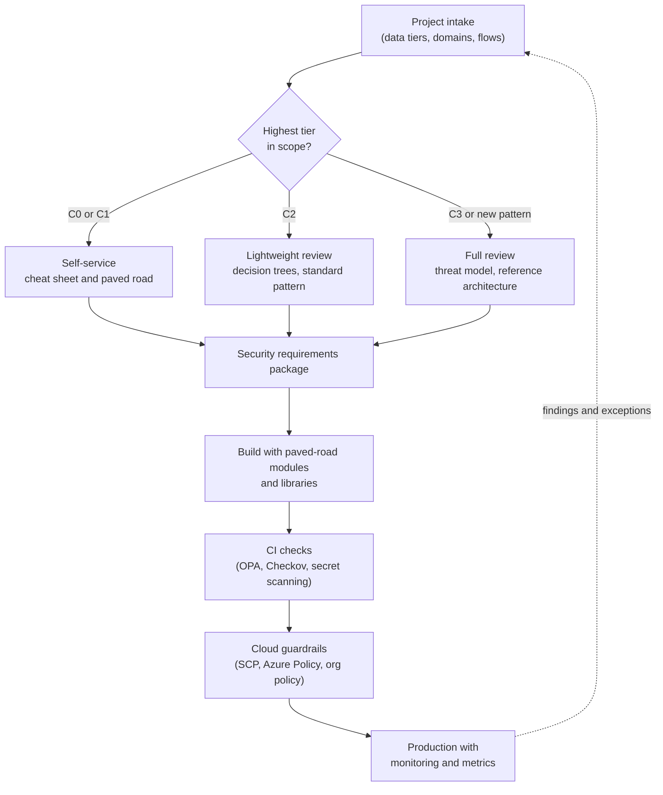

# Phase 7: Engineering enablement
{: .no_toc }

**Phase 7: Engineering enablement and governance.** This section turns the standards and patterns in earlier phases into a repeatable way for engineering teams to design, build, and ship protected systems.
{: .fs-5 .fw-300 }

## On this page
{: .no_toc .text-delta }

1. TOC
{:toc}

---

## Objective

Data protection controls only reach production if engineering teams build them. A central security team cannot write the encryption code for hundreds of services across reservations, loyalty, property technology, payments, and analytics. The objective of Phase 7 is to make the protected design the default design, so that most teams never need a bespoke review and the architect's time goes to the systems that carry C3 data or introduce new patterns.

Phase 7 has four mechanisms:

| Mechanism | What it gives engineering teams | Where it lives |
|---|---|---|
| Design review | A predictable path from "we are building X" to an approved security requirements package | [Security design review process]() |
| Decision support | Flowcharts that answer "which control do I use" without a meeting | [Encryption decision trees]() |
| Patterns and paved roads | Reference designs, Terraform modules, and libraries that already meet the profile | [Reference architectures](), [Code and tooling lab]() |
| Guardrails | Policy as code that blocks or flags non-compliant resources automatically | [Guardrails and policy as code]() |

## How the pieces fit

The loop matters. Guardrail violations and detection findings feed back into the intake process and into the patterns: if many teams request the same exception, the pattern is wrong, not the teams.

## Entry criteria

- Classification scheme and tag schema published (Phase 1), so intake questions have fixed answers.
- Crypto standard and key management architecture approved (Phase 2), so reviews have a standard to cite.
- At least one paved-road module per cloud that creates a tagged key and encrypted storage.

Phase 7 starts in Phase 0 with a minimal intake form. The later mechanisms are added as the standards they depend on are approved.

## Exit criteria

Phase 7 is continuous and has no final exit. It has maturity checkpoints:

| Checkpoint | Evidence |
|---|---|
| Review coverage | 100 percent of new projects handling C2/C3 data pass intake before build starts |
| Self-service share | At least 60 percent of C0/C1 and routine C2 projects complete without an architect meeting |
| Paved-road adoption | Most new keys and encrypted stores are created by approved modules, measured from tags |
| Guardrail maturity | Preventive guardrails in deny mode in production for all profiles; exceptions time-limited |
| Champions | A trained security champion in every product team that handles C2/C3 data |

## Deliverables

- Security design review process, intake form, SLAs, and templates.
- Encryption design record (ADR) template and a worked example.
- Decision trees for encryption layer, key custody, tokenization versus encryption, KMS tier, unstructured file protection, and PQC priority.
- Six reference architectures for hospitality systems.
- Guardrail library under `code/policy/` with tests.
- Engineering cheat sheet by data class.

## Child pages

| Page | What it covers |
|---|---|
| [Security design review process]() | Intake, triage by classification, threat modeling, requirements package, ADR example, SLAs, champions |
| [Encryption decision trees]() | Six flowcharts with explanatory tables for the most common design choices |
| [Reference architectures]() | Six end-to-end designs from reservations to franchise data sharing |
| [Guardrails and policy as code]() | SCPs, Azure Policy, GCP organization policies, OPA/Rego, Checkov |
| [Code and tooling lab]() | Working code: discovery, envelope encryption, tokenization, crypto-shredding, CBOM |
| [Engineering cheat sheet]() | One-page rules by data class and default libraries per language |

## Key takeaways for engineering teams

- Start every project with the intake form; the highest data tier decides how much review you get.
- Use the decision trees and reference architectures before asking for a meeting.
- Build with paved-road modules and libraries; they already satisfy the guardrails.
- Guardrails and CI checks are the same rules as the review, applied automatically.

## Related pages

- [Phased roadmap]()
- [Label-to-control mapping]()
- [Cryptographic standards]()
- [Govern and measure]()
