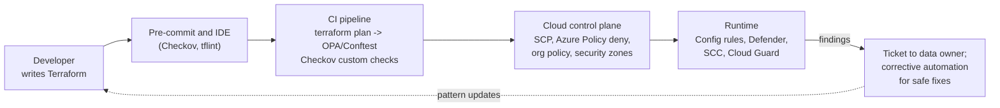

# Guardrails and policy as code
{: .no_toc }

**Phase 7: Engineering enablement and governance.** This page shows how the crypto standard and protection profiles become automated rules that block, detect, or fix non-compliant resources, so compliance does not depend on every reviewer catching every mistake.
{: .fs-5 .fw-300 }

## On this page
{: .no_toc .text-delta }

1. TOC
{:toc}

---

## Guardrail strategy

A guardrail is a rule enforced by a platform rather than by a person. The program uses three kinds, applied at four points in the delivery path.

| Kind | What it does | Examples | Failure mode to watch |
|---|---|---|---|
| Preventive | Stops a non-compliant action | AWS SCP deny, Azure Policy `deny`, GCP organization policy constraint, OCI security zone, OPA gate in CI | Blocks legitimate work if written too broadly |
| Detective | Reports non-compliance after the fact | AWS Config rules, Azure Policy `audit`, Security Command Center findings, OCI Cloud Guard | Findings pile up without owners |
| Corrective | Fixes non-compliance automatically | Azure Policy `deployIfNotExists` and `modify`, AWS Config remediation with Systems Manager Automation, Cloud Guard responders | Automatic changes surprise application owners |



The principle is **shift left, but enforce at the control plane**. CI checks give fast feedback, but they can be bypassed by console changes or other pipelines. Control-plane guardrails (SCPs, Azure Policy deny, organization policies) are the backstop because they apply to every API call regardless of source.

### Rollout sequence

1. Write the rule in detective (audit) mode and measure the number of existing violations.
2. Fix or grant exceptions for existing violations; publish the paved-road module that satisfies the rule.
3. Switch to preventive mode for new resources in non-production.
4. Switch to preventive mode in production.
5. Add corrective automation where the fix is safe and deterministic (for example enabling S3 Bucket Keys, adding a missing diagnostic setting).

### How guardrails key off the tag schema

The tag schema is the contract between classification and enforcement. Guardrails read `data-classification` and `protection-profile` to decide which rules apply.

| Tag value | Guardrails that apply |
|---|---|
| Any, including missing | Default encryption at rest required; TLS 1.2 minimum; no public storage unless `data-classification=public` |
| `protection-profile=pp2` | Customer-managed key required; key must carry matching `data-domain`; diagnostic logs on key usage |
| `protection-profile=pp3` | All PP-2 rules; key must be HSM-protected (where the service supports it); no public network access; private endpoints; key deletion restricted to break-glass role |
| `regulatory-scope` containing `pci` | Resources in PCI-scoped accounts only; stricter logging retention |
| `data-residency=eu` | Allowed regions restricted to EU regions |

A tag policy guardrail that requires the tags on creation is therefore the first guardrail deployed. Without tags, the others cannot distinguish a C3 store from a C0 store and fall back to the strictest safe default.

{: .note }
Tag values are lowercase with hyphens and underscores so the same schema works for AWS tags, Azure tags, GCP labels, and OCI tags. GCP labels do not allow uppercase characters.

Full policy files are maintained in the repository under [`code/policy/`](https://github.com/steven-smith-itnet/data-protection-pqc-security-architecture/tree/main/code/policy). The snippets on this page show the essential logic.

## AWS: service control policies

SCPs set the maximum permissions for accounts in an AWS Organizations organizational unit. They do not grant access; they remove it. They are the right tool for "no one in this OU, including administrators, may do X".

### Deny unencrypted S3 uploads

Since January 2023, Amazon S3 applies SSE-S3 encryption to all new objects by default, so objects are never stored unencrypted. The PP-2 and PP-3 requirement is stronger: objects must use SSE-KMS (or DSSE-KMS) with a customer managed key. The SCP below denies `PutObject` requests that explicitly ask for a different server-side encryption type. Bucket default encryption set to SSE-KMS handles requests that do not specify a header, and a bucket policy or Config rule verifies the default.

```json
{
  "Version": "2012-10-17",
  "Statement": [
    {
      "Sid": "DenyS3PutWithoutKmsEncryption",
      "Effect": "Deny",
      "Action": "s3:PutObject",
      "Resource": "*",
      "Condition": {
        "StringNotEqualsIfExists": {
          "s3:x-amz-server-side-encryption": ["aws:kms", "aws:kms:dsse"]
        },
        "Null": {
          "s3:x-amz-server-side-encryption": "false"
        }
      }
    }
  ]
}
```

The `Null` condition set to `false` means the statement only applies when the header is present, so requests that rely on bucket default encryption are not blocked. Denying requests without the header would break many AWS services and SDK defaults.

### Deny unencrypted RDS and Aurora

```json
{
  "Sid": "DenyUnencryptedRdsCreation",
  "Effect": "Deny",
  "Action": [
    "rds:CreateDBInstance",
    "rds:CreateDBCluster"
  ],
  "Resource": "*",
  "Condition": {
    "Bool": {
      "rds:StorageEncrypted": "false"
    }
  }
}
```

{: .verify }
Confirm the `rds:StorageEncrypted` condition key is evaluated for both `CreateDBInstance` and `CreateDBCluster` in the current RDS service authorization reference. For Aurora, instances inherit encryption from the cluster.

### Protect keys from deletion and policy changes

```json
{
  "Sid": "DenyKeyDestructionExceptBreakGlass",
  "Effect": "Deny",
  "Action": [
    "kms:ScheduleKeyDeletion",
    "kms:DisableKey",
    "kms:PutKeyPolicy",
    "kms:DeleteImportedKeyMaterial"
  ],
  "Resource": "*",
  "Condition": {
    "ArnNotLike": {
      "aws:PrincipalArn": [
        "arn:aws:iam::*:role/key-admin-breakglass",
        "arn:aws:iam::*:role/platform-key-admin-pipeline"
      ]
    }
  }
}
```

### Require classification tags on key creation

```json
{
  "Sid": "RequireClassificationTagOnKmsKey",
  "Effect": "Deny",
  "Action": "kms:CreateKey",
  "Resource": "*",
  "Condition": {
    "Null": {
      "aws:RequestTag/data-classification": "true"
    }
  }
}
```

AWS Organizations tag policies complement this by restricting allowed values (`public`, `internal`, `confidential`, `restricted`).

### Detective and corrective controls in AWS

| Control | Implementation |
|---|---|
| S3 bucket default encryption uses KMS | AWS Config managed rule `s3-default-encryption-kms` |
| RDS encrypted | Config managed rule `rds-storage-encrypted` |
| KMS key rotation enabled | Config managed rule `cmk-backing-key-rotation-enabled` |
| EBS default encryption | Config managed rule `ec2-ebs-encryption-by-default` |
| Remediation | Config remediation with Systems Manager Automation documents for safe fixes, such as enabling EBS default encryption |

{: .verify }
Config managed rule identifiers change occasionally; confirm names in the AWS Config managed rules list.

## Azure: Azure Policy

Azure Policy evaluates resources against definitions at management group, subscription, or resource group scope. Effects include `audit`, `deny`, `modify`, `deployIfNotExists`, and `auditIfNotExists`. Built-in definitions exist for most encryption requirements; custom definitions are used where the built-ins do not key off tags.

### Require customer-managed keys on storage accounts for PP-2 and PP-3

```json
{
  "properties": {
    "displayName": "Storage accounts tagged pp2 or pp3 must use customer-managed keys",
    "mode": "Indexed",
    "parameters": {
      "effect": {
        "type": "String",
        "allowedValues": ["Audit", "Deny", "Disabled"],
        "defaultValue": "Audit"
      }
    },
    "policyRule": {
      "if": {
        "allOf": [
          { "field": "type", "equals": "Microsoft.Storage/storageAccounts" },
          { "field": "tags['protection-profile']", "in": ["pp2", "pp3"] },
          {
            "field": "Microsoft.Storage/storageAccounts/encryption.keySource",
            "notEquals": "Microsoft.Keyvault"
          }
        ]
      },
      "then": { "effect": "[parameters('effect')]" }
    }
  }
}
```

### Require TLS 1.2 minimum on storage accounts

```json
{
  "properties": {
    "displayName": "Storage accounts must require TLS 1.2 or later",
    "mode": "Indexed",
    "policyRule": {
      "if": {
        "allOf": [
          { "field": "type", "equals": "Microsoft.Storage/storageAccounts" },
          {
            "anyOf": [
              { "field": "Microsoft.Storage/storageAccounts/minimumTlsVersion", "exists": "false" },
              { "field": "Microsoft.Storage/storageAccounts/minimumTlsVersion", "notEquals": "TLS1_2" }
            ]
          }
        ]
      },
      "then": { "effect": "deny" }
    }
  }
}
```

{: .note }
Azure is retiring TLS 1.0 and 1.1 for Azure Storage, which makes `TLS1_2` the effective floor. If a `TLS1_3` value becomes available for `minimumTlsVersion`, update the rule to accept it (verify current allowed values).

Assign with the Azure CLI:

```bash
az policy definition create \
  --name storage-cmk-by-profile \
  --display-name "Storage accounts tagged pp2 or pp3 must use customer-managed keys" \
  --rules storage-cmk-rule.json \
  --params storage-cmk-params.json \
  --mode Indexed \
  --management-group mg-production

az policy assignment create \
  --name storage-cmk-by-profile \
  --policy storage-cmk-by-profile \
  --scope /providers/Microsoft.Management/managementGroups/mg-production \
  --params '{ "effect": { "value": "Deny" } }'
```

Other Azure guardrails in the library:

| Requirement | Approach |
|---|---|
| SQL TDE with customer-managed key for PP-2/PP-3 | Built-in audit definition for SQL servers using customer-managed keys, scoped by tag through a custom wrapper |
| Key Vault purge protection and soft delete | Built-in definitions for Key Vault purge protection; deny |
| Key Vault keys have expiration or rotation policy | Built-in definitions for key expiration; audit |
| Private endpoints for PP-3 Key Vaults and storage | Built-in definitions for private link; deny for pp3 |
| Diagnostic logs from Key Vault to Log Analytics | `deployIfNotExists` built-in for diagnostic settings |

## Google Cloud: organization policy constraints

Google Cloud organization policies apply constraints to the resource hierarchy (organization, folders, projects). Two constraints are central to CMEK enforcement.

| Constraint | Effect |
|---|---|
| `constraints/gcp.restrictNonCmekServices` | List of services for which resources cannot be created without CMEK |
| `constraints/gcp.restrictCmekCryptoKeyProjects` | Restricts which projects may supply the KMS keys used for CMEK |

Apply to a folder that holds PP-2 and PP-3 projects:

```yaml
# restrict-non-cmek.yaml
name: folders/123456789012/policies/gcp.restrictNonCmekServices
spec:
  rules:
    - values:
        deniedValues:
          - bigquery.googleapis.com
          - storage.googleapis.com
          - sqladmin.googleapis.com
          - compute.googleapis.com
          - pubsub.googleapis.com
```

```yaml
# restrict-cmek-projects.yaml
name: folders/123456789012/policies/gcp.restrictCmekCryptoKeyProjects
spec:
  rules:
    - values:
        allowedValues:
          - under:projects/sec-keys-prod
```

```bash
gcloud org-policies set-policy restrict-non-cmek.yaml
gcloud org-policies set-policy restrict-cmek-projects.yaml
```

The semantics of `restrictNonCmekServices` are inverted from what the name suggests: listing a service under `deniedValues` means non-CMEK resource creation is denied for that service. Test in a sandbox folder first.

Other useful constraints include `constraints/gcp.resourceLocations` for residency (for example allowing only `in:eu-locations` for EU guest data folders) and `constraints/iam.disableServiceAccountKeyCreation` to keep long-lived service account keys out of code. Custom organization policy constraints can express tag- or field-specific rules for supported resource types.

{: .verify }
Custom organization policy constraint support varies by service. Confirm the supported resource types before writing a custom constraint.

## OCI: security zones and Cloud Guard

OCI Security Zones enforce recipes on compartments. A Maximum Security Zone recipe includes policies that require customer-managed Vault keys for supported resources such as Object Storage buckets and block volumes, and that deny public access. Cloud Guard provides detection and responder recipes. The organization places PP-3 workloads in compartments bound to a security zone and uses Cloud Guard detectors for PP-2 compartments.

{: .verify }
The exact list of security zone policies (for example the policy requiring Vault keys for buckets) should be confirmed against current OCI documentation.

## OPA and Rego on Terraform plans

Control-plane guardrails catch violations at deployment time, which can be late in a pipeline. OPA with Conftest evaluates the Terraform plan in CI, before apply, and gives the engineer an error message that references the standard.

```bash
terraform plan -out tfplan.binary
terraform show -json tfplan.binary > tfplan.json
conftest test tfplan.json --policy code/policy/opa
```

Example policy: S3 buckets tagged PP-2 or PP-3 must have a server-side encryption configuration using `aws:kms` with a key from the approved keys, and RDS must be encrypted.

```rego
package terraform.dataprotection

import rego.v1

protected_profiles := {"pp2", "pp3"}

resources contains r if {
  some r in input.resource_changes
  r.change.actions[_] in {"create", "update"}
}

deny contains msg if {
  some r in resources
  r.type == "aws_s3_bucket"
  profile := r.change.after.tags["protection-profile"]
  profile in protected_profiles
  not bucket_has_kms_sse(r.address)
  msg := sprintf("%s: buckets tagged %s must use SSE-KMS with a customer managed key (DP-02)", [r.address, profile])
}

bucket_has_kms_sse(bucket_address) if {
  some r in resources
  r.type == "aws_s3_bucket_server_side_encryption_configuration"
  rule := r.change.after.rule[_]
  rule.apply_server_side_encryption_by_default[_].sse_algorithm in {"aws:kms", "aws:kms:dsse"}
}

deny contains msg if {
  some r in resources
  r.type in {"aws_db_instance", "aws_rds_cluster"}
  not r.change.after.storage_encrypted
  msg := sprintf("%s: RDS and Aurora storage must be encrypted (DP-02)", [r.address])
}

deny contains msg if {
  some r in resources
  r.type == "aws_kms_key"
  not r.change.after.enable_key_rotation
  msg := sprintf("%s: KMS keys must have automatic rotation enabled", [r.address])
}

deny contains msg if {
  some r in resources
  tags := object.get(r.change.after, "tags", {})
  is_object(tags)
  not tags["data-classification"]
  r.type in taggable
  msg := sprintf("%s: missing required tag data-classification", [r.address])
}

taggable := {"aws_s3_bucket", "aws_db_instance", "aws_rds_cluster", "aws_kms_key", "aws_dynamodb_table"}
```

The bucket-to-encryption-configuration match above is simplified: it checks that some encryption configuration in the plan uses KMS. The full policy in the repository matches the configuration to the bucket by reference. Plans can contain unknown values (for example a bucket ID that is only known after apply), so production policies must handle `after_unknown`.

## Checkov custom checks

Checkov scans Terraform source (not just plans) and ships many built-in checks for encryption, such as S3 bucket encryption and RDS storage encryption. Custom checks encode organization-specific rules, such as requiring the classification tag or requiring a KMS key for PP-3 resources.

A YAML custom check:

```yaml
metadata:
  id: "CKV2_ORG_DP_1"
  name: "Resources must carry a data-classification tag"
  category: "GENERAL_SECURITY"
definition:
  and:
    - cond_type: "attribute"
      resource_types:
        - "aws_s3_bucket"
        - "aws_db_instance"
        - "aws_rds_cluster"
        - "aws_kms_key"
      attribute: "tags.data-classification"
      operator: "exists"
    - cond_type: "attribute"
      resource_types:
        - "aws_s3_bucket"
        - "aws_db_instance"
        - "aws_rds_cluster"
        - "aws_kms_key"
      attribute: "tags.data-classification"
      operator: "within"
      value:
        - "public"
        - "internal"
        - "confidential"
        - "restricted"
```

A Python custom check for Azure storage accounts with the PP-3 tag:

```python
from checkov.common.models.enums import CheckCategories, CheckResult
from checkov.terraform.checks.resource.base_resource_check import BaseResourceCheck


class StoragePp3PublicAccessDisabled(BaseResourceCheck):
    def __init__(self):
        super().__init__(
            name="PP-3 storage accounts must disable public network access",
            id="CKV_ORG_DP_2",
            categories=[CheckCategories.ENCRYPTION],
            supported_resources=["azurerm_storage_account"],
        )

    def scan_resource_conf(self, conf):
        tags = (conf.get("tags") or [{}])[0] or {}
        if tags.get("protection-profile") != "pp3":
            return CheckResult.PASSED
        public = (conf.get("public_network_access_enabled") or [True])[0]
        tls = (conf.get("min_tls_version") or ["TLS1_2"])[0]
        if public is False and tls == "TLS1_2":
            return CheckResult.PASSED
        return CheckResult.FAILED


check = StoragePp3PublicAccessDisabled()
```

Run in CI with the custom checks directory (the path is the application repository's own; this repository implements the equivalent checks in OPA/Rego under `code/policy/opa`):

```bash
checkov -d infra/ --external-checks-dir policy/checkov --framework terraform
```

## Exceptions

Guardrails need a documented exception path or teams will route around them.

| Element | Rule |
|---|---|
| Request | Ticket linked to the requirements package, stating the rule, resource, reason, and compensating control |
| Approval | Security architecture for PP-1/PP-2; security architecture and data owner for PP-3; CISO for PCI scope |
| Implementation | SCP condition on a tag such as `guardrail-exception` with a ticket ID value, or an Azure Policy exemption with an expiry date |
| Expiry | Maximum 90 days for PP-3, 180 days for others; renewal requires a new review |
| Reporting | Open exceptions by age in the monthly metrics |

Azure Policy exemptions support an `expiresOn` property, which makes expiry automatic. For AWS and GCP, a scheduled job removes exception tags after expiry.

## Testing guardrails

Guardrails are code and are tested like code:

- Unit tests for Rego policies with `opa test` using sample plans that should pass and fail.
- Checkov checks tested against fixture Terraform directories.
- SCPs and Azure Policy definitions tested in a sandbox organization or management group by attempting the denied action and asserting the error.
- A monthly report compares detective findings with preventive rules to find gaps.

## Key takeaways for engineering teams

- Tag every resource with `data-classification` and `protection-profile`; guardrails decide what applies from those tags.
- Run Checkov and Conftest locally or in pull requests to see failures before the control plane rejects the deployment.
- Use the paved-road Terraform modules; they satisfy the guardrails by construction.
- Request exceptions through the ticket process; exceptions expire automatically.
- Control-plane guardrails apply to every deployment path, including the console.

## Related pages

- [Labeling, tagging, and metadata]()
- [Label-to-control mapping]()
- [Code and tooling lab]()
- [AWS]()
- [Microsoft Azure]()
- [Google Cloud]()

## Sources

- AWS Organizations service control policies: <https://docs.aws.amazon.com/organizations/latest/userguide/orgs_manage_policies_scps.html>
- Azure Policy documentation: <https://learn.microsoft.com/en-us/azure/governance/policy/>
- Google Cloud organization policy constraints: <https://cloud.google.com/resource-manager/docs/organization-policy/org-policy-constraints>
- Google Cloud CMEK organization policies: <https://cloud.google.com/kms/docs/cmek-org-policy>
- Open Policy Agent: <https://www.openpolicyagent.org/docs/latest/>
- Checkov documentation (custom policies section): <https://www.checkov.io/>
