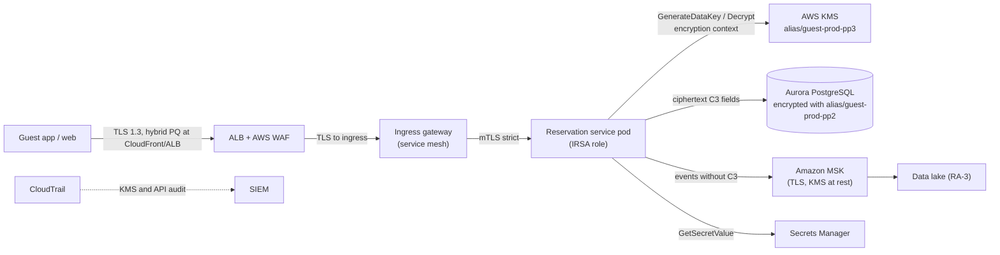
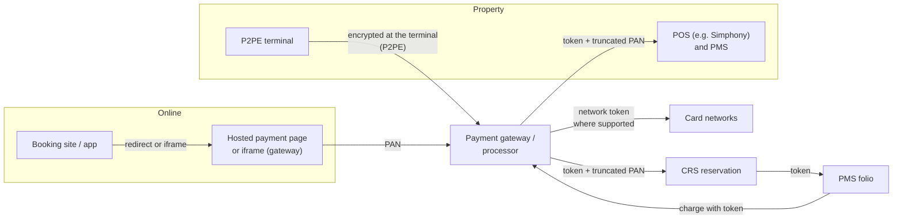
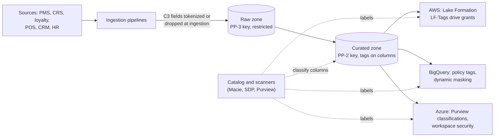
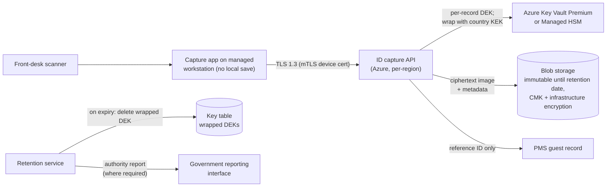
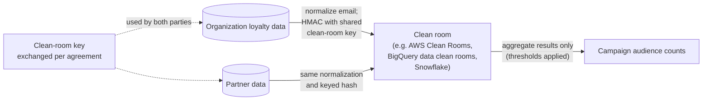
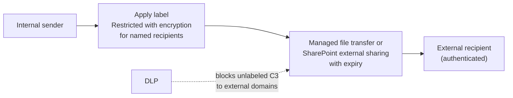
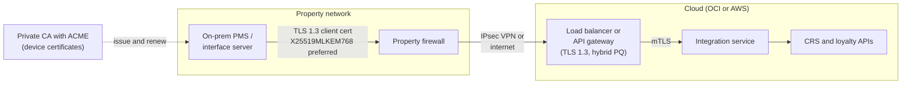

# Reference architectures
{: .no_toc }

**Phase 7: Engineering enablement and governance.** These six designs show how the protection profiles apply to real hospitality systems, so engineering teams can start from a reviewed pattern instead of a blank page.
{: .fs-5 .fw-300 }

## On this page
{: .no_toc .text-delta }

1. TOC
{:toc}

---

## How to use these designs

Each reference architecture follows the same structure: data classification, data flow diagram, controls by layer, key design, Good/Better/Best options, and residual risks. A project that adopts a reference architecture without material changes qualifies for the lightweight review path for C2 designs, and a shorter full review for C3 designs.

| # | Reference architecture | Highest tier | Primary cloud or location | Key techniques |
|---|---|---|---|---|
| RA-1 | Guest reservation and profile microservice | C3 | AWS (EKS, Aurora) | Field-level envelope encryption, mTLS, blind index |
| RA-2 | Tokenized payment flow | C3 (PCI) | Property POS, web booking, gateway | P2PE, hosted payment page, gateway and network tokens |
| RA-3 | Enterprise data lake and warehouse | C3 | Multi-cloud (AWS, Azure, Google Cloud) | Label-driven masking, policy tags, CMK per zone |
| RA-4 | Front-desk ID scan capture to retention | C3 | Property to Azure | Encrypt at capture, per-record keys, crypto-shredding |
| RA-5 | Franchise and partner data sharing | C2/C3 | Clean room or managed file exchange | Minimization, keyed-hash matching, label encryption |
| RA-6 | Property on-prem PMS integration to cloud | C2/C3 | Property data center to OCI or AWS | Hybrid PQ TLS, mTLS, certificate automation |

Diagrams show logical components. Product names are examples of what satisfies the control; equivalent services in another cloud are listed in the [cross-cloud terminology]() page.

## RA-1: Guest reservation and profile microservice on Kubernetes in AWS

### Context

The reservation and profile service creates and reads guest profiles and reservations for the booking website, the mobile app, the CRS, and contact centers. It runs on Amazon EKS with Aurora PostgreSQL and publishes events to Amazon MSK (Kafka) for downstream consumers such as loyalty and the data lake.

### Data classification

| Data element | Tier | Label | Protection |
|---|---|---|---|
| Reservation confirmation number | C1 | `Internal` | Plaintext |
| Guest name, email, phone, address | C2 | `Confidential\Guest-PII` | Aurora encryption with PP-2 CMK; masking for support roles |
| Stay history, preferences | C2 | `Confidential\Guest-PII` | As above |
| Date of birth of children on the reservation | C3 | `Restricted\Special-Category` | Field-level encryption |
| Passport number (required in some countries) | C3 | `Restricted\Guest-Identity` | Field-level encryption plus HMAC blind index |
| Payment card | C3 | `Restricted\PCI` | Never reaches this service; gateway token only (see RA-2) |

### Data flow



### Controls by layer

| Layer | Control | Why |
|---|---|---|
| Edge | CloudFront and ALB security policies that enforce TLS 1.2 minimum, TLS 1.3 preferred; hybrid PQ key exchange where the chosen policy supports it | Protects guest sessions in transit and addresses HNDL on the public edge |
| Service-to-service | Service mesh (for example Istio or Linkerd) with strict mTLS and authorization policies that allow only named callers | Stops lateral reads of guest data from other pods |
| Identity | IAM Roles for Service Accounts (IRSA) or EKS Pod Identity: one role per service | KMS key policy can name exactly one principal as key user |
| Application | AWS Encryption SDK or AWS Database Encryption SDK for C3 fields; encryption context includes `guest_id`, `field`, `data-domain` | Protects C3 from DBAs, snapshot restores, SQL injection reading raw columns, and downstream copies |
| Search | HMAC-SHA-256 blind index on passport number with a separate key; lookup by exact match only | Keeps check-in lookup working without deterministic encryption |
| Database | Aurora storage encryption with the PP-2 CMK; TLS required (`rds.force_ssl=1`); IAM database authentication | Protects C2 at rest and in transit to the database |
| Masking | Views or PostgreSQL row/column security for support roles that return partial values | Contact center sees what it needs |
| Events | Event schema excludes C3 fields; schema registry validation rejects events with C3 fields | Prevents C3 sprawl into the lake |
| Secrets | Database credentials in Secrets Manager with rotation; no secrets in container images | Removes long-lived credentials |
| Logging | Structured logging library redacts fields tagged C2/C3 in the schema | Stops PII in logs |
| Guardrails | SCP denies `kms:ScheduleKeyDeletion` except for the key admin role; Config rules for RDS encryption; OPA on Terraform plans | Prevents drift |

### Key design

| Key alias | Purpose | Key users | Key admins | Rotation |
|---|---|---|---|---|
| `alias/guest-prod-pp2` | Aurora storage, MSK storage, EBS | Aurora, MSK via service integration | Platform security | Automatic, annual |
| `alias/guest-prod-pp3` | Wrap DEKs for C3 fields | Reservation service role only | Platform security | Automatic, annual; ciphertexts keep working because KMS retains older key material |
| HMAC key (stored as a secret, or KMS HMAC key) | Blind index | Reservation service role only | Platform security | Rotation requires re-indexing; planned yearly |

Keys are regional. EU guests are served from an EU region with EU keys (`data-residency=eu`).

### Good, better, best

{: .good }
Aurora encryption with a customer managed key, TLS enforced, masking for support roles. Acceptable only if no C3 fields are stored.

{: .better }
Adds application-layer encryption for C3 fields with a dedicated PP-3 key, strict mTLS, event schema enforcement, and log redaction. This is the reference design.

{: .best }
Adds a CloudHSM custom key store for the PP-3 key if a contractual single-tenant requirement exists, and Nitro Enclaves for the service component that decrypts passport data. Costs more and adds availability planning; justified only by a specific requirement.

### Residual risks

- Plaintext exists in pod memory; a compromised pod with the service role can decrypt. Mitigated by runtime security monitoring, minimal images, and decrypt-rate anomaly alerts.
- Blind index reveals when two records share a passport number. Accepted: that equality is the business purpose.
- KMS regional outage blocks C3 reads. Data key caching is disabled for C3; the service degrades to "passport not available" rather than failing reservations.

## RA-2: Tokenized payment flow from property POS and web booking

### Context

Guests pay at properties (front desk, restaurants, spa) through POS and payment terminals, and online through the booking website and app. The organization needs card-on-file for no-show charges and incidentals but wants the smallest possible PCI DSS scope.

### Data classification

| Data element | Tier | Handling |
|---|---|---|
| PAN | C3 `Restricted\PCI` | Never stored by the organization; entered into P2PE terminals or a hosted payment page |
| Sensitive authentication data (CVV, track, PIN) | C3 `Restricted\PCI` | Never stored after authorization (PCI DSS 3.3) |
| Gateway token or network token | C2 | Stored in PMS and CRS reservation record |
| Truncated PAN (BIN and last four) | C2 | Displayed to staff and on receipts (PCI DSS 3.4.1 limits display to BIN and last four at most) |

### Data flow



### Controls by layer

| Layer | Control | PCI DSS reference | Why |
|---|---|---|---|
| Card capture at property | PCI-listed P2PE solution; terminals encrypt at the point of interaction | Scope reduction; P2PE validation program | POS and PMS never see clear PAN |
| Card capture online | Hosted payment page or gateway-hosted iframe; the organization's pages must still manage script integrity on the payment page | 6.4.3 and 11.6.1 (payment page scripts and change detection) | The website does not receive PAN; the page hosting the iframe is still in scope for script controls |
| Storage | Only tokens and truncated PAN stored | 3.5.1 | Tokens are not PAN; systems storing only tokens are typically out of the CDE, subject to the assessor |
| Card-on-file | Gateway tokens; network tokens where the processor supports them | Scope reduction | Network tokens survive card reissue and are domain-restricted |
| Detokenization | Only the gateway can detokenize; the organization has no detokenization API | 3.5.1 | Removes the organization's own vault from scope |
| Transit | TLS 1.2+ to gateway; certificate pinning in mobile app where appropriate | 4.2.1 | Strong cryptography over public networks |
| Key management | Keys in P2PE are managed by the solution provider; the organization documents which keys it holds (if any) | 3.6, 3.7, 4.2.1.1 | Most keys are outside the organization |
| Crypto review | Annual review of cipher suites and protocols, including a plan for anticipated cryptographic changes such as PQC | 12.3.3 | Direct hook for the crypto inventory |
| Monitoring | DLP rules for PAN patterns with Luhn validation in email, files, logs, and data lake | 12.5.2 (scope confirmation) | Detects PAN leaking outside the flow |

### Key design

The organization holds no PAN encryption keys in the reference design. If a legacy system must store PAN (for example a group sales tool), it uses the vault tokenization service described in [Tokenization, FPE, and masking]() with keys in an HSM and dual control for any manual key operation (PCI DSS 3.6 and 3.7, including split knowledge and dual control under 3.7.6).

### Good, better, best

{: .good }
Gateway tokens for card-on-file, hosted payment page online, validated P2PE at properties that have been upgraded. Some legacy properties still run non-P2PE terminals and remain in scope.

{: .better }
All properties on validated P2PE; network tokens for card-on-file; PAN discovery scans across the data estate quarterly with remediation.

{: .best }
Better, plus payment page script integrity monitoring, franchise contract requirements for P2PE, and an agreed scope statement with the QSA that removes PMS and CRS from the CDE.

### Residual risks

- Franchised properties choose their own terminals; the organization can require but not always enforce P2PE. Contractual controls and attestation.
- Staff type PAN into free-text fields (reservation notes, emails). DLP detection and PMS field validation.
- Group bookings arrive by email with card details. Dedicated secure intake form and DLP block on inbound email with PAN to general mailboxes.

## RA-3: Enterprise data lake and warehouse with label-driven masking across clouds

### Context

The organization runs analytics in more than one cloud: a lake in Amazon S3 with Lake Formation, a warehouse in BigQuery for marketing and revenue management, and Azure-based reporting (for example Microsoft Fabric or Azure Databricks) for finance. Data scientists, revenue managers, and marketing analysts need broad access, but mostly not to identifiable guest data.

### Data classification

| Zone | Tier | Content |
|---|---|---|
| Raw (landing) | Up to C3 | Source extracts as received |
| Curated | Up to C2 | C3 fields removed, tokenized, or encrypted; C2 fields tagged |
| Consumption (marts) | C1 or C2 | Aggregates and pseudonymized datasets |

### Data flow



### Controls by layer

| Layer | Control | Why |
|---|---|---|
| Ingestion | Pipelines call the tokenization service or drop C3 fields; passport and payment fields never land in curated zones | Keeps C3 out of broad-access zones |
| Storage | Separate buckets or datasets per zone, each with its own key: PP-3 key for raw, PP-2 key for curated | Key separation limits blast radius; raw access is a separate grant |
| Discovery | Macie on S3, Sensitive Data Protection profiles on BigQuery, Purview scans on Azure sources | Detects C2/C3 appearing in columns where it was not expected |
| Label propagation | Column classifications map to LF-Tags (AWS), policy tags (BigQuery), and Purview classifications (Azure) using the canonical taxonomy | One label, three enforcement engines |
| Access | Grants by tag, not by table: analysts get `data-classification` in `internal` and masked `confidential` | Scales with new tables automatically |
| Masking | BigQuery data masking rules on policy tags (for example hash or nullify); Lake Formation cell-level filters; views with masking in other engines | Analysts see pseudonymized values |
| Pseudonymization | Keyed hash of guest ID for joins across marts | Allows analysis per guest without identity |
| In-query encryption | BigQuery AEAD functions for specific columns where a key must be held separately | Adds a key boundary inside the warehouse |
| Residency | EU guest data processed in EU regions; cross-border copies need approval | GDPR transfer controls |
| Retention | Partition expiration by `retention-class` | Deletion at scale |

A BigQuery masking example: a policy tag `guest_pii.email` has a data policy with a masking rule. Principals with the Masked Reader role see the masked value; principals with Fine-Grained Reader see plaintext.

```sql
-- Analysts query normally; masking is applied by the policy tag on the column.
SELECT guest_key, email, stay_nights, total_revenue
FROM `analytics-prod.curated_guest.stays`
WHERE arrival_date BETWEEN '2026-01-01' AND '2026-03-31';

-- A column protected with an AEAD keyset held in Cloud KMS (keyset wrapped by a KMS key):
SELECT
  AEAD.DECRYPT_STRING(
    KEYS.KEYSET_CHAIN('gcp-kms://projects/sec-keys/locations/eu/keyRings/analytics/cryptoKeys/pp3-kek',
                      wrapped_keyset),
    national_id_ct,
    CAST(guest_key AS STRING)) AS national_id
FROM `analytics-prod.restricted.guest_identity`
JOIN `analytics-prod.restricted.keysets` USING (keyset_id);
```

{: .verify }
Confirm BigQuery masking rule options and the `KEYS.KEYSET_CHAIN` usage against current documentation; the second query is illustrative of the pattern.

### Key design

| Key | Cloud | Zone | Users |
|---|---|---|---|
| `lake-raw-pp3` | AWS KMS | Raw S3 buckets | Ingestion roles only |
| `lake-curated-pp2` | AWS KMS | Curated S3 buckets, with S3 Bucket Keys | Lake Formation service-linked access |
| `bq-curated-pp2` | Cloud KMS | BigQuery curated datasets (CMEK) | BigQuery service agent |
| `analytics-pp3-kek` | Cloud KMS (HSM) | Wraps AEAD keysets | Restricted analytics service accounts |
| `fabric-pp2` | Azure Key Vault Premium | Azure workspace storage | Workspace managed identity |

### Good, better, best

{: .good }
CMK on lake and warehouse storage, table-level access control, C3 excluded from curated zones by pipeline code.

{: .better }
Tag-based access and masking in each platform from the canonical labels; scanner-driven drift detection; keyed-hash pseudonymization for joins.

{: .best }
Better, plus a policy engine that compiles a single label-to-access policy into each platform, confidential computing for analytics on C3 in the raw zone, and differential privacy or aggregation thresholds for published marts.

### Residual risks

- Labels drift between platforms. Weekly reconciliation job compares column labels across catalogs.
- Keyed-hash pseudonyms are still personal data under GDPR if the key holder can re-identify. The key stays in the security domain and the data remains `Confidential`.
- Data scientists export extracts. DLP on endpoints and CASB controls for sanctioned storage only.

## RA-4: Front-desk ID scan capture to retention and crypto-shredding

### Context

Many countries require hotels to record guest identity documents at check-in. Properties scan passports and national ID cards at the front desk. Historically, scans end up in PMS attachments, shared drives, email, and scanner memory. This design captures scans once, encrypts them immediately, stores them in one place, and deletes them by destroying keys when the legal retention period ends.

### Data classification

| Element | Tier | Label |
|---|---|---|
| ID document image | C3 | `Restricted\Guest-Identity` |
| Extracted document number, nationality, date of birth | C3 | `Restricted\Guest-Identity` |
| Record that a scan exists, with retention date | C2 | `Confidential\Guest-PII` |

### Data flow



### Controls by layer

| Layer | Control | Why |
|---|---|---|
| Capture | Capture app streams the image to the API; scanner configured not to store images locally or email them | Removes the most common sprawl points |
| Device | Managed workstation with device certificate used for mTLS | Only approved front-desk devices can submit |
| Application | Per-record DEK (AES-256-GCM); DEK wrapped by a per-country, per-month KEK | Enables deletion by destroying one wrapped DEK or a whole month's KEK |
| Storage | Blob with CMK, infrastructure encryption (double encryption), and a time-based retention policy | Tamper resistance during the retention period |
| Access | Only the retention service and a break-glass role can decrypt; property staff see "ID captured: yes" in PMS | Staff do not need to see images after check-in |
| Reporting | Where authorities require submission, the API sends data directly to the reporting interface | Avoids copies at the property |
| Deletion | On expiry the retention service deletes the wrapped DEK (per record) or schedules deletion of the monthly KEK | Crypto-shredding: ciphertext in backups becomes unrecoverable |
| Evidence | Deletion log with record ID, key ID, timestamp | Demonstrates erasure for GDPR and local law |

### Crypto-shredding mechanics

Crypto-shredding works only if every copy of the plaintext was encrypted with keys that are destroyed. The design ensures this: the image is encrypted before it is written anywhere, backups contain only ciphertext, and no system receives the plaintext except the capture app memory and the authority reporting interface. NIST SP 800-88 Rev. 1 recognizes cryptographic erase as a sanitization technique when the key is destroyed and the encryption was applied to all copies.

Per-month KEKs make bulk deletion cheap: when a month's records reach the end of retention, and no record in that month is under legal hold, the KEK is scheduled for deletion. Records under legal hold are re-wrapped under a legal-hold KEK before the monthly KEK is destroyed.

### Good, better, best

{: .good }
Scans stored only in the PMS vendor's document store with vendor encryption; manual deletion.

{: .better }
The reference design with per-record DEKs, CMK, and automated crypto-shredding.

{: .best }
Better, plus Managed HSM for the KEKs, confidential computing for the extraction (OCR) step, and per-country key residency with keys created in-region.

### Residual risks

- Screen captures or photocopies at properties. Addressed by procedure, training, and property audits.
- PMS vendors that require the image in their own store. Negotiate reference-only integration or ensure vendor encryption and deletion.
- Legal retention periods differ by country and change. Retention rules are configuration, reviewed by legal annually.

## RA-5: Franchise and partner data sharing via clean room or secure file exchange

### Context

The organization shares data with franchisees and owners (property performance, guest feedback), with marketing partners (co-branded credit card, airline loyalty partners), and with vendors. Much of this historically went by SFTP with shared passwords or by email attachment.

### Data classification

| Sharing case | Tier | Preferred mechanism |
|---|---|---|
| Property performance reports to owners | C1/C2 | Reporting portal with row-level security |
| Guest list matching with a loyalty partner | C2 | Data clean room with keyed-hash matching |
| Guest data to a franchisee for their own property operations | C2 | API with scoped access; contract as controller or processor |
| Incident data to a forensic vendor | C3 | Secure file exchange with label encryption and expiry |

### Data flow: clean room matching



### Data flow: secure file exchange



### Controls by layer

| Layer | Control | Why |
|---|---|---|
| Minimization | Share only fields needed for the purpose; documented in the data sharing agreement | Least data is the strongest control |
| Matching | Keyed hash (HMAC-SHA-256) of normalized email or phone with a per-agreement key; never unkeyed hashes | Unkeyed hashes of emails are easily reversed by dictionary attack |
| Clean room | Analysis rules that allow only aggregates above a minimum threshold; no row-level export | Partner learns overlap counts, not guest identities |
| File exchange | Managed file transfer with per-partner accounts, MFA, and PGP or AES encryption of files; or label encryption with named external users | Replaces shared SFTP passwords and email attachments |
| Expiry | Links and label permissions expire; files deleted after the agreed period | Limits ongoing exposure |
| Contract | Data processing agreement, security schedule including encryption and key custody requirements, audit rights | Shared responsibility with franchisees and partners |
| Monitoring | DLP and CASB on external sharing; access logs reviewed per agreement | Detects over-sharing |

### Good, better, best

{: .good }
Managed file transfer with per-partner accounts and encrypted transport; data sharing agreements in place.

{: .better }
Label encryption for C3 files with named recipients and expiry; clean rooms for any guest matching; keyed hashes per agreement.

{: .best }
Better, plus privacy-enhancing computation (aggregation thresholds, differential privacy) and automated deletion confirmation from partners.

### Residual risks

- Once a partner decrypts data, the organization relies on contract controls. Audit rights and attestation.
- Franchisees operate their own systems with varying maturity. Minimum security requirements in franchise agreements; brand-standard technology stacks.
- Keyed-hash matching reveals set membership to both sides for matched records if row-level output is allowed. Aggregation-only rules.

## RA-6: Property on-prem PMS integration to cloud with hybrid PQ TLS

### Context

Some properties, particularly owned and managed resorts, still run on-prem PMS or interface servers that connect to the cloud CRS, loyalty, and data platforms. Traffic historically ran over site-to-site IPsec VPNs with plaintext application protocols inside.

### Data classification

| Flow | Tier |
|---|---|
| Reservation sync CRS to PMS | C2 |
| Folio and revenue postings | C2 |
| ID document data (where captured on-prem) | C3 |
| Door lock and key encoding commands | C2 (integrity-critical) |

### Data flow



### Controls by layer

| Layer | Control | Why |
|---|---|---|
| Transport | TLS 1.3 from the interface server to the cloud endpoint, with mutual authentication; the VPN is kept as a network control, not as the encryption control | Application-layer TLS protects end to end, including inside the cloud network |
| Key exchange | Hybrid `X25519MLKEM768` offered by the client and accepted by the endpoint where both sides support it; falls back to X25519 otherwise | Addresses HNDL for guest data crossing the internet |
| Certificates | Private CA issuing short-lived device certificates via ACME or EST; automated renewal | Scales to thousands of properties; supports shrinking lifetimes |
| Firewalls | Inspection proxies at properties excluded for this flow, or upgraded to support larger handshakes | Some middleboxes fail on larger PQ key shares |
| Integration service | Validates client certificate to property ID mapping; per-property authorization | A compromised property cannot read another property's data |
| At rest in property | PMS database encryption (for example Oracle TDE for on-prem OPERA deployments) with keys in Oracle Key Vault or an HSM | Protects local copies |

To check what a client negotiates, engineers can test with OpenSSL 3.5 or later:

```bash
# Offer only the hybrid group to confirm the endpoint supports it
openssl s_client -connect integration.example.net:443 -tls1_3 \
  -groups X25519MLKEM768 -brief </dev/null

# Offer hybrid first with classical fallback, as production clients should
openssl s_client -connect integration.example.net:443 -tls1_3 \
  -groups X25519MLKEM768:X25519 -brief </dev/null
```

The `-brief` output includes the negotiated group, which should read `X25519MLKEM768` when both sides support it.

{: .verify }
Hybrid PQ TLS support on managed load balancers and API gateways differs by provider and changes frequently. As of mid-2026, confirm support on the specific OCI or AWS load balancer policy before relying on it. Where the managed endpoint does not support it, terminate on a proxy (for example an OpenSSL 3.5 based proxy) in front of the integration service.

### Good, better, best

{: .good }
IPsec VPN with TLS 1.2 inside for application traffic; server-only certificates.

{: .better }
TLS 1.3 with mTLS, device certificates from an automated private CA, per-property authorization.

{: .best }
Better, plus hybrid PQ key exchange end to end, and a PQC-ready private CA plan for device certificates.

### Residual risks

- Legacy interface servers cannot run OpenSSL 3.5. Place a local TLS proxy at the property or replace the server during PMS cloud migration.
- Franchise properties with self-managed networks. Brand standard requires the approved integration appliance.
- Hybrid PQ only protects key exchange; the certificates are still RSA or ECDSA. Acceptable until PQC certificates are widely supported, since signature forgery requires a quantum computer at the time of the attack.

## Key takeaways for engineering teams

- Start from the closest reference architecture and document only the differences.
- C3 fields are protected in the application before they reach storage, events, or the lake.
- Payment data is best handled by not having it: P2PE, hosted payment pages, and tokens.
- Crypto-shredding requires encrypting every copy with keys you can destroy.
- Share data with partners through clean rooms or label-encrypted files, never shared passwords or unkeyed hashes.
- Enable hybrid PQ key exchange on external flows carrying guest data where both ends support it.

## Related pages

- [Encryption decision trees]()
- [Payment card data and PCI DSS]()
- [Data lakes and analytics platforms]()
- [Retention, deletion, and crypto-shredding]()
- [Encryption in transit]()
- [AWS]()

## Sources

- PCI DSS v4.0.1 document library: <https://www.pcisecuritystandards.org/document_library/>
- NIST SP 800-88 Rev. 1: <https://csrc.nist.gov/pubs/sp/800/88/r1/final>
- AWS Encryption SDK: <https://docs.aws.amazon.com/encryption-sdk/latest/developer-guide/introduction.html>
- BigQuery column-level security and masking: <https://cloud.google.com/bigquery/docs/column-data-masking-intro>
