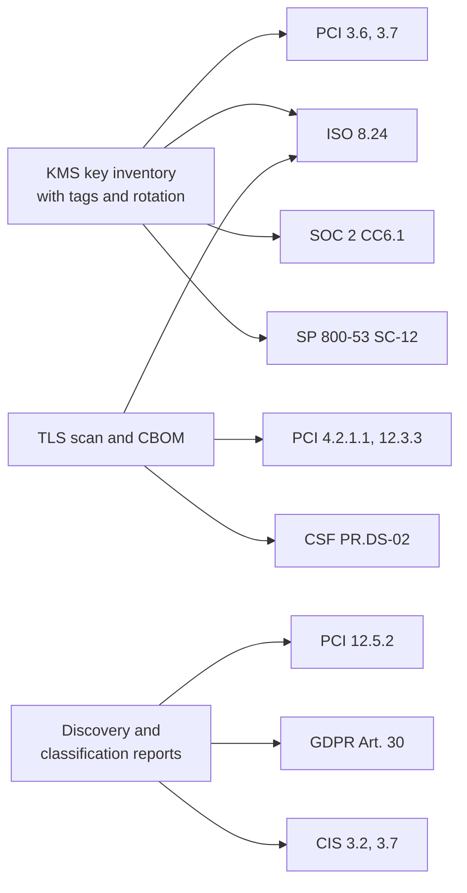

# Compliance mapping
{: .no_toc }

**Phase 7: Engineering enablement and governance.** This page maps each data protection control in the program to the requirements it helps satisfy, so evidence is collected once and reused across assessments.
{: .fs-5 .fw-300 }

## On this page
{: .no_toc .text-delta }

1. TOC
{:toc}

---

## How to use this mapping

The program is designed from risk and data classification, not from any single framework. The mapping shows where each control contributes to a requirement. It does not claim that a control alone satisfies a requirement: most requirements need policy, process, and evidence in addition to technology. Assessors (QSAs, ISO certification auditors, SOC 2 auditors) make the final determination.

{: .important }
Requirement identifiers are cited from the published versions named on this page: PCI DSS v4.0.1 (June 2024), ISO/IEC 27001:2022, NIST CSF 2.0 (February 2024), NIST SP 800-53 Rev. 5, the 2017 Trust Services Criteria (with 2022 revised points of focus) for SOC 2, and CIS Controls v8. Legal texts (GDPR, CCPA/CPRA, PIPL) are summarized, not quoted; privacy counsel should confirm interpretations.

## Program control catalog

The controls below are the program's own control IDs, used in the requirements package and metrics.

| ID | Control | Profile |
|---|---|---|
| DP-INV | Data asset inventory and discovery | All |
| DP-CLS | Classification and labeling (C0 to C3, tags) | All |
| DP-FLOW | Data flows, ownership, and lineage | All |
| DP-CBOM | Cryptographic inventory | All |
| DP-STD | Cryptographic standard and annual review | All |
| DP-KMS | Key management: hierarchy, custody, rotation, separation of duties | PP-2, PP-3 |
| DP-HSM | HSM protection and manual key ceremonies with dual control | PP-3 |
| DP-REST | Encryption at rest with customer-managed keys | PP-2, PP-3 |
| DP-FLE | Field-level encryption or tokenization in the application | PP-3 |
| DP-MASK | Masking and pseudonymization | PP-2, PP-3 |
| DP-TRANSIT | TLS 1.2+ (1.3 preferred), mTLS, hybrid PQ | All |
| DP-PKI | Certificate lifecycle and inventory | All |
| DP-SECRETS | Secrets management | All |
| DP-DLP | DLP and CASB | PP-2, PP-3 |
| DP-LBL-ENC | Label-based persistent file encryption | PP-3 |
| DP-RET | Retention, deletion, crypto-shredding | All |
| DP-NONPROD | Non-production data controls | PP-2, PP-3 |
| DP-GUARD | Guardrails and policy as code | All |
| DP-MON | Monitoring of key, label, and DLP events | All |
| DP-REVIEW | Security design review | All |
| DP-VENDOR | Vendor and franchise cryptographic requirements | All |
| DP-PQC | PQC migration and crypto agility | All |

## Master matrix

| Control | PCI DSS v4.0.1 | GDPR | ISO 27001:2022 Annex A | NIST SP 800-53 Rev. 5 | NIST CSF 2.0 | SOC 2 | CIS v8 |
|---|---|---|---|---|---|---|---|
| DP-INV | 12.5.1, 12.5.2 | Art. 30 | 5.9 | CM-8, PM-5, PM-5(1) | ID.AM-07 | CC6.1, C1.1 | 3.2 |
| DP-CLS | 12.5.2 (locations of account data) | Art. 9, Art. 32 | 5.12, 5.13 | RA-2, AC-16 | ID.AM-05, ID.AM-07 | C1.1 | 3.7 |
| DP-FLOW | 1.2.4 (account data flow diagrams), 12.5.2 | Art. 30, Art. 44 to 49 | 5.14 | AC-4, PM-5(1) | ID.AM-03 | CC6.1 | 3.8 |
| DP-CBOM | 4.2.1.1, 12.3.3 | Art. 32 | 8.24 | SC-12, SC-13, CM-8 | ID.AM-02, ID.AM-08 | CC6.1 | 3.2 (supports) |
| DP-STD | 12.3.3, 4.2.1 | Art. 32 | 5.1, 8.24 | SC-13, PL-2 | GV.PO-01 | CC6.1 | 3.10, 3.11 |
| DP-KMS | 3.6.1, 3.7.1 to 3.7.8 | Art. 32 | 8.24 | SC-12, SC-12(1), AC-5, AC-6 | PR.DS-01 | CC6.1 | 3.11 |
| DP-HSM | 3.6.1.2, 3.7.6 | Art. 32 | 8.24 | SC-12, SC-13 | PR.DS-01 | CC6.1 | 3.11 |
| DP-REST | 3.5.1, 3.5.1.2 | Art. 32, Art. 34(3)(a) | 8.24 | SC-28, SC-28(1) | PR.DS-01 | CC6.1 | 3.11 |
| DP-FLE | 3.5.1 | Art. 25, Art. 32 | 8.24, 8.3 | SC-28(1), AC-3 | PR.DS-01 | CC6.1 | 3.11, 3.12 |
| DP-MASK | 3.4.1, 3.5.1.1 | Art. 4(5), Art. 25, Art. 32 | 8.11 | SI-19 | PR.DS-01 | C1.1 | 3.3 |
| DP-TRANSIT | 4.2.1 | Art. 32 | 8.20, 8.24, 5.14 | SC-8, SC-8(1), SC-23 | PR.DS-02 | CC6.7 | 3.10 |
| DP-PKI | 4.2.1, 4.2.1.1 | Art. 32 | 8.24 | SC-12, SC-17 | PR.DS-02 | CC6.7 | 3.10 |
| DP-SECRETS | 8.3.2, 8.6.2 | Art. 32 | 5.17, 8.24 | IA-5 | PR.AA-01 | CC6.1 | 3.11 (supports) |
| DP-DLP | 12.10.7 (response to stored PAN found where unexpected) | Art. 32 | 8.12 | SC-7(10), SI-4 | PR.DS-01, DE.CM-09 | CC6.7 | 3.13 |
| DP-LBL-ENC | 3.5.1 (files containing PAN) | Art. 32 | 5.13, 8.24 | AC-16, SC-28(1) | PR.DS-01 | CC6.1, CC6.7 | 3.11 |
| DP-RET | 3.2.1, 9.4.7 | Art. 5(1)(e), Art. 17 | 5.33, 8.10, 7.14 | SI-12, SI-12(3), MP-6 | PR.DS-01 | C1.2 | 3.4, 3.5 |
| DP-NONPROD | 6.5.5, 6.5.6 | Art. 25, Art. 32 | 8.31, 8.33 | SA-3(2), CM-4 | PR.DS-01 | CC8.1 | 3.12 |
| DP-GUARD | 1.2.1, 2.2.1 (configuration standards) | Art. 25 | 8.9 | CM-2, CM-6, CM-7 | PR.PS-01 | CC7.1, CC8.1 | 4.1 |
| DP-MON | 10.2.1, 10.4.1, 10.5.1 | Art. 33 | 8.15, 8.16 | AU-2, AU-6, AU-12, SI-4 | DE.CM-03, DE.CM-09 | CC7.2 | 3.14, 8.2 |
| DP-REVIEW | 6.2.1, 6.2.3 | Art. 25, Art. 35 | 8.25, 8.27 | SA-8, SA-11, SA-17 | PR.PS-06 | CC8.1 | 16.1 |
| DP-VENDOR | 12.8.1 to 12.8.5, 12.9 | Art. 28 | 5.19 to 5.22 | SA-9, SR-3 | GV.SC-05, GV.SC-07 | CC9.2 | 15.4 |
| DP-PQC | 12.3.3 | Art. 32 (state of the art) | 8.24 | SC-12, SC-13 | ID.RA-01, GV.RM | CC6.1 | 3.10, 3.11 |

{: .verify }
PCI DSS sub-requirement numbers outside the core cryptography set (for example 1.2.4, 6.5.5, 6.5.6, 12.10.7) and NIST CSF 2.0 subcategory numbers should be checked against the current published documents before an assessment. Mappings of "supports" indicate an indirect contribution.

## PCI DSS v4.0.1

PCI DSS v4.0.1 was published in June 2024. Requirements that were future-dated in v4.0 became effective on March 31, 2025.

| Requirement | Summary | Program control and evidence |
|---|---|---|
| 3.2.1 | Account data storage kept to a minimum with retention and disposal policies | DP-RET: retention classes; PAN discovery scans; deletion jobs |
| 3.3.1 (and sub-requirements) | Sensitive authentication data not retained after authorization | P2PE and gateway design (RA-2); discovery for track and CVV patterns |
| 3.4.1 | PAN masked when displayed; BIN and last four digits maximum | DP-MASK: application display rules; masking in PMS and POS |
| 3.5.1 | PAN rendered unreadable anywhere it is stored (one-way hashes, truncation, index tokens, strong cryptography with key management) | DP-FLE and tokenization; gateway tokens |
| 3.5.1.1 | Hashes used to render PAN unreadable are keyed cryptographic hashes of the entire PAN | Keyed HMAC in any PAN matching; no plain SHA-256 of PAN |
| 3.5.1.2 | Disk-level or partition-level encryption used only on removable media, or with another mechanism that meets 3.5.1 | TDE or storage encryption is not relied on alone for PAN |
| 3.6.1 | Procedures to protect keys used for stored account data | DP-KMS: key policies, access restriction, fewest custodians |
| 3.6.1.1 | Service providers maintain a documented description of the cryptographic architecture | Applies to the organization only where it acts as a service provider (for example to franchisees); CBOM and key architecture document |
| 3.6.1.2 | Secret and private keys stored in approved forms (encrypted with a KEK, in an HSM or secure cryptographic device, or as key components) | DP-HSM; KMS HSM-backed keys |
| 3.7.1 to 3.7.8 | Key generation, distribution, storage, cryptoperiod, retirement, split knowledge and dual control for manual cleartext operations, prevention of substitution, custodian acknowledgment | Key management standard; key ceremony procedures; custodian acknowledgment forms |
| 4.2.1 | Strong cryptography for PAN over open, public networks; certificates valid and not expired | DP-TRANSIT, DP-PKI |
| 4.2.1.1 | Inventory of trusted keys and certificates used to protect PAN in transit | DP-CBOM; certificate inventory |
| 6.4.3, 11.6.1 | Payment page script management and change detection | Booking site hosted payment page design (RA-2) |
| 10.5.1 | Audit log history retained for at least 12 months, three months immediately available | DP-MON retention |
| 12.3.3 | Cipher suites and protocols documented and reviewed at least every 12 months, with a plan to respond to anticipated changes in cryptographic vulnerabilities | DP-STD annual review; DP-PQC plan. This is the most direct PCI hook for PQC planning |
| 12.5.2 | Scope documented and confirmed at least every 12 months | DP-INV, DP-FLOW, PAN discovery |
| 12.8.x | Third-party service provider management | DP-VENDOR: AOCs, responsibility matrix |

Scope reduction techniques (P2PE, tokenization, network tokens, hosted payment pages) do not appear as numbered requirements but reduce the number of systems to which the requirements apply.

## GDPR

| Article | Relevance | Program control |
|---|---|---|
| Art. 4(5) | Defines pseudonymization; pseudonymized data remains personal data | DP-MASK: keyed-hash pseudonyms treated as `Confidential` |
| Art. 5(1)(c), (e), (f) | Data minimization, storage limitation, integrity and confidentiality | DP-CLS, DP-RET, DP-REST |
| Art. 9 | Special categories (including health data and biometric data for identification) | Allergy, accessibility, spa health data, biometrics classified C3 |
| Art. 17 | Right to erasure | DP-RET: deletion service; crypto-shredding where designed |
| Art. 25 | Data protection by design and by default | DP-REVIEW, DP-NONPROD |
| Art. 28 | Processor obligations | DP-VENDOR |
| Art. 30 | Records of processing activities | DP-INV, DP-FLOW |
| Art. 32 | Security of processing, naming pseudonymization and encryption as appropriate measures, taking into account the state of the art | Core justification for DP-REST, DP-FLE, DP-TRANSIT, DP-KMS; state of the art includes PQC planning |
| Art. 33, 34 | Breach notification; Art. 34(3)(a) removes the duty to notify data subjects where data was rendered unintelligible, for example by encryption, to unauthorized persons | DP-MON; key separation ensures the encryption is effective (keys not also compromised) |
| Art. 35 | Data protection impact assessment | DP-REVIEW for C3 and new technologies |
| Art. 44 to 49 | International transfers | DP-FLOW; `data-residency` tag; key locality |

The UK GDPR carries the same article numbering for these provisions.

## CCPA / CPRA (California)

| Provision | Relevance | Program control |
|---|---|---|
| Civil Code 1798.100(e) | Businesses collecting personal information implement reasonable security procedures and practices | Whole program |
| Civil Code 1798.150 | Private right of action for breaches of nonencrypted and nonredacted personal information caused by failure to maintain reasonable security | DP-REST, DP-FLE, DP-MASK: encryption and redaction reduce statutory damages exposure |
| Civil Code 1798.121 | Right to limit use of sensitive personal information (includes precise geolocation, account credentials, government ID numbers) | DP-CLS: these elements are C3 |
| Civil Code 1798.105 | Right to delete | DP-RET |
| CPPA regulations on cybersecurity audits and risk assessments | Additional audit obligations for certain businesses | DP-MON, DP-REVIEW evidence |

{: .verify }
California Privacy Protection Agency regulations on cybersecurity audits and risk assessments were finalized in 2025 with phased effective dates; confirm applicability and dates with counsel.

## China PIPL

| Article | Relevance | Program control |
|---|---|---|
| Art. 28 | Sensitive personal information: includes biometrics, religious beliefs, specific identity, medical health, financial accounts, whereabouts, and personal information of minors under 14 | Maps to C3 |
| Art. 38 to 40 | Cross-border transfer mechanisms (security assessment, certification, standard contract); localization for certain processors | `data-residency=cn`; in-country keys and processing; DP-FLOW |
| Art. 47 | Deletion obligations | DP-RET |
| Art. 51 | Processors must take measures including classification management and appropriate technical measures such as encryption and de-identification | DP-CLS, DP-REST, DP-MASK |
| Art. 55, 56 | Personal information protection impact assessment for sensitive data, cross-border transfer, and other cases | DP-REVIEW |
| Art. 57 | Breach remediation and notification | DP-MON |

{: .note }
China's commercial cryptography regulations can require the use of approved domestic algorithms (for example SM2, SM3, SM4) for certain systems. Operations in mainland China need a separate cryptographic review; the crypto standard includes a China annex.

## ISO/IEC 27001:2022 Annex A

| Control | Title | Program control |
|---|---|---|
| 5.9 | Inventory of information and other associated assets | DP-INV |
| 5.12 | Classification of information | DP-CLS |
| 5.13 | Labelling of information | DP-CLS, DP-LBL-ENC |
| 5.14 | Information transfer | DP-TRANSIT, DP-FLOW |
| 5.17 | Authentication information | DP-SECRETS |
| 5.19 to 5.22 | Supplier relationships and monitoring | DP-VENDOR |
| 5.33 | Protection of records | DP-RET |
| 5.34 | Privacy and protection of PII | Whole program |
| 7.14 | Secure disposal or re-use of equipment | DP-RET (cryptographic erase) |
| 8.3 | Information access restriction | DP-FLE, DP-MASK |
| 8.9 | Configuration management | DP-GUARD |
| 8.10 | Information deletion | DP-RET |
| 8.11 | Data masking | DP-MASK |
| 8.12 | Data leakage prevention | DP-DLP |
| 8.15, 8.16 | Logging; monitoring activities | DP-MON |
| 8.24 | Use of cryptography (rules for effective use of cryptography, including key management) | DP-STD, DP-KMS, DP-HSM, DP-REST, DP-TRANSIT, DP-PKI, DP-PQC |
| 8.25, 8.27 | Secure development life cycle; secure system architecture and engineering principles | DP-REVIEW |
| 8.31, 8.33 | Separation of environments; test information | DP-NONPROD |

## NIST SP 800-53 Rev. 5

| Control | Title | Program control |
|---|---|---|
| AC-16 | Security and privacy attributes | Labels and tags (DP-CLS) |
| CM-8 | System component inventory | DP-INV, DP-CBOM |
| MP-6 | Media sanitization | DP-RET (cryptographic erase per SP 800-88) |
| PM-5(1) | Inventory of personally identifiable information | DP-INV |
| RA-2 | Security categorization | DP-CLS |
| SC-8, SC-8(1) | Transmission confidentiality and integrity; cryptographic protection | DP-TRANSIT |
| SC-12 | Cryptographic key establishment and management | DP-KMS, DP-HSM |
| SC-12(1) | Availability (of keys) | Key availability design, especially for external keys |
| SC-13 | Cryptographic protection | DP-STD |
| SC-17 | Public key infrastructure certificates | DP-PKI |
| SC-28, SC-28(1) | Protection of information at rest; cryptographic protection | DP-REST, DP-FLE |
| SI-12, SI-12(3) | Information management and retention; information disposal | DP-RET |
| SI-19 | De-identification | DP-MASK |
| SA-8 | Security and privacy engineering principles | DP-REVIEW |
| SA-9 | External system services | DP-VENDOR |
| AU-2, AU-6, AU-12, SI-4 | Event logging, review, generation; system monitoring | DP-MON |

## NIST CSF 2.0

| Subcategory | Outcome | Program control |
|---|---|---|
| ID.AM-07 | Inventories of data and corresponding metadata for designated data types are maintained | DP-INV, DP-CLS |
| ID.AM-05 | Assets are prioritized based on classification, criticality, resources, and impact | DP-CLS |
| ID.AM-03 | Representations of authorized network communication and data flows are maintained | DP-FLOW |
| PR.DS-01 | Confidentiality, integrity, and availability of data at rest are protected | DP-REST, DP-FLE, DP-KMS |
| PR.DS-02 | Confidentiality, integrity, and availability of data in transit are protected | DP-TRANSIT, DP-PKI |
| PR.DS-10 | Confidentiality, integrity, and availability of data in use are protected | Confidential computing where adopted |
| PR.DS-11 | Backups of data are created, protected, maintained, and tested | Backup key separation |
| PR.PS-01 | Configuration management practices are established and applied | DP-GUARD |
| DE.CM-09 | Computing hardware and software, runtime environments, and their data are monitored | DP-MON, DP-DLP |
| GV.SC | Cybersecurity supply chain risk management | DP-VENDOR |

## SOC 2 (Trust Services Criteria)

| Criterion | Relevance | Program control |
|---|---|---|
| CC6.1 | Logical access security software, infrastructure, and architectures to protect information assets; points of focus include encryption to protect data and protecting encryption keys | DP-KMS, DP-REST, DP-FLE, DP-INV |
| CC6.7 | Restricts the transmission, movement, and removal of information to authorized users and processes, and protects it during transmission | DP-TRANSIT, DP-DLP |
| CC7.2 | Monitors system components for anomalies | DP-MON |
| CC8.1 | Change management | DP-REVIEW, DP-GUARD |
| CC9.2 | Vendor and business partner risk | DP-VENDOR |
| C1.1, C1.2 | Identifies and maintains confidential information; disposes of confidential information | DP-CLS, DP-RET |

## CIS Controls v8: Control 3, Data Protection

| Safeguard | Title | Program control |
|---|---|---|
| 3.1 | Establish and maintain a data management process | Operating model, data classification standard |
| 3.2 | Establish and maintain a data inventory | DP-INV |
| 3.3 | Configure data access control lists | DP-MASK, access policies |
| 3.4 | Enforce data retention | DP-RET |
| 3.5 | Securely dispose of data | DP-RET |
| 3.6 | Encrypt data on end-user devices | Endpoint baseline (BitLocker, FileVault) |
| 3.7 | Establish and maintain a data classification scheme | DP-CLS |
| 3.8 | Document data flows | DP-FLOW |
| 3.9 | Encrypt data on removable media | Endpoint baseline |
| 3.10 | Encrypt sensitive data in transit | DP-TRANSIT |
| 3.11 | Encrypt sensitive data at rest | DP-REST, DP-FLE |
| 3.12 | Segment data processing and storage based on sensitivity | Account and network segmentation by profile |
| 3.13 | Deploy a data loss prevention solution | DP-DLP |
| 3.14 | Log sensitive data access | DP-MON |

## Evidence reuse

| Evidence artifact | Produced by | Reused for |
|---|---|---|
| Key inventory export (tags, rotation status, key policy summary) | Nightly job per cloud | PCI 3.6/3.7, ISO 8.24, SOC 2 CC6.1, SP 800-53 SC-12 |
| Guardrail compliance reports | Config, Azure Policy, SCC, Cloud Guard | ISO 8.9, SP 800-53 CM-6, CSF PR.PS-01 |
| CBOM and TLS scan | CBOM tooling | PCI 4.2.1.1 and 12.3.3, ISO 8.24 |
| Discovery reports | Macie, Purview, SDP, Data Safe | PCI 12.5.2, GDPR Art. 30, CIS 3.2 |
| Design review records and EDRs | Design review process | GDPR Art. 25 and 35, ISO 8.25/8.27, SOC 2 CC8.1 |
| Deletion logs | Retention service | GDPR Art. 17, PCI 3.2.1, ISO 8.10 |

## Key takeaways for engineering teams

- One control usually satisfies several frameworks; produce evidence in a reusable form.
- PCI DSS 12.3.3 and GDPR Article 32 are the direct regulatory hooks for crypto inventory and PQC planning.
- Encryption with separated keys can change breach notification outcomes (GDPR Article 34(3)(a), CCPA 1798.150).
- Disk or TDE encryption alone does not satisfy PCI DSS 3.5.1 for stored PAN outside removable media.
- Cite the program control ID in design records so auditors can trace requirement to implementation.

## Related pages

- [Threats and regulatory drivers]()
- [Payment card data and PCI DSS]()
- [Label-to-control mapping]()
- [Metrics and KPIs]()
- [Sources]()

## Sources

- PCI Security Standards Council document library: <https://www.pcisecuritystandards.org/document_library/>
- GDPR (Regulation (EU) 2016/679) on EUR-Lex: <https://eur-lex.europa.eu/eli/reg/2016/679/oj>
- NIST SP 800-53 Rev. 5: <https://csrc.nist.gov/pubs/sp/800/53/r5/upd1/final>
- NIST Cybersecurity Framework 2.0: <https://www.nist.gov/cyberframework>
- CIS Critical Security Controls: <https://www.cisecurity.org/controls>
- ISO/IEC 27001:2022: <https://www.iso.org/standard/27001>
