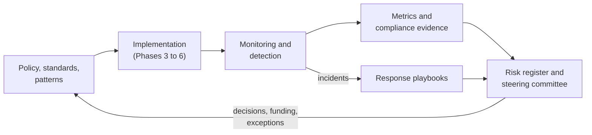

# Govern and measure
{: .no_toc }

**Phase 7: Engineering enablement and governance.** This section covers how the program is run, monitored, evidenced, and measured once controls are in place, so protection holds up over time and under audit.
{: .fs-5 .fw-300 }

## On this page
{: .no_toc .text-delta }

1. TOC
{:toc}

---

## Objective

Controls decay. Keys get shared between applications, labels are downgraded to get a file out the door, exceptions outlive their reasons, certificates expire, and new data stores appear without tags. Governance is the set of mechanisms that detects this decay and corrects it. For a global hospitality organization, governance also has to work across ownership models: the organization can mandate controls for owned and managed properties, but for franchised properties it relies on brand standards, contracts, and attestation.

The objectives of this section:

1. Define who decides, who does the work, and who is informed for every data protection activity.
2. Monitor keys, labels, and data movement so misuse is detected quickly.
3. Map every control to the regulatory and framework requirements it satisfies, so evidence is produced once and reused.
4. Measure coverage, hygiene, PQC readiness, and engineering enablement, and report them to leadership.
5. Keep a live register of risks and known anti-patterns.

## Governance loop

## Entry criteria

- Classification scheme, tag schema, and crypto standard approved (Phases 1 and 2).
- Central logging for key management services in each cloud (CloudTrail, Azure Monitor diagnostic logs, Cloud Audit Logs, OCI Audit) routed to the SIEM.
- A named owner for the metrics dashboard.

## Exit criteria and maturity checkpoints

Governance is continuous. The checkpoints below mark maturity:

| Checkpoint | Evidence |
|---|---|
| RACI in force | Signed RACI; every C2/C3 data store and key has a named owner |
| Detection coverage | Detections live for key disable/deletion, key policy changes, decrypt anomalies, label downgrades, and certificate expiry in every cloud |
| Compliance mapping | Control-to-requirement matrix used in the last PCI DSS assessment and ISO 27001 surveillance audit |
| Metrics | Monthly dashboard produced automatically from tags, KMS inventories, and scanner outputs |
| Risk register | Reviewed quarterly by the steering committee |

## Deliverables

- Operating model with RACI, policy hierarchy, exception process, and vendor requirements.
- Detection library and key compromise response playbook.
- Compliance mapping matrix.
- Metrics definitions and dashboard.
- Risk register and anti-pattern catalog.

## Child pages

| Page | What it covers |
|---|---|
| [Operating model and RACI]() | Crypto center of excellence, RACI, policy hierarchy, exceptions, vendor management |
| [Monitoring and detection]() | What to monitor, example detections in SQL, KQL, and Cloud Logging, SIEM integration, key compromise playbook |
| [Compliance mapping]() | Controls mapped to PCI DSS v4.0.1, GDPR, CCPA, PIPL, ISO 27001:2022, NIST CSF 2.0, SP 800-53, SOC 2, CIS v8 |
| [Metrics and KPIs]() | Coverage, hygiene, PQC readiness, enablement, and board-level metrics |
| [Risks and anti-patterns]() | Risk register and common design mistakes |

## Key takeaways for engineering teams

- Every key and data store you create has an owner in the RACI and appears in the metrics.
- Key management and label changes are monitored; expect questions about unusual decrypt activity.
- The compliance mapping explains why a requirement exists; cite it in design records.
- Exceptions are time-limited and visible to leadership.

## Related pages

- [Phased roadmap]()
- [Phase 7: Engineering enablement]()
- [Business objectives]()
- [Threats and regulatory drivers]()
