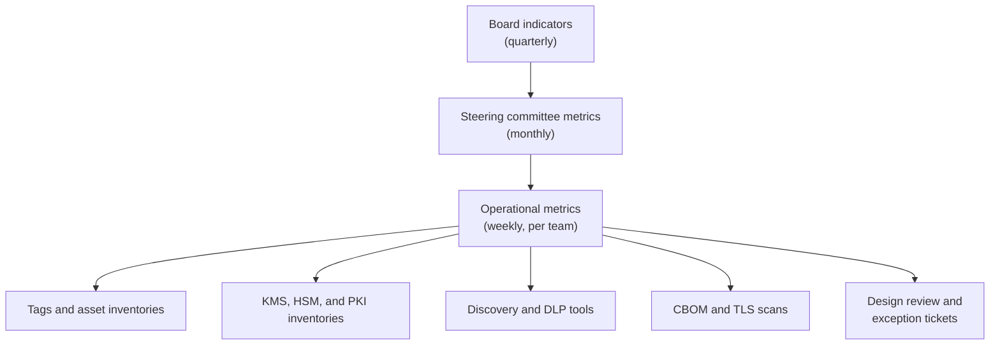
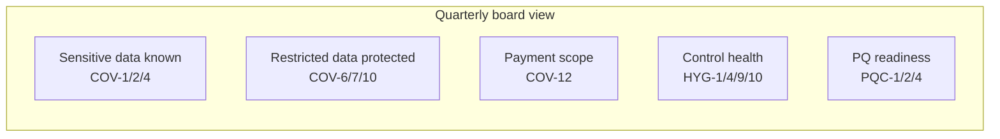

# Metrics and KPIs
{: .no_toc }

**Phase 7: Engineering enablement and governance.** This page defines how the program measures progress and control health, with formulas and data sources precise enough to automate, and a short set of indicators for the board.
{: .fs-5 .fw-300 }

## On this page
{: .no_toc .text-delta }

1. TOC
{:toc}

---

## Measurement principles

| Principle | Application |
|---|---|
| Automate collection | Every metric is computed from a system of record (tags, KMS inventories, scanner outputs, ticketing), not from surveys |
| Denominators matter | "Encrypted stores" means nothing without "of all discovered stores"; discovery coverage is always reported next to protection coverage |
| Weight by tier | A C3 store without field-level protection counts more than a C1 store without tags |
| Trend over snapshot | Show 6-month trends; one month's number alone does not show whether the program is working |
| Few metrics upward | The board sees five or six indicators; operational teams see the full set |
| Targets tied to phases | Targets change as phases complete; early targets are about coverage, later ones about hygiene |

## Metric hierarchy



## Coverage metrics

Coverage metrics answer "how much of the estate is known and protected". They are the primary measures during Phases 1 to 4.

| ID | Metric | Formula | Source | Target (month 12) | Target (month 24) |
|---|---|---|---|---|---|
| COV-1 | Data stores discovered | Stores in the register / stores in cloud inventories and CMDB | Asset register vs AWS Config, Azure Resource Graph, Cloud Asset Inventory, OCI Search, CMDB | 90% | 98% |
| COV-2 | Data stores classified | Stores with `data-classification` tag / stores in the register | Tags | 85% | 98% |
| COV-3 | C2/C3 stores with owner | C2/C3 stores with `data-owner` / C2/C3 stores | Tags | 95% | 100% |
| COV-4 | Discovery scan coverage | C2/C3 stores scanned in the last 90 days / C2/C3 stores | Macie, Purview, SDP, Data Safe | 70% | 95% |
| COV-5 | CMK coverage, PP-2 | PP-2 stores encrypted with a customer-managed key / PP-2 stores | KMS key references on resources | 80% | 100% |
| COV-6 | CMK coverage, PP-3 | PP-3 stores with a dedicated PP-3 key / PP-3 stores | As above | 70% | 100% |
| COV-7 | Field-level coverage for C3 | C3 fields protected by application-layer encryption or tokenization / C3 fields identified in the catalog | Data catalog column tags; EDRs; raw-column tests | 40% | 90% |
| COV-8 | Label coverage (Microsoft 365) | Files in SharePoint and OneDrive with a sensitivity label / total files (sampled or reported) | Purview content explorer and activity explorer | 50% | 80% |
| COV-9 | Auto-labeling for C3 patterns | C3 sensitive information types with active auto-labeling policy / C3 information types defined | Purview configuration | 60% | 100% |
| COV-10 | DLP enforcement | C3 exfiltration channels (email, web upload, endpoint USB, cloud apps) in block mode / total channels | DLP policy configuration | 50% | 100% |
| COV-11 | Non-production cleanliness | Non-production stores with production C2/C3 data detected / non-production stores (lower is better) | Discovery scans on non-production accounts | Under 10% | Under 2% |
| COV-12 | PAN outside the CDE | Stores outside the CDE where PAN was detected (count; target zero) | PAN discovery | Trending down | 0 |

### Example: computing COV-5 on AWS

The metrics job lists resources by tag and checks the KMS key on each. For S3:

```bash
# Buckets tagged pp2 and their default encryption key
aws resourcegroupstaggingapi get-resources \
  --resource-type-filters s3 \
  --tag-filters Key=protection-profile,Values=pp2 \
  --query 'ResourceTagMappingList[].ResourceARN' --output text |
tr '\t' '\n' | sed 's#arn:aws:s3:::##' |
while read -r bucket; do
  algo=$(aws s3api get-bucket-encryption --bucket "$bucket" \
    --query 'ServerSideEncryptionConfiguration.Rules[0].ApplyServerSideEncryptionByDefault.SSEAlgorithm' \
    --output text 2>/dev/null)
  echo "$bucket,$algo"
done
```

A bucket counts as compliant when the algorithm is `aws:kms` or `aws:kms:dsse` and the key is a customer managed key (not the AWS managed `aws/s3` key). The equivalent in Azure uses Azure Resource Graph:

```kusto
resources
| where type == "microsoft.storage/storageaccounts"
| where tags["protection-profile"] in ("pp2", "pp3")
| extend keySource = tostring(properties.encryption.keySource)
| summarize total = count(), cmk = countif(keySource == "Microsoft.Keyvault") by tostring(tags["protection-profile"])
| extend coverage = round(100.0 * cmk / total, 1)
```

## Hygiene metrics

Hygiene metrics answer "are the controls still healthy". They dominate once coverage is high.

| ID | Metric | Formula | Source | Target |
|---|---|---|---|---|
| HYG-1 | Key rotation compliance | Symmetric CMKs with automatic rotation enabled (or rotated within cryptoperiod) / CMKs | KMS APIs | 100% |
| HYG-2 | Key role separation | CMKs where no principal has both administrative and usage permissions / CMKs | Key policies, IAM analysis | 100% for PP-3; 95% for PP-2 |
| HYG-3 | Orphaned keys | Keys with no usage in 90 days and no tagged owner | KMS usage logs | Trending to 0 |
| HYG-4 | Certificates expiring within 30 days without automated renewal | Count | Certificate inventories, CBOM | 0 |
| HYG-5 | Automated certificate renewal | Certificates renewed by ACME or managed services / all certificates | CA and ACM/Key Vault inventories | 90% by March 2027 |
| HYG-6 | Weak TLS endpoints | Endpoints accepting TLS 1.0/1.1 or weak cipher suites | TLS scans | 0 external; trending to 0 internal |
| HYG-7 | Secrets age | Secrets older than their rotation policy / secrets | Secrets managers | Under 5% |
| HYG-8 | Secrets in code | New secrets detected by scanning per month | Secret scanning | Trending down |
| HYG-9 | Guardrail violations open | Open preventive or detective findings on encryption rules, by age | Config, Azure Policy, SCC, Cloud Guard | No findings older than 30 days for PP-3 |
| HYG-10 | Exceptions | Open exceptions, by profile and age; expired exceptions not closed | Exception register | No expired exceptions |
| HYG-11 | Label downgrades | Restricted label downgrades per 1,000 users per month | Purview audit | Baseline, then trending down |
| HYG-12 | DLP override rate | DLP matches overridden by users / DLP matches | Purview DLP | Under 10% for C3 |
| HYG-13 | Key compromise response time | Median time from high-severity key alert to containment | SIEM and ticketing | Under 4 hours |

## PQC readiness metrics

PQC metrics are reported from Phase 6 onward and continue to 2035.

| ID | Metric | Formula | Source | Target |
|---|---|---|---|---|
| PQC-1 | CBOM coverage | Systems with a CBOM entry / systems in the application inventory | CBOM | 80% by month 12; 100% of C2/C3 systems by month 24 |
| PQC-2 | External TLS endpoints hybrid-PQ capable | External endpoints that negotiate `X25519MLKEM768` (or another approved hybrid group) when offered / external endpoints | TLS scan offering hybrid groups | 50% by end of 2027; 90% by end of 2028 |
| PQC-3 | Internal C3 flows hybrid-PQ capable | C3 service-to-service and site-to-cloud flows using hybrid key exchange / C3 flows | Mesh telemetry, TLS scans | Trending up; 80% by 2030 |
| PQC-4 | Quantum-vulnerable algorithms by priority | Count of priority 1 systems still using only RSA/ECC key exchange | CBOM ranked by Mosca | 0 by 2028 |
| PQC-5 | Crypto-agile new systems | New systems passing the crypto-agility requirement at design review / new systems | Design review records | 100% |
| PQC-6 | Vendors with PQC roadmap | Critical vendors with a written PQC roadmap / critical vendors | Vendor questionnaires | 80% by 2027 |
| PQC-7 | PQC signing for roots of trust | Code and firmware signing pipelines using PQC or hybrid signatures / pipelines | PKI inventory | Plan by 2027; 100% by 2030 |
| PQC-8 | RSA/ECC at 112-bit security remaining | Count of RSA-2048 and P-256 uses in production | CBOM | 0 by 2030 (NIST IR 8547 draft deprecation date) |

Measuring PQC-2 is straightforward with OpenSSL 3.5 or later: connect offering only the hybrid group and record whether the handshake succeeds.

```bash
while read -r host; do
  if openssl s_client -connect "${host}:443" -servername "$host" -tls1_3 \
       -groups X25519MLKEM768 </dev/null 2>/dev/null | grep -q 'BEGIN CERTIFICATE'; then
    echo "$host,hybrid"
  else
    echo "$host,classical-only"
  fi
done < external-endpoints.txt
```

## Engineering enablement metrics

These show whether Phase 7 is making the secure path the easy path.

| ID | Metric | Formula | Target |
|---|---|---|---|
| ENG-1 | Design review coverage | New C2/C3 projects with a completed intake before build / new C2/C3 projects | 100% |
| ENG-2 | Review SLA attainment | Reviews decided within SLA / reviews | 90% |
| ENG-3 | Self-service share | Projects completed via self-service or lightweight path / all projects | 60% or more |
| ENG-4 | Paved-road adoption | Keys and encrypted stores created by approved modules (tag `created-by=paved-road` or module tag) / all new keys and stores | 80% |
| ENG-5 | CI policy checks active | Repositories with infrastructure code running OPA or Checkov checks / such repositories | 95% |
| ENG-6 | Champions coverage | Product teams handling C2/C3 with a trained champion / such teams | 100% |
| ENG-7 | Time to first encrypted deploy | Median days for a new team from onboarding to a deployed CMK-encrypted store | Under 5 days |
| ENG-8 | Repeat exceptions | Exceptions requested for the same requirement by three or more teams in a quarter | Triggers pattern review |

{: .note }
ENG-4 relies on a tag written by the paved-road modules. It is a program-specific tag, separate from the shared data tag schema, and is used only for measurement.

## Board-level dashboard

The board does not need 40 metrics. It needs to know whether sensitive data is known, whether it is protected, whether controls are healthy, and whether the organization is on track for post-quantum deadlines.

| Indicator | Composed from | Presentation |
|---|---|---|
| Sensitive data known | COV-1, COV-2, COV-4 | Percentage with 6-month trend |
| Restricted data protected | COV-6, COV-7, COV-10 weighted | Percentage with trend; RAG status |
| Payment data scope | COV-12 and PCI scope count | Count of in-scope systems; trend |
| Control health | HYG-1, HYG-4, HYG-9, HYG-10 | RAG status with top three issues |
| Post-quantum readiness | PQC-1, PQC-2, PQC-4 | Percentage and milestone status against 2030 and 2035 |
| Incidents involving encryption or keys | Count and severity | Narrative |



### RAG thresholds

| Indicator | Green | Amber | Red |
|---|---|---|---|
| Sensitive data known | At or above target | Within 10 points of target | More than 10 points below target |
| Restricted data protected | At or above target | Within 10 points | More than 10 points below, or any C3 store with no CMK |
| Control health | No PP-3 findings older than 30 days; no expired exceptions | Some PP-3 findings over 30 days | Any key deletion incident, or expired PP-3 exceptions |
| PQ readiness | Milestones on plan | One milestone at risk | Priority 1 systems without a plan |

## Reporting cadence

| Audience | Cadence | Content |
|---|---|---|
| Product and platform teams | Weekly (self-service dashboard) | Their own COV, HYG, and ENG metrics with drill-down to resources |
| CCoE | Weekly | Full operational set; exceptions; detections |
| Steering committee | Monthly | Coverage, hygiene, PQC, enablement, top risks, decisions needed |
| Board or audit committee | Quarterly | Board-level dashboard and narrative |
| External assessors | Per assessment | Evidence extracts mapped in [Compliance mapping]() |

## Pitfalls

| Pitfall | Effect | Avoidance |
|---|---|---|
| Measuring encryption without discovery coverage | 100% encrypted of a small known subset | Always report COV-1 next to protection metrics |
| Counting TDE as C3 protection | Overstates protection of restricted data | COV-7 counts only application-layer protection |
| Metrics maintained in spreadsheets | Stale, disputed numbers | Compute from tags and APIs |
| Targets that never change | Program stalls at "good enough" | Raise targets at each phase gate |
| Rewarding exception closure by extension | Exceptions renewed indefinitely | HYG-10 counts renewals separately |

## Key takeaways for engineering teams

- Your team's metrics are computed from tags and platform APIs; correct tags make your numbers correct.
- Field-level coverage for C3 is measured separately from storage encryption.
- Hybrid PQ readiness of external endpoints is tested automatically; expect findings for endpoints that do not negotiate hybrid groups.
- Paved-road modules are how adoption is measured; hand-built keys look like gaps.
- Repeated exceptions are a signal to fix the pattern, and the metrics surface them.

## Related pages

- [Phased roadmap]()
- [Monitoring and detection]()
- [Cryptographic inventory (CBOM)]()
- [PQC migration program]()
- [Business objectives]()
