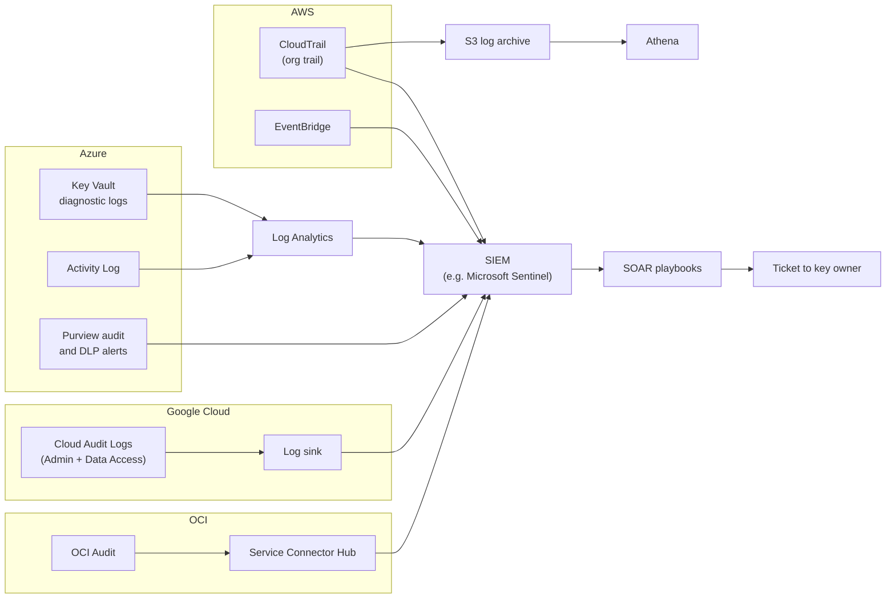
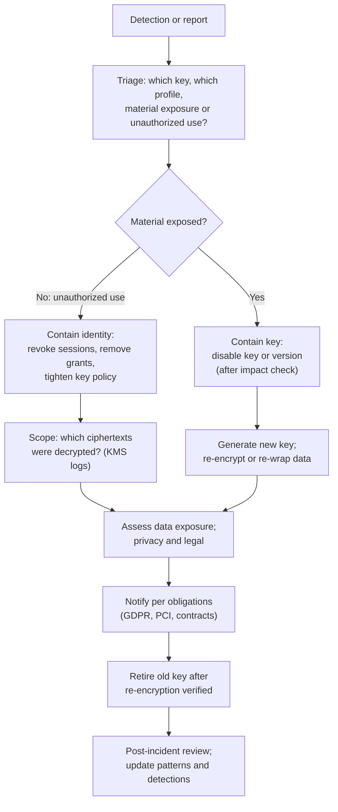

# Monitoring and detection
{: .no_toc }

**Phase 7: Engineering enablement and governance.** This page defines the signals that show encryption, keys, and labels being misused or weakened, gives working detection queries for each cloud, and sets out the response when a key is suspected compromised.
{: .fs-5 .fw-300 }

## On this page
{: .no_toc .text-delta }

1. TOC
{:toc}

---

## Why monitor cryptographic controls

Encryption changes where an attacker has to go. If guest data in a database is encrypted with a key the attacker cannot use, the attacker's target becomes the key: its policy, its grants, the roles that can call `Decrypt`, or the ability to disable it and hold the data to ransom. Key management services log every one of those actions. Monitoring them turns encryption from a static control into a detective one.

The same applies to labels and DLP. A sensitivity label protects a file only until someone downgrades it. The downgrade is logged, and it is a strong signal when it precedes an external share.

## What to monitor

| Signal | Why it matters | Source | Severity |
|---|---|---|---|
| Key scheduled for deletion or disabled | Destructive action; used in cloud ransomware and sabotage | CloudTrail `ScheduleKeyDeletion`, `DisableKey`; Key Vault `KeyDelete`, `KeyUpdate`; Cloud KMS `DestroyCryptoKeyVersion`, `DisableCryptoKeyVersion`; OCI Audit key events | High |
| Use of a key pending deletion | Indicates a key still in use; deletion would cause data loss | CloudTrail events with error `KMSInvalidStateException` | High |
| Key policy or IAM change | Adds a new principal who can decrypt | CloudTrail `PutKeyPolicy`, `CreateGrant`; Key Vault access policy or RBAC changes; Cloud KMS `SetIamPolicy` | High for PP-3 keys, medium otherwise |
| Decrypt volume anomaly | Bulk decryption before exfiltration | KMS data plane logs aggregated per principal and key | Medium to high |
| Decrypt by unexpected principal | A principal outside the key's intended users | KMS logs compared with the owner's expected principals | High for PP-3 |
| Decrypt from unexpected network location | Stolen credentials used from outside | Source IP and VPC endpoint in KMS logs | High |
| External key store errors | Availability risk for XKS, Cloud EKM, or External KMS | Provider metrics and logs | Medium (availability) |
| Label downgrade or removal | Precedes exfiltration of labeled files | Purview audit (Microsoft 365 unified audit log) | Medium; high if followed by external share |
| DLP policy match and override | Data leaving through email, web, endpoint, or cloud apps | Purview DLP alerts, CASB | Varies by tier |
| DLP or label policy changes | Weakening of controls | Microsoft 365 audit | High |
| Guardrail changes | SCP detached, Azure Policy assignment deleted, org policy relaxed | CloudTrail Organizations events, Azure Activity Log, Cloud Audit Logs | High |
| Certificate expiry | Outages; teams disabling validation to recover | ACM events, Key Vault certificate events, CA inventory | Medium, escalating |
| Secrets age and access | Stale or over-accessed secrets | Secrets Manager, Key Vault, Secret Manager logs | Medium |
| Plaintext protocol use | TLS below 1.2, plaintext database connections | Load balancer logs, database logs, mesh telemetry | Medium |
| New data store without tags | Unclassified data | Config, Azure Policy, Cloud Asset Inventory | Low to medium |

## Architecture



### Logging prerequisites

| Cloud | Prerequisite |
|---|---|
| AWS | Organization trail with management events. KMS cryptographic operations (`Decrypt`, `GenerateDataKey`) are recorded as management events and are logged by default unless a trail excludes KMS events, which makes volume analysis possible |
| Azure | Diagnostic settings on every Key Vault and Managed HSM sending `AuditEvent` logs to Log Analytics (deploy with Azure Policy `deployIfNotExists`) |
| Google Cloud | Data Access audit logs enabled for Cloud KMS (not on by default) to capture `Encrypt` and `Decrypt`; Admin Activity logs are always on |
| OCI | Audit is on by default; route key management events to the SIEM with Service Connector Hub |
| Microsoft 365 | Unified audit log on; Purview DLP alerts forwarded to the SIEM |

{: .note }
KMS request logging generates large volumes. Keep full logs in low-cost storage (S3 with Athena, Log Analytics basic or auxiliary tiers, or BigQuery log sinks) and send only aggregated or high-severity events to the SIEM analytics tier.

## Example detections

### AWS: destructive key actions (Athena on CloudTrail)

This assumes the standard CloudTrail Athena table (`cloudtrail_logs`) created from the CloudTrail console or partition projection.

```sql
SELECT eventtime,
       useridentity.arn                                    AS principal,
       eventname,
       json_extract_scalar(requestparameters, '$.keyId')   AS key_id,
       sourceipaddress,
       errorcode
FROM cloudtrail_logs
WHERE eventsource = 'kms.amazonaws.com'
  AND eventname IN ('ScheduleKeyDeletion', 'DisableKey', 'PutKeyPolicy',
                    'CreateGrant', 'DeleteImportedKeyMaterial',
                    'DisableKeyRotation', 'UpdateCustomKeyStore')
  AND eventtime > to_iso8601(current_timestamp - interval '1' day)
ORDER BY eventtime DESC;
```

For real-time alerting on the same events, use an EventBridge rule on AWS API calls via CloudTrail:

```json
{
  "source": ["aws.kms"],
  "detail-type": ["AWS API Call via CloudTrail"],
  "detail": {
    "eventSource": ["kms.amazonaws.com"],
    "eventName": ["ScheduleKeyDeletion", "DisableKey", "PutKeyPolicy", "DeleteImportedKeyMaterial"]
  }
}
```

### AWS: decrypt volume anomaly per principal and key

```sql
WITH hourly AS (
  SELECT useridentity.arn                                         AS principal,
         element_at(resources, 1).arn                             AS key_arn,
         date_trunc('hour', from_iso8601_timestamp(eventtime))    AS hr,
         count(*)                                                 AS calls
  FROM cloudtrail_logs
  WHERE eventsource = 'kms.amazonaws.com'
    AND eventname IN ('Decrypt', 'GenerateDataKey')
    AND eventtime > to_iso8601(current_timestamp - interval '14' day)
  GROUP BY 1, 2, 3
),
baseline AS (
  SELECT principal, key_arn,
         avg(calls)    AS avg_calls,
         stddev(calls) AS sd_calls
  FROM hourly
  WHERE hr < date_trunc('hour', current_timestamp - interval '1' day)
  GROUP BY 1, 2
)
SELECT h.principal, h.key_arn, h.hr, h.calls, b.avg_calls
FROM hourly h
JOIN baseline b ON h.principal = b.principal AND h.key_arn = b.key_arn
WHERE h.hr >= date_trunc('hour', current_timestamp - interval '1' day)
  AND h.calls > b.avg_calls + 4 * coalesce(b.sd_calls, 0)
  AND h.calls > 1000
ORDER BY h.calls DESC;
```

The thresholds (four standard deviations and a floor of 1,000 calls) are starting points. Services that use data key caching make fewer calls, so a sudden rise can also mean a cache was disabled; the detection routes to the service owner first.

### AWS: decrypt of a PP-3 key by an unexpected principal

```sql
SELECT eventtime, useridentity.arn AS principal, sourceipaddress,
       element_at(resources, 1).arn AS key_arn
FROM cloudtrail_logs
WHERE eventsource = 'kms.amazonaws.com'
  AND eventname = 'Decrypt'
  AND element_at(resources, 1).arn IN (SELECT key_arn FROM security.pp3_keys)
  AND useridentity.arn NOT IN (SELECT principal_arn FROM security.pp3_expected_principals)
  AND eventtime > to_iso8601(current_timestamp - interval '1' day);
```

The two lookup tables are generated nightly from KMS key tags (`protection-profile=pp3`) and from the requirements package, which names the intended key users.

### Azure: Key Vault destructive and access changes (KQL)

```kusto
AzureDiagnostics
| where ResourceProvider == "MICROSOFT.KEYVAULT"
| where OperationName in ("KeyDelete", "KeyPurge", "KeyUpdate", "VaultPatch", "VaultPut",
                          "SecretDelete", "SecretPurge", "CertificateDelete")
| project TimeGenerated, Resource, OperationName, ResultSignature, CallerIPAddress,
          CallerObjectId = identity_claim_http_schemas_microsoft_com_identity_claims_objectidentifier_g,
          id_s
| order by TimeGenerated desc
```

RBAC role assignments on a vault appear in the Azure Activity Log, not in the vault's diagnostic logs:

```kusto
AzureActivity
| where OperationNameValue =~ "MICROSOFT.AUTHORIZATION/ROLEASSIGNMENTS/WRITE"
| where _ResourceId has "/providers/microsoft.keyvault/vaults/"
| project TimeGenerated, Caller, CallerIpAddress, _ResourceId, ActivityStatusValue
```

### Azure: Key Vault decrypt and unwrap anomaly (KQL)

```kusto
let lookback = 14d;
let recent = 1h;
let ops = dynamic(["KeyDecrypt", "KeyUnwrap"]);
let baseline = AzureDiagnostics
  | where TimeGenerated between (ago(lookback) .. ago(1d))
  | where ResourceProvider == "MICROSOFT.KEYVAULT" and OperationName in (ops)
  | summarize calls = count() by Resource,
      Caller = identity_claim_http_schemas_microsoft_com_identity_claims_objectidentifier_g,
      bin(TimeGenerated, 1h)
  | summarize avg_calls = avg(calls), sd_calls = stdev(calls) by Resource, Caller;
AzureDiagnostics
| where TimeGenerated > ago(recent)
| where ResourceProvider == "MICROSOFT.KEYVAULT" and OperationName in (ops)
| summarize calls = count() by Resource,
    Caller = identity_claim_http_schemas_microsoft_com_identity_claims_objectidentifier_g
| join kind=leftouter baseline on Resource, Caller
| where isnull(avg_calls) or calls > avg_calls + 4 * sd_calls
| project Resource, Caller, calls, avg_calls
```

A caller with no baseline (`isnull(avg_calls)`) is itself a finding for PP-3 vaults.

{: .verify }
Key Vault logs may be written to the legacy `AzureDiagnostics` table or the resource-specific `AZKVAuditLogs` table depending on the diagnostic setting. Column names differ between the two. Confirm which table your diagnostic settings use and adjust the queries.

### Microsoft Purview: label downgrade followed by external sharing (KQL)

In Microsoft Defender XDR advanced hunting or Microsoft Sentinel with the Microsoft 365 connector:

```kusto
let window = 1h;
let downgrades = CloudAppEvents
  | where Timestamp > ago(1d)
  | where ActionType in ("FileSensitivityLabelChanged", "FileSensitivityLabelRemoved",
                         "SensitivityLabelUpdated", "SensitivityLabelRemoved")
  | project DowngradeTime = Timestamp, AccountObjectId, ObjectName, ActionType, RawEventData;
let shares = CloudAppEvents
  | where Timestamp > ago(1d)
  | where ActionType in ("SharingInvitationCreated", "AnonymousLinkCreated", "SharingSet")
  | project ShareTime = Timestamp, AccountObjectId, ObjectName, ShareAction = ActionType;
downgrades
| join kind=inner shares on AccountObjectId, ObjectName
| where ShareTime between (DowngradeTime .. DowngradeTime + window)
| project DowngradeTime, ShareTime, AccountObjectId, ObjectName, ActionType, ShareAction
```

The query uses the file name as the join key for readability; production versions join on the object ID in `RawEventData`. The detection is most useful when filtered to downgrades from `Restricted\*` labels, which requires parsing the old and new label IDs from `RawEventData`.

{: .verify }
Audit operation names for label changes differ between workloads (SharePoint and OneDrive file events, Office client events, Exchange). Confirm the `ActionType` values present in your tenant before deploying.

### Google Cloud: key destruction and IAM changes (Cloud Logging query)

```text
protoPayload.serviceName="cloudkms.googleapis.com"
(protoPayload.methodName:"DestroyCryptoKeyVersion"
 OR protoPayload.methodName:"DisableCryptoKeyVersion"
 OR protoPayload.methodName:"UpdateCryptoKeyPrimaryVersion"
 OR protoPayload.methodName:"SetIamPolicy")
```

Create a log-based alert or route through a log sink to the SIEM:

```bash
gcloud logging sinks create kms-admin-to-siem \
  pubsub.googleapis.com/projects/sec-logging/topics/siem-kms \
  --organization=123456789012 --include-children \
  --log-filter='protoPayload.serviceName="cloudkms.googleapis.com" AND logName:"cloudaudit.googleapis.com%2Factivity"'
```

For decrypt volume, route Data Access logs for Cloud KMS to BigQuery and aggregate by `protoPayload.authenticationInfo.principalEmail` and `resource.labels.crypto_key_id`, using the same baseline logic as the AWS query.

### OCI: Vault key events

OCI Audit records key management operations for Vault. Use the Logging search or route events through Service Connector Hub to the SIEM, filtering on the key management service event types for key disable, schedule deletion, and policy changes to the Vault compartment. Cloud Guard includes detector rules for Vault keys that have not been rotated.

{: .verify }
Confirm the exact OCI Audit event type names for Vault key operations in the current documentation before building the filter.

### Certificate expiry

| Platform | Mechanism |
|---|---|
| AWS Certificate Manager | EventBridge event `ACM Certificate Approaching Expiration`, and the `DaysToExpiry` CloudWatch metric |
| Azure Key Vault | Event Grid event `Microsoft.KeyVault.CertificateNearExpiry` |
| Private CAs and on-prem | CBOM scanner output (see [Cryptographic inventory (CBOM)]()) compared daily with a 30/14/7-day threshold |
| External endpoints | External TLS scan from the CBOM tooling |

As public certificate lifetimes fall to 200 days (from March 15, 2026), 100 days (from March 15, 2027), and 47 days (from March 15, 2029) under CA/Browser Forum ballot SC-081, manual renewal stops being viable. The metric to watch is not only expiry but the share of certificates renewed automatically.

## SIEM integration

| Design choice | Recommendation |
|---|---|
| Normalization | Map key events to a common schema: `cloud`, `key_id`, `key_profile` (from tags), `action`, `principal`, `source_ip`, `result` |
| Enrichment | Join events with the key inventory (tags `data-classification`, `protection-profile`, `data-owner`) so alerts show which data is at risk and whom to call |
| Severity | Derived from `protection-profile`: PP-3 events are one level higher than PP-2 |
| Suppression | Suppress expected actions by the key admin pipeline role during approved change windows |
| Routing | High-severity key events page security operations; medium creates a ticket for the key owner |
| Retention | Key management logs retained at least one year (PCI DSS 10.5.1 requires 12 months with three months immediately available for in-scope systems) |

## Key compromise response playbook

A key is suspected compromised when key material may have been exposed (for example an exported key file or an HSM credential leak), or when an unauthorized principal was able to use it. Cloud KMS keys that never leave the HSM are rarely "stolen"; the more common case is unauthorized **use** through a compromised identity.



| Step | Actions | Owner |
|---|---|---|
| 1. Triage | Identify the key (ID, alias, cloud, region), its profile and data domain from tags, the data it protects, and whether the issue is exposure of material or unauthorized use | Security operations |
| 2. Impact check before disabling | List services depending on the key (grants, key policy principals, recent callers). Disabling a key used by a production database makes the database unavailable | Platform engineering with the data owner |
| 3. Contain | For unauthorized use: revoke the identity's sessions and credentials, remove grants, restrict the key policy. For exposed material: disable the key or key version, or for external keys revoke access at the external key manager | Platform engineering; key custodians for HSM or external keys |
| 4. Scope | Query KMS logs for all operations by the suspect principal or with the key since the earliest possible exposure; map to records via encryption context | Security operations |
| 5. Recover | Create a new key; re-encrypt data (for envelope encryption, re-wrap DEKs; if DEKs themselves were exposed, re-encrypt data); update applications to the new key | Application teams, platform engineering |
| 6. Notify | Privacy and legal assess notification duties (GDPR 72-hour supervisory authority notification where applicable; PCI incident procedures; contracts) | Privacy, legal, CISO |
| 7. Retire | Schedule deletion of the compromised key only after re-encryption is verified and backups are handled | Key custodians |
| 8. Learn | Post-incident review; update detections, key policies, and patterns | CCoE |

{: .warning }
Rotating a KMS key with automatic rotation does not re-encrypt existing data or DEKs; it only changes the material used for new encryptions. For a compromise of key material, rotation alone is not remediation.

## Key takeaways for engineering teams

- Tag keys with profile, domain, and owner so alerts reach the right team with the right severity.
- Name your service's expected key users in the requirements package; unexpected decrypts are alerts.
- Keep KMS usage predictable: sudden decrypt spikes will be investigated.
- Automate certificate renewal; expiry monitoring is a backstop, not the process.
- Never disable a key during an incident without checking which systems depend on it.

## Related pages

- [Key management architecture]()
- [Certificates and PKI]()
- [DLP and CASB enforcement]()
- [Metrics and KPIs]()
- [Risks and anti-patterns]()

## Sources

- AWS KMS logging with CloudTrail: <https://docs.aws.amazon.com/kms/latest/developerguide/logging-using-cloudtrail.html>
- Azure Key Vault logging: <https://learn.microsoft.com/en-us/azure/key-vault/general/logging>
- Cloud KMS audit logging: <https://cloud.google.com/kms/docs/audit-logging>
- Microsoft Purview auditing: <https://learn.microsoft.com/en-us/purview/audit-solutions-overview>
