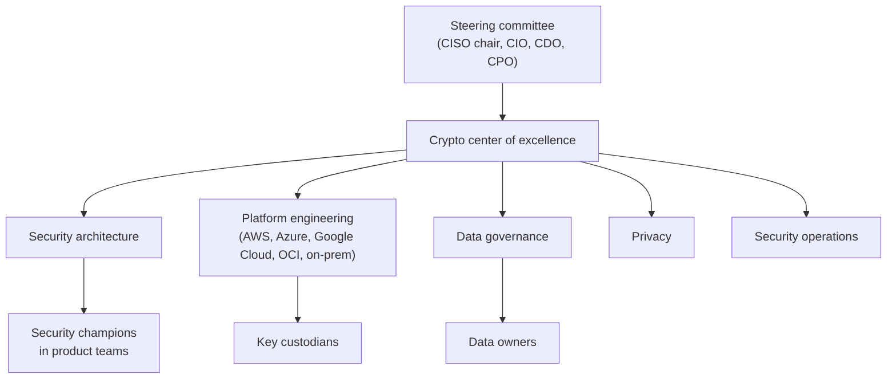
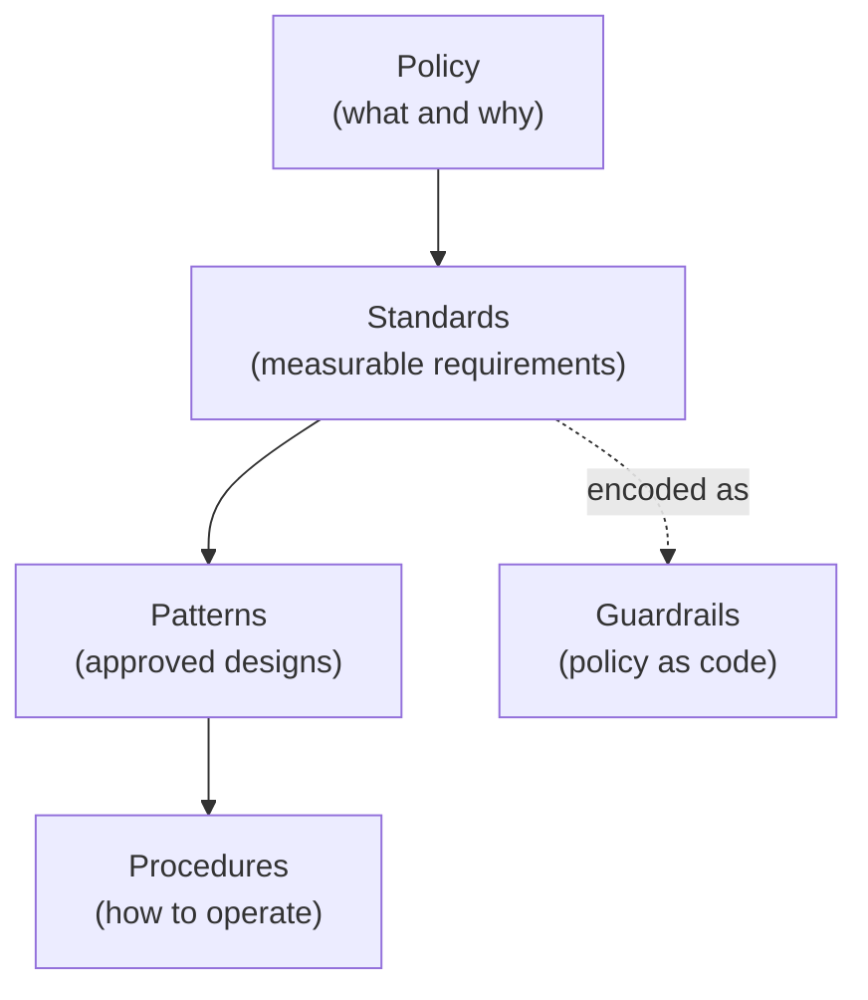
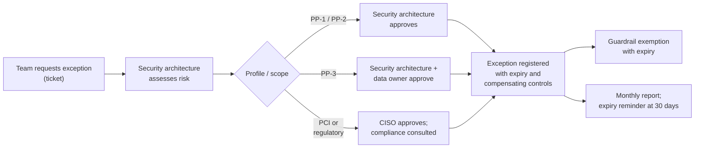

# Operating model and RACI
{: .no_toc }

**Phase 7: Engineering enablement and governance.** This page defines who owns data protection and cryptography decisions, how policies are layered, how exceptions work, and what the organization requires of vendors and franchisees.
{: .fs-5 .fw-300 }

## On this page
{: .no_toc .text-delta }

1. TOC
{:toc}

---

## Why an operating model

Encryption and key management fail most often at the seams between teams: the platform team creates a key, the application team uses it, the data owner never approved who can decrypt, and nobody is watching when the key policy changes. Post-quantum migration makes this worse because it touches every team at once. The operating model names a single accountable party for each activity and a standing group, the crypto center of excellence, that owns the standards and the migration.

## Crypto center of excellence

The crypto center of excellence (CCoE) is a small, cross-functional group led by the security architecture function. It is a standing body, not a project.

| Element | Design |
|---|---|
| Lead | Senior manager, cloud security architecture (the architect) |
| Core members | Security architects (data protection, PKI), platform engineering leads per cloud, a data governance lead, a privacy engineer, a security operations lead |
| Extended members | Payments engineering, property technology, Microsoft 365 platform, identity, procurement, internal audit (observer) |
| Charter | Own the crypto standard, key management architecture, protection patterns, CBOM, and PQC migration plan; approve crypto-related exceptions; advise on vendor cryptography |
| Cadence | Weekly working session; monthly decision meeting; quarterly report to the steering committee |
| Artifacts | Crypto standard, key management standard, CBOM, PQC roadmap, pattern library, exception register |
| Decision rights | Approve new algorithms, libraries, key custody models, and HSM platforms; set cryptoperiods; declare algorithms deprecated |

## Roles

| Role | Responsibility |
|---|---|
| CISO | Accountable for the program; chairs the steering committee; accepts enterprise-level residual risk |
| Security architecture | Designs standards and patterns; runs design review; leads the CCoE; owns the CBOM and PQC roadmap |
| Platform engineering | Builds and operates KMS, HSM, PKI, secrets managers, and paved-road modules; implements guardrails |
| Data governance | Owns the classification scheme and label taxonomy; maintains the data asset register; runs discovery |
| Privacy | Interprets privacy law requirements; reviews data sharing, cross-border transfers, retention |
| Application teams | Build and operate systems to the requirements package; hold security champions |
| Data owners | Business leaders accountable for a data domain; approve access, trade-offs, and residual risk |
| Franchise operations | Communicates and enforces brand technology standards with franchisees; collects attestations |
| Key custodians | Named individuals who perform manual key ceremonies and hold key components or HSM credentials under dual control and split knowledge |
| Security operations | Monitors detections; runs incident response including key compromise |
| Internal audit | Independent assurance |

## RACI

R = responsible, A = accountable, C = consulted, I = informed.

| Activity | CISO | Security architecture | Platform engineering | Data governance | Privacy | App teams | Franchise ops | Key custodians |
|---|---|---|---|---|---|---|---|---|
| Classification scheme and labels | I | C | I | A/R | C | I | I | - |
| Data asset register and discovery | I | C | C | A/R | C | R (own systems) | I | - |
| Crypto standard | A | R | C | I | C | C | I | C |
| Key management architecture | A | R | R | I | I | C | - | C |
| Key creation via paved road | - | C | A/R | - | - | R (request) | - | - |
| Manual key ceremonies (HSM init, key import) | I | C | A | - | - | - | - | R |
| Key rotation and retirement | I | C | A/R | - | - | C | - | R (manual keys) |
| PKI and certificate lifecycle | I | C | A/R | - | - | R (own endpoints) | I | C (CA keys) |
| Secrets management platform | I | C | A/R | - | - | R (use) | - | - |
| Design review and requirements package | I | A/R | C | C | C | R | - | - |
| Field-level encryption and tokenization in apps | I | C | C | I | I | A/R | - | - |
| Label and DLP policy configuration | I | C | R (M365 team) | A | C | I | I | - |
| Guardrails (policy as code) | I | A | R | C | - | I | - | - |
| Monitoring and detection | I | C | C | I | I | I | - | - |
| Key compromise response | A | R | R | C | C | R | I | R |
| CBOM and PQC migration | A | R | R | I | I | R | I | C |
| Franchise brand technology standards | A | C | C | C | C | - | R | - |
| Vendor crypto and PQC requirements | I | R | C | C | C | C | C | - |
| Exceptions (PP-3) | I | R | C | C | C | R (request) | - | - |
| Metrics and reporting | I | A | R | R | I | I | I | - |

Monitoring and detection is accountable to security operations (not shown as a column for width); security operations is also responsible for detection engineering, with security architecture consulted on key-related logic.

## Policy hierarchy

The program uses four document levels so that change happens at the right speed. Policies change rarely and need executive approval; procedures change often and need only team approval.

| Level | Purpose | Example | Approver | Review cycle |
|---|---|---|---|---|
| Policy | States intent and mandates | Information Protection Policy: "Data is classified and protected according to its classification" | CISO, with executive endorsement | Every two years |
| Standard | Measurable, mandatory requirements | Cryptographic Standard (algorithms, key lengths, cryptoperiods); Key Management Standard; Data Classification Standard | CCoE, CISO | Annually (PCI DSS 12.3.3 requires the cipher suite and protocol review at least every 12 months) |
| Pattern | Approved designs that satisfy the standards | Reference architectures, paved-road modules, decision trees | Security architecture | As needed, versioned |
| Procedure | Step-by-step operational instructions | Key ceremony procedure; certificate renewal runbook; key compromise playbook | Owning team, CCoE review | Annually and after incidents |

### Standards that make up the program

| Standard | Key contents |
|---|---|
| Data classification standard | Tiers C0 to C3, label taxonomy, tag schema, handling rules |
| Cryptographic standard | Approved algorithms (AES-256-GCM, SHA-2/SHA-3, RSA-3072+ and ECDSA P-256+ during transition, ML-KEM and ML-DSA per FIPS 203 and 204), TLS profiles, deprecated algorithms, PQC transition dates |
| Key management standard | Key hierarchy, custody options by profile, cryptoperiods (aligned to SP 800-57 Part 1 Rev. 5), rotation, separation of duties, dual control and split knowledge for manual operations, destruction |
| Certificate standard | CA hierarchy, validity periods (tracking CA/Browser Forum SC-081 reductions), automation, inventory |
| Secrets standard | Approved secrets managers, rotation, no secrets in code |
| Data retention standard | Retention classes and deletion methods, including crypto-shredding |

## Exception process

Exceptions are normal. What matters is that they are visible, justified, time-limited, and carry compensating controls.

| Field | Content |
|---|---|
| Requirement | Standard clause or requirement ID (for example DP-03) |
| Scope | Resources, accounts, or systems |
| Reason | Business or technical reason, for example vendor PMS does not support TLS 1.3 |
| Risk | Assessed likelihood and impact |
| Compensating controls | For example network isolation, additional monitoring |
| Remediation plan | Date and owner |
| Expiry | 90 days (PP-3), 180 days (PP-1/PP-2), maximum one year for vendor-dependent items |

Repeated exceptions for the same requirement trigger a CCoE review of the standard or pattern.

## Vendor management

Many sensitive systems in hospitality are SaaS or vendor-hosted: PMS, CRS, POS, CRM, HR/payroll, revenue management, guest messaging. The organization's cryptographic posture is only as strong as these vendors'.

### Vendor requirements by tier

| Requirement | Vendors processing C2 | Vendors processing C3 |
|---|---|---|
| Encryption at rest | Required, AES-256 or equivalent | Required, with customer-managed key option preferred |
| Customer-managed keys or BYOK | Preferred | Required where offered for the product tier; justify if not |
| Encryption in transit | TLS 1.2+ | TLS 1.2+, TLS 1.3 preferred |
| Key management evidence | SOC 2 Type II or ISO 27001 certificate | Plus description of key hierarchy, HSM use, and access controls |
| PCI DSS | n/a | AOC for service providers where cardholder data is in scope |
| Data residency | Stated regions | Contractually fixed regions; subprocessors listed |
| Deletion | Deletion on termination with confirmation | Plus crypto-shredding or NIST SP 800-88 aligned sanitization evidence |
| Crypto inventory | On request | Provide a CBOM or equivalent listing of algorithms and protocols |
| PQC | Roadmap on request | Written PQC roadmap with dates for hybrid key exchange and PQC signatures |
| Breach notification | Contractual timeline | Shorter timeline; key compromise explicitly included |

### Vendor PQC questionnaire (excerpt)

1. Which public-key algorithms does the product use for key exchange, signatures, and certificates?
2. Does the product support TLS 1.3 and hybrid key exchange such as `X25519MLKEM768`? If not, when?
3. Which cryptographic libraries and versions are used? Are they FIPS 140-3 validated?
4. Can algorithms be changed by configuration, or does a change require a new release?
5. What is the plan to support ML-KEM (FIPS 203) and ML-DSA (FIPS 204)?
6. How are customer data encryption keys protected, and can the customer supply or control them?

### Franchise and owner relationships

Franchised properties are operated by independent companies. The organization's leverage comes from:

| Mechanism | Use |
|---|---|
| Brand standards | Mandatory technology standards: approved PMS and POS, P2PE terminals, network segmentation, managed ID capture |
| Franchise agreement clauses | Data protection obligations, audit rights, incident notification |
| Shared-responsibility matrix | For each system, who operates, who secures, who holds keys |
| Attestation | Annual self-assessment and evidence submission |
| Brand-provided platforms | Cloud PMS and managed integration appliances that embed controls, reducing franchisee effort |

## Key takeaways for engineering teams

- The CCoE owns the crypto standard; new algorithms, libraries, or custody models go through it.
- The RACI tells you who approves what: data owners approve trade-offs, platform engineering creates keys.
- Standards are mandatory; patterns are the easiest way to meet them.
- Exceptions expire; plan remediation from the day you request one.
- Ask vendors about cryptography and PQC before contract signature, not after.

## Related pages

- [Govern and measure]()
- [Security design review process]()
- [Key management architecture]()
- [Cryptographic standards]()
- [Vendor and cloud PQC readiness]()
