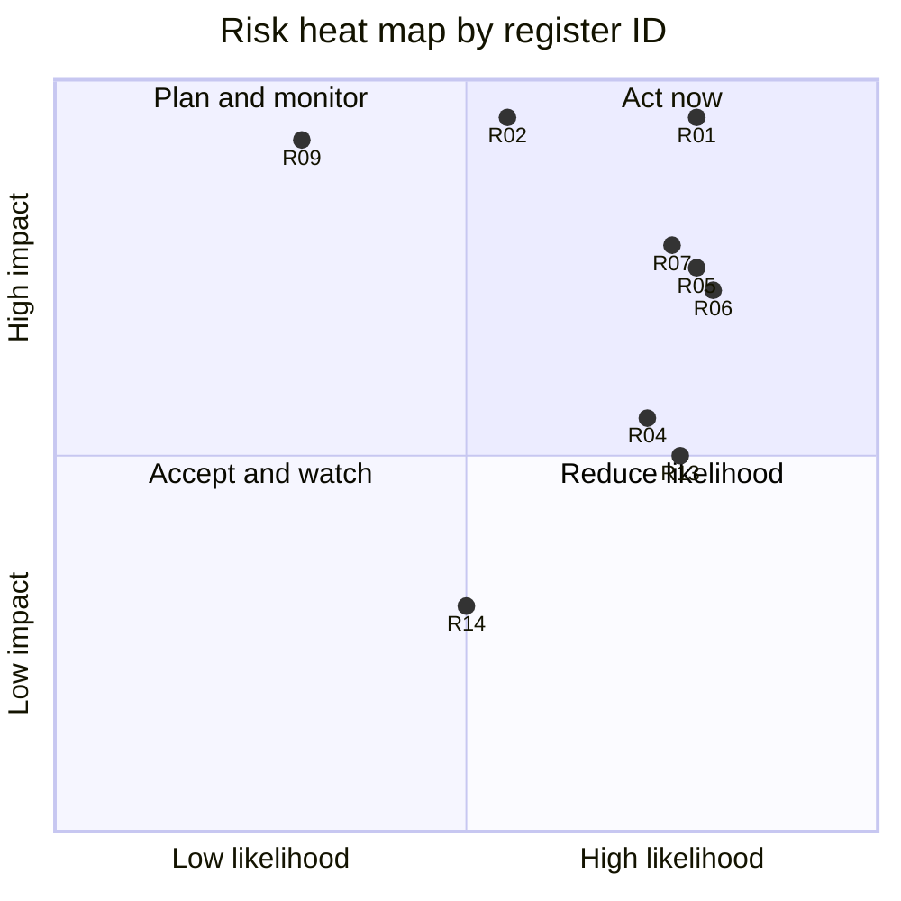

# Risks and anti-patterns
{: .no_toc }

**Phase 7: Engineering enablement and governance.** This page records the risks that can stop the program from delivering and the design mistakes that make encryption look present while leaving data exposed.
{: .fs-5 .fw-300 }

## On this page
{: .no_toc .text-delta }

1. TOC
{:toc}

---

## Risk register

Likelihood and impact use a 1 to 5 scale. The score is likelihood multiplied by impact. The register is reviewed quarterly by the steering committee; the CCoE updates it monthly.

| ID | Risk | Likelihood | Impact | Score | Mitigation | Owner |
|---|---|---|---|---|---|---|
| R-01 | Incomplete data inventory leaves C3 data unprotected in unknown stores (shadow copies, exports, legacy property systems) | 4 | 5 | 20 | Discovery across all clouds and file shares; COV-1 reported with every protection metric; new-store detection via tag guardrails | Data governance |
| R-02 | Key unavailability causes an outage (external key store, HSM cluster failure, accidental key disable) | 3 | 5 | 15 | Availability design for external keys; SCPs and deny policies on key disable/delete; multi-HSM clusters; tested runbooks | Platform engineering |
| R-03 | Accidental or malicious key deletion makes data permanently unrecoverable | 2 | 5 | 10 | Waiting periods (AWS 7 to 30 days; Azure soft delete and purge protection; Cloud KMS scheduled destruction), deletion restricted to break-glass roles, detection on schedule deletion | Platform engineering |
| R-04 | Field-level encryption breaks search, joins, and reporting, causing teams to resist or bypass it | 4 | 3 | 12 | Decision trees with blind index and tokenization options; data owner sign-off on trade-offs; reference architectures | Security architecture |
| R-05 | PAN leaks outside the CDE through free-text fields, emails, and logs, expanding PCI scope | 4 | 4 | 16 | P2PE and hosted payment pages; DLP with Luhn validation; PMS field validation; quarterly PAN discovery | Payments engineering |
| R-06 | Passport and ID scans accumulate at properties in email, shared drives, and scanner memory | 4 | 4 | 16 | Managed ID capture (RA-4); discovery on property file shares; property audits | Property technology |
| R-07 | Franchise properties do not implement required controls | 4 | 4 | 16 | Brand standards; contract clauses; attestation; brand-provided platforms | Franchise operations |
| R-08 | Certificate outages as public certificate lifetimes shorten to 200, 100, then 47 days | 4 | 3 | 12 | ACME automation; HYG-4 and HYG-5 metrics; expiry detections | Platform engineering |
| R-09 | Harvested encrypted traffic is decrypted in future by a cryptographically relevant quantum computer | 2 | 5 | 10 | Hybrid PQ key exchange on priority flows; Mosca ranking; data minimization and short retention | Security architecture |
| R-10 | Vendors cannot support PQC or customer-managed keys in time | 3 | 4 | 12 | Vendor PQC questionnaire; contract clauses; roadmap tracking; alternative vendors for critical systems | Procurement |
| R-11 | Guardrails block delivery and teams lose trust in the program | 3 | 3 | 9 | Audit mode first; paved-road modules; exception process with expiry; clear error messages | Platform engineering |
| R-12 | DLP false positives disrupt front-desk and contact-center operations | 3 | 3 | 9 | Monitor-then-block; tuning; property-specific policies; override with justification for C2 | Security operations |
| R-13 | Architect capacity becomes a review bottleneck | 4 | 3 | 12 | Classification-based triage; champions; self-service path; published patterns | Security architecture |
| R-14 | KMS request costs rise sharply with CMK adoption | 3 | 2 | 6 | S3 Bucket Keys; data key caching for C2; cost monitoring per domain | Platform engineering |
| R-15 | Crypto-shredding destroys data still under legal hold or required retention | 2 | 4 | 8 | Retention service checks legal hold before key destruction; re-wrap held records under a legal-hold key | Privacy and legal |
| R-16 | Regulatory divergence (for example domestic algorithms in mainland China, residency rules) forces separate designs | 3 | 3 | 9 | Crypto standard annexes by jurisdiction; `data-residency` tag; regional keys | Security architecture |
| R-17 | Encryption gives false assurance because keys are accessible to the same identities that can read the storage | 3 | 4 | 12 | Key separation reviews (HYG-2); PP-3 key used only by named services | Security architecture |
| R-18 | Loss of skilled key custodians or HSM expertise | 2 | 4 | 8 | At least three trained custodians per HSM domain; documented ceremonies; vendor support contracts | Platform engineering |

## Anti-patterns

An anti-pattern is a design that looks like it meets a requirement but does not reduce the risk it is supposed to reduce. Each entry below describes the pattern, why it fails, how to detect it, and what to do instead.

### Summary

| # | Anti-pattern | Core problem |
|---|---|---|
| AP-01 | Encrypting without key separation | Whoever can read the data can use the key |
| AP-02 | "TDE means we're done" | TDE protects media, not data from people with database access |
| AP-03 | CMK everywhere without purpose | Cost and operational load with no change in who can read data |
| AP-04 | External keys without availability planning | Self-inflicted outages |
| AP-05 | Logging PII | Logs become the least-protected copy of the most sensitive data |
| AP-06 | Tokenizing but letting everyone detokenize | Scope and risk are unchanged |
| AP-07 | Unkeyed hashes as pseudonyms | Reversible by dictionary attack |
| AP-08 | Deterministic encryption of low-cardinality fields | Frequency analysis reveals values |
| AP-09 | Rotation as a compliance ritual | Rotation does not re-encrypt data or fix compromise |
| AP-10 | One key for everything | No blast-radius control; impossible to crypto-shred |
| AP-11 | Production data in non-production | Weaker environments hold the same data |
| AP-12 | Labels without enforcement | Classification is visible but nothing changes |
| AP-13 | DLP straight to block | Business disruption leads to DLP being disabled |
| AP-14 | Crypto hard-coded in applications | PQC migration becomes a rewrite |
| AP-15 | Treating the VPN as the encryption control | Plaintext inside the tunnel and after it |
| AP-16 | Secrets in environment variables baked into images | Secrets leak with the image |
| AP-17 | Crypto-shredding with plaintext copies | Deletion claims that are not true |
| AP-18 | Waiting for perfect classification before any control | Baseline risk stays high for a year |

### AP-01: Encrypting without key separation

**Pattern.** An application role has `s3:GetObject` and `kms:Decrypt` on the bucket key, and so does every administrator and every analytics role. The data is "encrypted with a customer-managed key".

**Why it fails.** Encryption at rest with a key that every reader can use protects only against the storage provider's media and against access paths that bypass IAM. It does nothing against a compromised administrator or over-privileged role.

**Detect.** HYG-2 (role separation); IAM analysis listing principals with both data read and key use; PP-3 keys used by more than the named services.

**Instead.** Separate key admins from key users; grant `Decrypt` on PP-3 keys only to named service roles; use application-layer encryption for C3 so storage readers see ciphertext.

### AP-02: "TDE means we're done"

**Pattern.** A database holding passport numbers and allergy data has TDE enabled, and the project is marked compliant.

**Why it fails.** TDE decrypts transparently for anyone who can query the database: DBAs, application accounts, SQL injection, reporting tools, and anyone who restores a backup in an environment with the key. PCI DSS 3.5.1.2 recognizes this for disk-level encryption of PAN.

**Detect.** COV-7 (field-level coverage) versus COV-5/6.

**Instead.** TDE with CMK is the PP-2 baseline. C3 fields need application-layer encryption or tokenization.

### AP-03: CMK everywhere without purpose

**Pattern.** Every resource, including C0 buckets of marketing images, gets its own customer-managed key, because "CMK is more secure".

**Why it fails.** CMK changes who controls the key lifecycle, not who can read the data (unless key policies are also designed). It adds cost (per key and per request), operational burden (rotation, policies, deletion risk), and alert noise.

**Instead.** Follow the profile: provider-managed keys for PP-1; CMK per domain and environment for PP-2; dedicated PP-3 keys with narrow key policies for C3.

### AP-04: External keys without availability planning

**Pattern.** A team adopts an external key store (XKS, Cloud EKM, OCI External KMS, or DKE) to meet a sovereignty requirement, with a single on-prem key manager cluster and no tested failover.

**Why it fails.** Every encrypt and decrypt now depends on the external key manager and the network path to it. A network outage or certificate expiry on the proxy takes down the dependent cloud services.

**Instead.** Require a documented availability design (multiple sites, redundant connectivity, latency budgets, monitoring) and a game-day test before go-live. Use external keys only where a specific requirement justifies them.

### AP-05: Logging PII

**Pattern.** Request and response bodies are logged at debug level, which is left on in production. Logs contain guest names, emails, reservation details, and sometimes PAN typed into free-text fields.

**Why it fails.** Logs are copied to many systems (SIEM, observability platforms, support tools), retained for long periods, and widely accessible.

**Detect.** DLP scans of log streams; discovery on log buckets.

**Instead.** Structured logging with an allow-list of fields; redaction filters as a safety net; C2/C3 fields marked in schemas and excluded by default.

### AP-06: Tokenizing but letting everyone detokenize

**Pattern.** A tokenization service replaces PAN or passport numbers with tokens, but the detokenization API is open to every internal service and to analysts.

**Why it fails.** The token becomes a pointer that any caller can dereference. PCI scope and privacy risk are not reduced.

**Instead.** Detokenization only for named services with a business need; per-caller authorization and rate limits; monitoring of detokenization volume. For payments, prefer gateway tokens where the organization cannot detokenize at all.

### AP-07: Unkeyed hashes as pseudonyms

**Pattern.** Guest emails are hashed with SHA-256 to share with a marketing partner or to create an analytics join key.

**Why it fails.** Email addresses and phone numbers have small, guessable input spaces. Anyone with a list of emails can compute the same hashes. PCI DSS 3.5.1.1 requires keyed hashes for PAN for the same reason.

**Instead.** HMAC with a managed key; per-purpose or per-partner keys.

### AP-08: Deterministic encryption of low-cardinality fields

**Pattern.** Country of residence, loyalty tier, or gender is deterministically encrypted to allow filtering.

**Why it fails.** With few possible values, frequency analysis maps ciphertexts back to values.

**Instead.** Randomized encryption with masking or access control for filtering; deterministic protection only for high-cardinality identifiers where joins are required.

### AP-09: Rotation as a compliance ritual

**Pattern.** Keys are rotated annually and this is presented as a response to key compromise risk.

**Why it fails.** KMS automatic rotation creates new key material for new encryptions; existing ciphertexts and wrapped DEKs remain decryptable with retained older material. Rotation limits the amount of data under one key version; it does not remediate a compromise.

**Instead.** Rotate according to cryptoperiods (SP 800-57); for compromise, re-encrypt or re-wrap and retire the old key.

### AP-10: One key for everything

**Pattern.** A single CMK encrypts all data stores in an account or subscription.

**Why it fails.** No separation between domains or environments; any key user can decrypt everything; crypto-shredding a subset is impossible.

**Instead.** Keys per data domain, environment, and profile; per-subject or per-period keys where crypto-shredding is planned.

### AP-11: Production data in non-production

**Pattern.** Production database snapshots are restored into test for realistic data.

**Why it fails.** Non-production environments have broader access, weaker monitoring, and third-party developers.

**Instead.** Synthetic data or masked copies (static masking with consistent pseudonyms); guardrails that block cross-environment snapshot sharing for PP-2/PP-3 keys.

### AP-12: Labels without enforcement

**Pattern.** Sensitivity labels are published and users label files, but no DLP, encryption, or access policy uses the labels.

**Why it fails.** Labels become decoration. Users stop taking them seriously.

**Instead.** Each label maps to controls in the [label-to-control mapping](): encryption for Restricted labels, DLP conditions, sharing restrictions.

### AP-13: DLP straight to block

**Pattern.** DLP policies go live in block mode without a monitoring period.

**Why it fails.** False positives stop legitimate work (for example group booking contracts with long numbers that look like card numbers). The business demands DLP be switched off.

**Instead.** Monitor for 30 to 60 days, tune, then block for C3 with user notification and justification override for C2.

### AP-14: Crypto hard-coded in applications

**Pattern.** Algorithms, key sizes, and curves are constants in code; ciphertext has no version identifier.

**Why it fails.** Any algorithm change, including PQC migration, requires code changes and a data migration without a way to tell old from new ciphertext.

**Instead.** Crypto agility: approved libraries, algorithm identifiers in ciphertext headers, configuration-driven providers.

### AP-15: Treating the VPN as the encryption control

**Pattern.** Property-to-cloud traffic runs over IPsec, so application protocols inside run in plaintext.

**Why it fails.** Traffic is plaintext on the property LAN and inside the cloud network after tunnel termination.

**Instead.** Application-layer TLS 1.3 with mTLS end to end; the VPN is a network control.

### AP-16: Secrets in environment variables baked into images

**Pattern.** Database passwords and API keys are set as environment variables in Dockerfiles or build pipelines.

**Why it fails.** Images are copied to registries, caches, and developer machines.

**Instead.** Workload identity; secrets fetched at runtime from a secrets manager; secret scanning on images.

### AP-17: Crypto-shredding with plaintext copies

**Pattern.** A system claims crypto-shredding for deletion, but plaintext copies exist in caches, search indexes, analytics extracts, or logs.

**Why it fails.** Destroying the key does not affect plaintext copies. The deletion claim is false.

**Instead.** Crypto-shredding only where every copy is encrypted under the destroyable key; deletion from other stores by other means; documented plaintext map.

### AP-18: Waiting for perfect classification before any control

**Pattern.** The program declares that no encryption work starts until the inventory is complete.

**Why it fails.** The inventory takes a year or more; baseline risk stays unchanged.

**Instead.** Deploy PP-1 baseline controls and guardrails in audit mode immediately (quick wins in the [phased roadmap]()); gate only the PP-2/PP-3 controls on classification.

## Key takeaways for engineering teams

- Encryption is only as good as the separation between who can read the storage and who can use the key.
- TDE and storage encryption are baselines, not C3 protection.
- External keys and single-tenant HSMs need availability designs, not just justification.
- Keep sensitive values out of logs, tokens out of reach of casual detokenization, and hashes keyed.
- Build for crypto agility now so PQC migration is a configuration change.

## Related pages

- [Encryption decision trees]()
- [Key custody: BYOK, HYOK, and external keys]()
- [Tokenization, FPE, and masking]()
- [Crypto agility and hybrid designs]()
- [Metrics and KPIs]()
