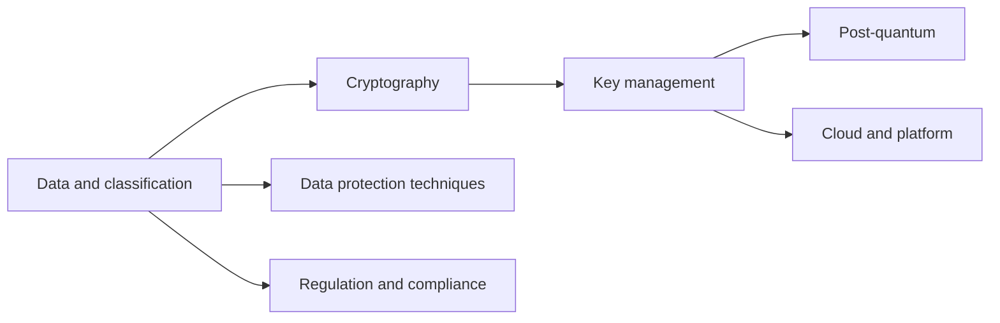

# Glossary
{: .no_toc }

**All phases.** Definitions of the terms used across this architecture, written for engineers, auditors, and leadership.
{: .fs-5 .fw-300 }

## On this page
{: .no_toc .text-delta }

1. TOC
{:toc}

---

## How the glossary is organized

Terms are grouped by topic and listed alphabetically within each group. Where a term has a program-specific meaning (for example "C3" or "PP-2"), the program meaning is given. Cloud product names are defined briefly; the [cross-cloud terminology]() page maps equivalent services across providers.

## Data and classification

| Term | Definition |
|---|---|
| C0, C1, C2, C3 | The program's four classification tiers: Public, Internal, Confidential, and Restricted. The tier of a system is the highest tier of any data element it processes. |
| Data asset register | The authoritative list of data stores with tier, owner, residency, and retention. Output of Phase 1. |
| Data classification | Assigning data to a tier based on the harm its disclosure, alteration, or loss would cause. |
| Data discovery | Automated scanning of data stores to find sensitive data types (for example Amazon Macie, Microsoft Purview, Google Sensitive Data Protection, OCI Data Safe). |
| Data domain | A business grouping of data with a single accountable owner, expressed in the `data-domain` tag (`guest`, `payment`, `loyalty`, `employee`, `finance`, `operations`, `property-iot`, `security`). |
| Data flow diagram | A diagram of how data moves between systems, used for threat modeling and transit controls. |
| Data lineage | The record of where data came from and how it was transformed. |
| Data owner | The business leader accountable for a data domain, who approves access, trade-offs, and residual risk. |
| Data residency | The geographic location where data is stored and processed, expressed in the `data-residency` tag. |
| Label | A persistent classification marker on a file, email, or column. In Microsoft 365, a sensitivity label can also apply encryption and markings. |
| Protection profile (PP-1, PP-2, PP-3) | The program's control bundles: PP-1 Baseline (Good) for C0/C1, PP-2 Enhanced (Better) for C2, PP-3 Maximum (Best) for C3. |
| Sensitive information type | In Microsoft Purview, a pattern-based classifier (for example a credit card number with Luhn check). |
| Special category data | GDPR Article 9 data, including health data and biometric data used for identification. Classified C3 in this program. |
| Tag schema | The shared key-value schema applied to cloud resources: `data-classification`, `protection-profile`, `data-domain`, `regulatory-scope`, `data-residency`, `data-owner`, `retention-class`. |

## Cryptography

| Term | Definition |
|---|---|
| AEAD | Authenticated encryption with associated data. Encryption that provides confidentiality and integrity, and authenticates additional unencrypted data (the associated data). AES-GCM is the most common AEAD. |
| AES | Advanced Encryption Standard (FIPS 197), a symmetric block cipher with 128, 192, or 256-bit keys. AES-256 is the program standard. |
| AES-GCM | AES in Galois/Counter Mode (NIST SP 800-38D), an AEAD mode. Requires a unique nonce per encryption under the same key. |
| Associated data | Data that is authenticated but not encrypted in an AEAD operation, such as a record ID, binding ciphertext to its context. |
| Asymmetric cryptography | Cryptography using key pairs (public and private), such as RSA, ECDH, ECDSA, ML-KEM, and ML-DSA. |
| Cipher suite | In TLS, the set of algorithms negotiated for a connection. In TLS 1.3 it names the AEAD and hash; key exchange is negotiated separately as a group. |
| Diffie-Hellman (DH, ECDH) | Key agreement methods that let two parties derive a shared secret. Broken by Shor's algorithm on a cryptographically relevant quantum computer. |
| Digital signature | A value created with a private key that proves origin and integrity, verifiable with the public key (RSA, ECDSA, EdDSA, ML-DSA, SLH-DSA). |
| ECDSA | Elliptic Curve Digital Signature Algorithm. Quantum-vulnerable. |
| EdDSA | Edwards-curve Digital Signature Algorithm (for example Ed25519). Quantum-vulnerable. |
| Forward secrecy | A property of key exchange in which compromise of long-term keys does not reveal past session keys. TLS 1.3 provides it by default. |
| Hash function | A one-way function producing a fixed-size digest (SHA-256, SHA-384, SHA-3). |
| HMAC | Hash-based message authentication code (FIPS 198-1). A keyed hash used for integrity, keyed pseudonyms, and blind indexes. |
| Key encapsulation mechanism (KEM) | A public-key method for transporting a shared secret. ML-KEM is a KEM. |
| Key exchange group | In TLS 1.3, the named method used to establish the shared secret, such as `x25519` or the hybrid `X25519MLKEM768`. |
| mTLS | Mutual TLS: both client and server authenticate with certificates. |
| Nonce / IV | A number used once, or initialization vector. In AES-GCM, reusing a nonce with the same key breaks confidentiality and integrity. |
| RSA | A public-key algorithm used for encryption and signatures. Quantum-vulnerable. |
| Symmetric cryptography | Cryptography where the same key encrypts and decrypts (AES). Not broken by known quantum algorithms at 256-bit key length. |
| TLS 1.3 | The current version of Transport Layer Security (RFC 8446). The program prefers TLS 1.3 and requires at least TLS 1.2. |

## Key management

| Term | Definition |
|---|---|
| BYOK | Bring your own key: generating key material outside the cloud provider (typically in an organization HSM) and importing it into the provider's KMS. The provider still uses the key. |
| Cloud HSM | A cloud-hosted HSM service. As product names: AWS CloudHSM, Google Cloud HSM, Azure Cloud HSM and Managed HSM. |
| CMK (customer-managed key) | A key whose lifecycle and access policy the customer controls in a cloud KMS. AWS now calls these customer managed KMS keys. |
| CMEK | Customer-managed encryption keys, Google Cloud's term for services encrypting data with a customer's Cloud KMS key. |
| Crypto-shredding | Making data unrecoverable by destroying the keys that encrypt it, provided every copy was encrypted under those keys. Also called cryptographic erase (NIST SP 800-88). |
| Cryptoperiod | The time span during which a key is authorized for use (NIST SP 800-57 Part 1 Rev. 5). |
| DEK | Data encryption key: the key that encrypts data directly. In envelope encryption, stored only in wrapped form. |
| Dual control | A requirement that two or more people perform a sensitive key operation together. |
| Encryption context | In AWS KMS and the AWS Encryption SDK, non-secret key-value pairs bound to ciphertext as associated data and recorded in logs. |
| Envelope encryption | Encrypting data with a DEK and encrypting (wrapping) the DEK with a KEK held in a KMS or HSM. |
| External key store / HYOK | Hold your own key: keys stay in a key manager operated by the customer outside the cloud provider, which must approve each use (AWS XKS, Google Cloud EKM, OCI External KMS). |
| HSM | Hardware security module: tamper-resistant hardware that generates, stores, and uses keys without exposing them. |
| KEK | Key encryption key: a key that encrypts other keys. |
| Key admin / key user separation | The principle that identities able to manage a key's policy and lifecycle are different from those able to use it for cryptographic operations. |
| Key custodian | A named person responsible for key components or HSM credentials during manual key operations (PCI DSS 3.6 and 3.7). |
| Key hierarchy | The layered structure of root keys, KEKs, and DEKs. |
| Key rotation | Replacing the key material used for new encryptions. Automatic KMS rotation keeps older material to decrypt existing data. |
| KMIP | Key Management Interoperability Protocol (OASIS), used by storage and database systems to obtain keys from an external key manager. |
| KMS | Key management service, such as AWS KMS, Azure Key Vault, Google Cloud KMS, or OCI Vault. |
| Split knowledge | A condition where no single person knows a complete key; each custodian holds only a component. |
| Wrapping | Encrypting a key with another key. |

## Data protection techniques

| Term | Definition |
|---|---|
| Blind index | A keyed hash (HMAC) of a normalized value stored beside its ciphertext to support exact-match search without decryption. |
| Clean room | An environment where two parties analyze combined data under rules that allow only approved (typically aggregate) outputs. |
| Column-level encryption | Encrypting specific database columns, either in the database engine or in the application. |
| Confidential computing | Protecting data in use by processing it in hardware-based trusted execution environments (for example AMD SEV-SNP, Intel TDX, AWS Nitro Enclaves). |
| Data masking (dynamic) | Returning masked values to users at query time based on their role, without changing stored data. |
| Data masking (static) | Permanently replacing sensitive values in a copy of data, typically for non-production use. |
| De-identification | Removing or transforming identifiers so data cannot readily be linked to a person. |
| Deterministic encryption | Encryption that produces the same ciphertext for the same plaintext and key, enabling equality matching but leaking equality and frequency. |
| DLP | Data loss prevention: detecting and blocking sensitive data leaving approved channels. |
| CASB | Cloud access security broker: controls and monitors use of cloud applications. |
| Double Key Encryption (DKE) | A Microsoft Purview option in which content is protected with two keys, one held by the customer, so Microsoft cannot decrypt it alone. |
| Field-level encryption | Encrypting individual data fields in the application before they are stored or transmitted. |
| Format-preserving encryption (FPE) | Encryption whose output has the same format as the input (for example 16 digits). FF1 is specified in NIST SP 800-38G. |
| Network token | A card network-issued substitute for a PAN, restricted to a merchant or domain. |
| P2PE | Point-to-point encryption: card data encrypted in a validated terminal and decrypted only in the solution provider's secure environment. |
| Pseudonymization | Processing personal data so it cannot be attributed to a person without additional information kept separately (GDPR Article 4(5)). Pseudonymized data remains personal data. |
| Randomized encryption | Encryption that produces different ciphertexts for the same plaintext, as AES-GCM does with unique nonces. |
| TDE | Transparent data encryption: database-engine encryption of data files and backups, transparent to authorized queries. |
| Tokenization | Replacing a sensitive value with a surrogate token. Vault tokenization stores the mapping in a secured vault; vaultless tokenization derives tokens cryptographically. |
| Truncation | Permanently removing part of a value, such as all but the last four digits of a PAN. |

## Post-quantum cryptography

| Term | Definition |
|---|---|
| CBOM | Cryptography bill of materials: an inventory of cryptographic assets (algorithms, keys, certificates, protocols, libraries), supported in CycloneDX. |
| CNSA 2.0 | NSA Commercial National Security Algorithm Suite 2.0 (announced September 2022): ML-KEM-1024, ML-DSA-87, AES-256, SHA-384/512, LMS/XMSS for firmware signing. |
| CRQC | Cryptographically relevant quantum computer: a quantum computer able to break RSA or ECC at practical key sizes. |
| Crypto agility | The ability to change cryptographic algorithms and parameters with limited disruption. |
| FN-DSA | FFT over NTRU-Lattice-Based Digital Signature Algorithm (Falcon), planned as FIPS 206; draft status should be verified. |
| Grover's algorithm | A quantum search algorithm that roughly halves the effective security of symmetric keys; AES-256 remains appropriate. |
| HNDL | Harvest now, decrypt later: recording encrypted traffic today to decrypt it once a CRQC exists. The main reason to migrate key exchange first. |
| HQC | A code-based KEM selected by NIST in March 2025 as a backup to ML-KEM. |
| Hybrid key exchange | Combining a classical and a post-quantum key exchange so the session is secure if either remains unbroken, for example `X25519MLKEM768`. |
| LMS / XMSS | Stateful hash-based signature schemes (NIST SP 800-208), suited to firmware signing; the signer must never reuse a one-time key state. |
| ML-DSA | Module-Lattice-Based Digital Signature Algorithm (FIPS 204, August 2024), parameter sets ML-DSA-44, ML-DSA-65, ML-DSA-87. |
| ML-KEM | Module-Lattice-Based Key-Encapsulation Mechanism (FIPS 203, August 2024), parameter sets ML-KEM-512, ML-KEM-768, ML-KEM-1024. |
| Mosca's inequality | If data shelf life (X) plus migration time (Y) exceeds the time to a CRQC (Z), the data is at risk and migration should start now. |
| NIST IR 8547 | NIST's transition report (initial public draft, November 2024) proposing deprecation of 112-bit quantum-vulnerable algorithms after 2030 and disallowing them after 2035. |
| Post-quantum cryptography (PQC) | Classical algorithms believed secure against both classical and quantum computers. |
| Shor's algorithm | A quantum algorithm that breaks RSA, DH, ECDH, ECDSA, and EdDSA given a CRQC. |
| SLH-DSA | Stateless Hash-Based Digital Signature Algorithm (FIPS 205, August 2024), based on SPHINCS+. Larger signatures, conservative security assumptions. |
| X25519MLKEM768 | The hybrid TLS key exchange group combining X25519 and ML-KEM-768 (codepoint 0x11EC), enabled by default in major browsers. |

## Cloud and platform

| Term | Definition |
|---|---|
| Autokey | A Google Cloud KMS feature that automates creation of CMEK keys for resources. |
| AWS Encryption SDK | A client-side library implementing envelope encryption with KMS and other keyrings. |
| AWS Database Encryption SDK | A client-side library for record-level encryption, including searchable encryption with beacons, for DynamoDB. |
| Azure Managed HSM | A single-tenant, FIPS 140-3 Level 3 validated HSM pool service in Azure. |
| Cloud EKM | Google Cloud External Key Manager, using keys held in a supported external key manager. |
| Customer Key | Microsoft 365 service encryption with customer-provided root keys held in Azure Key Vault. |
| Key Access Justifications | A Google Cloud feature that attaches a reason to each key access request to Cloud EKM or Cloud HSM keys, which the customer can approve or deny by policy. |
| Nitro Enclaves | Isolated compute environments on AWS EC2 for processing sensitive data. |
| OCI Vault | Oracle Cloud Infrastructure key and secret management, with HSM-protected or software-protected keys and virtual private vaults. |
| Paved road | A pre-approved, supported way to build something (a Terraform module, library, or template) that meets standards by default. |
| S3 Bucket Keys | An S3 feature that reduces KMS request volume for SSE-KMS by using a bucket-level key derived from the KMS key. |
| SCP | Service control policy in AWS Organizations, setting maximum permissions for accounts. |
| Security zone | An OCI compartment feature that enforces security policies on resources. |
| SSE-KMS / DSSE-KMS / SSE-C | Amazon S3 server-side encryption with KMS keys, dual-layer server-side encryption with KMS keys, and server-side encryption with customer-provided keys. |
| XKS | AWS KMS external key store. |

## Regulation, compliance, and assurance

| Term | Definition |
|---|---|
| AOC | Attestation of Compliance for PCI DSS. |
| CDE | Cardholder data environment: systems that store, process, or transmit cardholder data or sensitive authentication data, and connected systems. |
| CMVP | NIST Cryptographic Module Validation Program, which validates modules against FIPS 140-3. |
| FIPS 140-3 | The current US standard for validating cryptographic modules. FIPS 140-2 certificates move to the historical list on September 21, 2026. |
| PAN | Primary account number: the card number. |
| PCI DSS | Payment Card Industry Data Security Standard; v4.0.1 published June 2024. |
| QSA | Qualified Security Assessor for PCI DSS. |
| SAD | Sensitive authentication data (full track, card verification code, PIN and PIN block). Must not be stored after authorization. |
| ROPA | Records of processing activities (GDPR Article 30). |
| DPIA | Data protection impact assessment (GDPR Article 35). |
| PIPL | China's Personal Information Protection Law. |
| LGPD | Brazil's General Data Protection Law. |
| DPDP Act | India's Digital Personal Data Protection Act, 2023. |
| CCPA / CPRA | California Consumer Privacy Act as amended by the California Privacy Rights Act. |
| STRIDE | A threat modeling mnemonic: spoofing, tampering, repudiation, information disclosure, denial of service, elevation of privilege. |
| ADR / EDR | Architecture decision record; the program's encryption design record uses the ADR format. |

## Key takeaways for engineering teams

- Use these terms consistently in design records and tickets.
- "Encrypted" is not a complete statement: say at which layer, with which key, and who can use the key.
- Tokenization, FPE, encryption, masking, and pseudonymization are different controls with different scope effects.
- Hybrid key exchange addresses HNDL; PQC signatures address future forgery of long-lived trust.

## Related pages

- [Reference]()
- [Sources]()
- [Cross-cloud terminology]()
- [Data classification scheme]()
