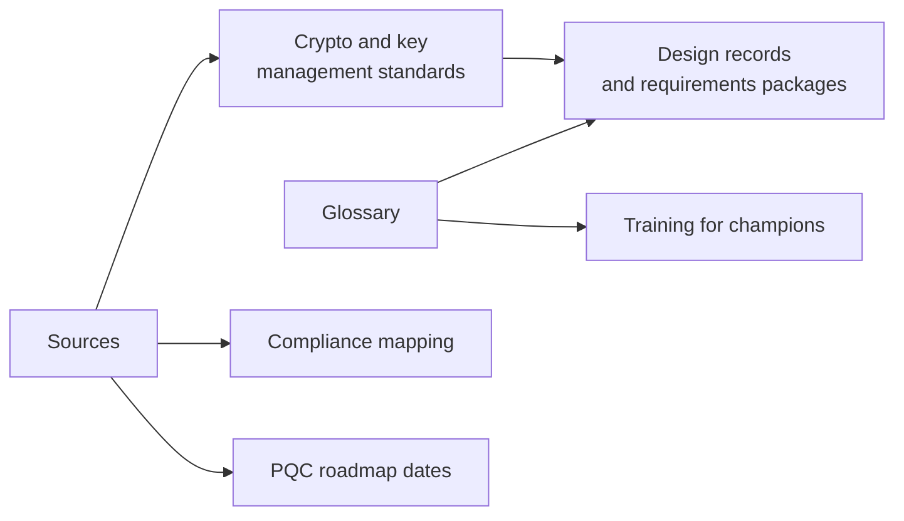

# Reference
{: .no_toc }

**All phases.** Shared vocabulary and the authoritative sources behind the architecture, so engineering teams, auditors, and leadership read the same terms the same way.
{: .fs-5 .fw-300 }

## On this page
{: .no_toc .text-delta }

1. TOC
{:toc}

---

## Objective

A data protection program crosses security, privacy, legal, platform engineering, application teams, and franchise operations. Each group uses the same words differently. "Key" means a cryptographic key to the platform team and a door key card to property operations. "Tokenization" means PAN replacement to the payments team and text splitting to the data science team. "Encrypted" can mean anything from a disk setting to application-layer encryption with a dedicated HSM key. The reference section fixes the vocabulary and points to the primary sources, so that design records, requirements packages, and audit evidence can be read without ambiguity.

The reference section also supports accuracy. The architecture follows a rule that claims about standards, dates, and product capabilities must be traceable to an official source. The sources page lists those sources by publisher.

## How the reference pages are used

| Use | Page | How |
|---|---|---|
| Writing an encryption design record | Glossary | Use glossary terms (for example "envelope encryption", "encryption context", "blind index") so reviewers read the design the same way |
| Onboarding security champions | Glossary | Core terms are part of the champion training curriculum |
| Updating the crypto standard | Sources | Standards changes start from NIST, IETF, and national agency publications |
| Preparing for an assessment | Sources | Link requirements to the official document versions cited in the compliance mapping |
| Checking a cloud capability | Sources | Start from the official cloud documentation; many features change status frequently |

## Entry and exit criteria

The reference pages have no phase gate. They are maintained continuously by the crypto center of excellence.

| Maintenance activity | Frequency | Owner |
|---|---|---|
| Add terms introduced by new patterns or standards | As needed | Security architecture |
| Review sources for new versions (for example NIST final publications of drafts, PCI DSS updates) | Quarterly | Security architecture |
| Recheck cloud capability statements marked "verify" | Quarterly | Platform engineering leads |
| Annual full review aligned with the crypto standard review (PCI DSS 12.3.3) | Annually | CCoE |

## Deliverables

- A glossary of more than 80 terms covering classification, cryptography, key management, PQC, cloud services, and compliance.
- A sources list grouped by publisher with official URLs.

## Child pages

| Page | What it covers |
|---|---|
| [Glossary]() | Definitions of data protection, cryptography, key management, PQC, cloud, and compliance terms used on this site |
| [Sources]() | Authoritative sources grouped by NIST, NSA, PCI SSC, EU, UK NCSC, IETF, other regulators, and cloud providers |

## Key takeaways for engineering teams

- Use glossary terms in design records so reviewers and auditors interpret them consistently.
- Check the official source before relying on a date, algorithm parameter, or cloud feature status.
- Items marked "verify" on this site are known to change; confirm them before committing a design.

## Related pages

- [Overview and how to use this site]()
- [Cross-cloud terminology]()
- [Compliance mapping]()
- [PQC standards and timelines]()
