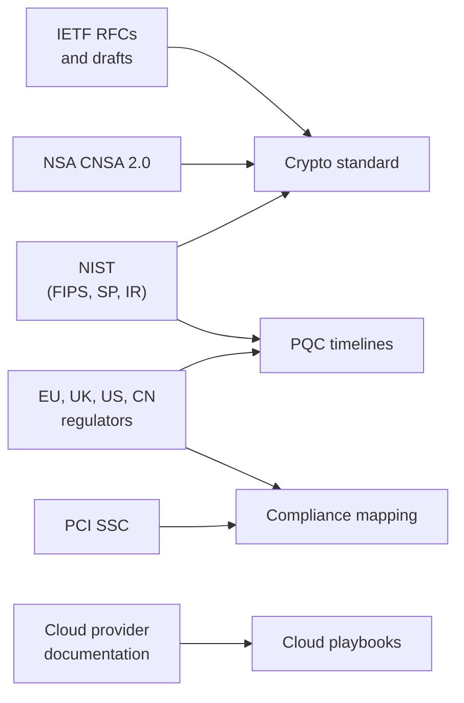

# Sources
{: .no_toc }

**All phases.** The official documents this architecture relies on, grouped by publisher, with notes on what each is used for.
{: .fs-5 .fw-300 }

## On this page
{: .no_toc .text-delta }

1. TOC
{:toc}

---

## How to use this list

Every date, algorithm parameter, and regulatory requirement on this site should trace to one of these sources. Where a document is a draft or a capability is in preview, the site marks the statement with a "verify" callout. Before using a statement in a design record, contract, or audit response, open the source and confirm the current version.

Links point to the publisher's official page. Where a stable deep link was uncertain, the link goes to the publisher's top-level documentation page and the document title is given so it can be found by search.

## NIST: Federal Information Processing Standards

| Document | Use on this site | URL |
|---|---|---|
| FIPS 203, Module-Lattice-Based Key-Encapsulation Mechanism Standard (ML-KEM), August 2024 | PQC key establishment; parameter sets ML-KEM-512/768/1024 | <https://csrc.nist.gov/pubs/fips/203/final> |
| FIPS 204, Module-Lattice-Based Digital Signature Standard (ML-DSA), August 2024 | PQC signatures; ML-DSA-44/65/87 | <https://csrc.nist.gov/pubs/fips/204/final> |
| FIPS 205, Stateless Hash-Based Digital Signature Standard (SLH-DSA), August 2024 | Conservative PQC signatures | <https://csrc.nist.gov/pubs/fips/205/final> |
| FIPS 197, Advanced Encryption Standard | AES | <https://csrc.nist.gov/pubs/fips/197/final> |
| FIPS 198-1, The Keyed-Hash Message Authentication Code (HMAC) | Keyed hashes, blind indexes | <https://csrc.nist.gov/pubs/fips/198-1/final> |
| FIPS 140-3, Security Requirements for Cryptographic Modules | Module validation requirements for HSMs and libraries | <https://csrc.nist.gov/pubs/fips/140-3/final> |

FN-DSA (Falcon) is planned as FIPS 206. Check the NIST PQC project page for its current status before referencing it.

## NIST: Special Publications and reports

| Document | Use on this site | URL |
|---|---|---|
| SP 800-57 Part 1 Rev. 5, Recommendation for Key Management: Part 1 – General | Key hierarchy, cryptoperiods, key states | <https://csrc.nist.gov/pubs/sp/800/57/pt1/r5/final> |
| SP 800-131A Rev. 2, Transitioning the Use of Cryptographic Algorithms and Key Lengths | Algorithm transition and deprecation | <https://csrc.nist.gov/pubs/sp/800/131/a/r2/final> |
| SP 800-38D, Galois/Counter Mode (GCM) and GMAC | AES-GCM | <https://csrc.nist.gov/pubs/sp/800/38/d/final> |
| SP 800-38G, Methods for Format-Preserving Encryption | FF1 FPE; a draft revision proposes withdrawing FF3-1 (verify status) | <https://csrc.nist.gov/pubs/sp/800/38/g/final> |
| SP 800-52 Rev. 2, Guidelines for the Selection, Configuration, and Use of TLS Implementations | TLS configuration | <https://csrc.nist.gov/pubs/sp/800/52/r2/final> |
| SP 800-88 Rev. 1, Guidelines for Media Sanitization | Cryptographic erase, crypto-shredding (check for a later revision) | <https://csrc.nist.gov/pubs/sp/800/88/r1/final> |
| SP 800-208, Recommendation for Stateful Hash-Based Signature Schemes | LMS and XMSS for firmware signing | <https://csrc.nist.gov/pubs/sp/800/208/final> |
| SP 800-227, Recommendations for Key-Encapsulation Mechanisms | KEM usage guidance | Search the NIST SP 800 series: <https://csrc.nist.gov/publications/sp800> |
| SP 800-53 Rev. 5, Security and Privacy Controls for Information Systems and Organizations | Compliance mapping | <https://csrc.nist.gov/pubs/sp/800/53/r5/upd1/final> |
| NIST IR 8547 (initial public draft, November 2024), Transition to Post-Quantum Cryptography Standards | 2030 deprecation and 2035 disallowance of quantum-vulnerable algorithms | <https://csrc.nist.gov/pubs/ir/8547/ipd> |
| NIST Cybersecurity Framework 2.0 | Compliance mapping | <https://www.nist.gov/cyberframework> |

## NIST: programs and projects

| Resource | Use | URL |
|---|---|---|
| Post-Quantum Cryptography project | Standardization status, HQC selection (March 2025), FN-DSA progress | <https://csrc.nist.gov/projects/post-quantum-cryptography> |
| Cryptographic Module Validation Program | FIPS 140-3 validated modules; FIPS 140-2 certificates move to historical on September 21, 2026 | <https://csrc.nist.gov/projects/cryptographic-module-validation-program> |
| Computer Security Resource Center publications | Finding current versions of any SP, FIPS, or IR | <https://csrc.nist.gov/publications> |

## NSA

| Document | Use | URL |
|---|---|---|
| Commercial National Security Algorithm Suite 2.0 (CNSA 2.0), announced September 2022, and the CNSA 2.0 FAQ | Algorithm set (ML-KEM-1024, ML-DSA-87, AES-256, SHA-384/512, LMS/XMSS) and transition timeline for national security systems | NSA cybersecurity resources: <https://www.nsa.gov/Cybersecurity/> (search "CNSA 2.0") |

## PCI Security Standards Council

| Document | Use | URL |
|---|---|---|
| PCI DSS v4.0.1 (June 2024) | Requirements 3, 4, 10, 12.3.3 and related | <https://www.pcisecuritystandards.org/document_library/> |
| Point-to-Point Encryption (P2PE) standard and listed solutions | Property payment terminals | <https://www.pcisecuritystandards.org/> |
| Tokenization and scope guidance (information supplements) | Scope reduction | Document library (search "tokenization") |

## European Union

| Document | Use | URL |
|---|---|---|
| General Data Protection Regulation (Regulation (EU) 2016/679) | Articles 5, 9, 25, 30, 32 to 35, 44 to 49 | <https://eur-lex.europa.eu/eli/reg/2016/679/oj> |
| Commission Recommendation on a Coordinated Implementation Roadmap for the transition to Post-Quantum Cryptography (April 2024) and the coordinated implementation roadmap (June 2025) | EU PQC milestones: begin by end of 2026, high-risk use cases by end of 2030, as many systems as feasible by 2035 | European Commission digital strategy: <https://digital-strategy.ec.europa.eu/> (search "post-quantum") |

## United Kingdom

| Document | Use | URL |
|---|---|---|
| NCSC guidance on PQC migration timelines (March 2025) | Discovery and planning by 2028, high-priority migration by 2031, completion by 2035 | <https://www.ncsc.gov.uk/> (search "PQC migration timelines") |
| UK GDPR and Data Protection Act 2018 | UK privacy obligations | Information Commissioner's Office: <https://ico.org.uk/> |

## United States (other than NIST and NSA)

| Document | Use | URL |
|---|---|---|
| Quantum Computing Cybersecurity Preparedness Act (H.R. 7535, 117th Congress, enacted December 2022) | Federal PQC migration driver | <https://www.congress.gov/bill/117th-congress/house-bill/7535> |
| National Security Memorandum 10 (May 2022) | Federal quantum policy | Published by the White House; search by title |
| OMB Memorandum M-23-02, Migrating to Post-Quantum Cryptography | Federal crypto inventory requirement; model for the CBOM | Published by OMB; search by title |
| California Consumer Privacy Act as amended by CPRA; California Privacy Protection Agency regulations | CCPA/CPRA obligations | <https://cppa.ca.gov/> |

## Other jurisdictions

| Law | Use | Note |
|---|---|---|
| China Personal Information Protection Law (PIPL) | Sensitive personal information, cross-border transfer, Article 51 security measures | No official English text; use a reputable translation and confirm with counsel |
| Brazil LGPD (Lei 13.709/2018) | Brazilian guest and employee data | Authority: ANPD |
| India Digital Personal Data Protection Act, 2023 | Indian guest and employee data | Rules phased in; confirm current status |

## IETF and IANA

| Document | Use | URL |
|---|---|---|
| RFC 8446, TLS 1.3 | Transit standard | <https://www.rfc-editor.org/rfc/rfc8446> |
| RFC 5246, TLS 1.2 | Minimum TLS version | <https://www.rfc-editor.org/rfc/rfc5246> |
| RFC 8554, Leighton-Micali Hash-Based Signatures (LMS) | Firmware signing | <https://www.rfc-editor.org/rfc/rfc8554> |
| RFC 8391, XMSS | Firmware signing | <https://www.rfc-editor.org/rfc/rfc8391> |
| RFC 5869, HKDF | Key derivation | <https://www.rfc-editor.org/rfc/rfc5869> |
| RFC 8555, ACME | Certificate automation | <https://www.rfc-editor.org/rfc/rfc8555> |
| RFC 7030, Enrollment over Secure Transport (EST) | Device certificate enrollment | <https://www.rfc-editor.org/rfc/rfc7030> |
| Hybrid key exchange in TLS 1.3 (draft-ietf-tls-hybrid-design) | Hybrid design | <https://datatracker.ietf.org/doc/draft-ietf-tls-hybrid-design/> |
| ECDHE-MLKEM hybrid groups for TLS 1.3 (draft-ietf-tls-ecdhe-mlkem) | `X25519MLKEM768` definition | <https://datatracker.ietf.org/doc/draft-ietf-tls-ecdhe-mlkem/> |
| IANA TLS parameters registry | Supported groups codepoints (0x11EC) | <https://www.iana.org/assignments/tls-parameters/tls-parameters.xhtml> |

## Industry bodies and frameworks

| Source | Use | URL |
|---|---|---|
| CA/Browser Forum (ballot SC-081, certificate validity reduction) | Certificate lifetimes: 200 days from March 15, 2026; 100 days from March 15, 2027; 47 days from March 15, 2029 | <https://cabforum.org/> |
| ISO/IEC 27001:2022 | Annex A mapping | <https://www.iso.org/standard/27001> |
| CIS Critical Security Controls v8 | Control 3 mapping | <https://www.cisecurity.org/controls> |
| AICPA Trust Services Criteria (SOC 2) | CC6.1, CC6.7 mapping | <https://www.aicpa-cima.com/> (search "Trust Services Criteria") |
| CycloneDX (CBOM support) | Cryptographic inventory format | <https://cyclonedx.org/> |
| OASIS KMIP | Key management interoperability | <https://www.oasis-open.org/> |
| OpenSSL | ML-KEM, ML-DSA, SLH-DSA, and hybrid TLS in OpenSSL 3.5 | <https://www.openssl.org/> |

## Cloud provider documentation

{: .verify }
Cloud PQC capabilities, key management tiers, and product names change frequently. As of mid-2026, confirm any capability against the provider's current documentation and release notes.

### AWS

| Topic | URL |
|---|---|
| AWS KMS developer guide | <https://docs.aws.amazon.com/kms/latest/developerguide/overview.html> |
| AWS KMS logging with CloudTrail | <https://docs.aws.amazon.com/kms/latest/developerguide/logging-using-cloudtrail.html> |
| AWS CloudHSM | <https://docs.aws.amazon.com/cloudhsm/> |
| AWS Encryption SDK | <https://docs.aws.amazon.com/encryption-sdk/latest/developer-guide/introduction.html> |
| Amazon Macie | <https://docs.aws.amazon.com/macie/> |
| AWS Organizations SCPs | <https://docs.aws.amazon.com/organizations/latest/userguide/orgs_manage_policies_scps.html> |
| AWS post-quantum cryptography | <https://aws.amazon.com/security/post-quantum-cryptography/> |

### Microsoft

| Topic | URL |
|---|---|
| Azure Key Vault | <https://learn.microsoft.com/en-us/azure/key-vault/> |
| Azure Key Vault Managed HSM | <https://learn.microsoft.com/en-us/azure/key-vault/managed-hsm/> |
| Azure Policy | <https://learn.microsoft.com/en-us/azure/governance/policy/> |
| Microsoft Purview | <https://learn.microsoft.com/en-us/purview/> |
| SymCrypt (ML-KEM, ML-DSA) | <https://github.com/microsoft/SymCrypt> |

### Google Cloud

| Topic | URL |
|---|---|
| Cloud KMS | <https://cloud.google.com/kms/docs> |
| CMEK organization policies | <https://cloud.google.com/kms/docs/cmek-org-policy> |
| Cloud KMS audit logging | <https://cloud.google.com/kms/docs/audit-logging> |
| Sensitive Data Protection | <https://cloud.google.com/sensitive-data-protection/docs> |
| Organization policy constraints | <https://cloud.google.com/resource-manager/docs/organization-policy/org-policy-constraints> |

### Oracle Cloud Infrastructure

| Topic | URL |
|---|---|
| OCI Vault (key management) | <https://docs.oracle.com/en-us/iaas/Content/KeyManagement/home.htm> |
| OCI documentation home (Data Safe, Security Zones, Cloud Guard) | <https://docs.oracle.com/en-us/iaas/Content/home.htm> |

### Libraries

| Library | URL |
|---|---|
| Google Tink | <https://developers.google.com/tink> |
| libsodium | <https://doc.libsodium.org/> |
| Open Policy Agent | <https://www.openpolicyagent.org/docs/latest/> |
| Checkov | <https://www.checkov.io/> |

## Key takeaways for engineering teams

- Cite the primary source (NIST, IETF, PCI SSC, the regulator) rather than a blog post.
- Check the version: drafts (NIST IR 8547, SP 800-38G revision, FN-DSA) can change before final publication.
- Cloud capability statements are the most volatile; confirm against current provider documentation.

## Related pages

- [Reference]()
- [Glossary]()
- [PQC standards and timelines]()
- [Compliance mapping]()
