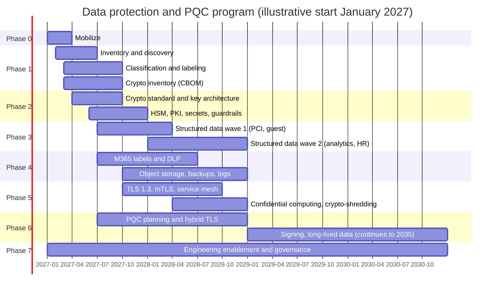
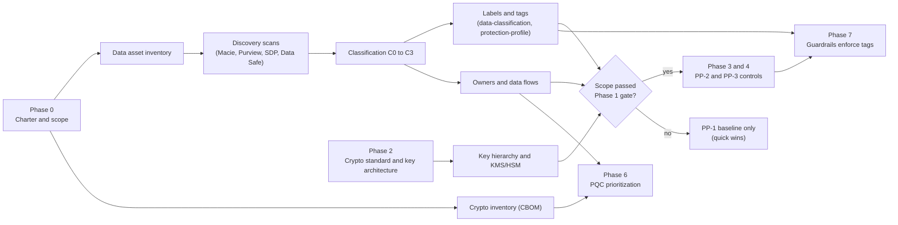
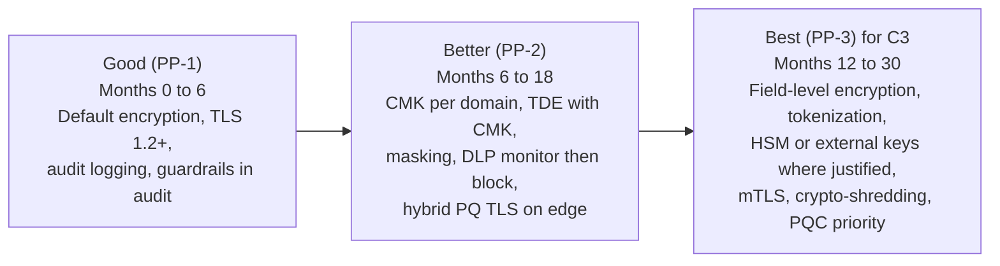

# Phased roadmap
{: .no_toc }

**Phases 0 to 7: the full program.** This page sequences the data protection and post-quantum program so that knowing the data comes before protecting it, and every control deployment has a measurable entry and exit gate.
{: .fs-5 .fw-300 }

## On this page
{: .no_toc .text-delta }

1. TOC
{:toc}

---

## How to read this roadmap

The roadmap is organized as eight phases (0 to 7). The phases overlap on purpose. A global hospitality organization cannot wait for a complete, perfect data inventory before it encrypts anything, and it cannot wait for every system to be protected before it starts post-quantum planning. The rule the roadmap enforces is narrower: **a control that depends on knowing the data (a label, a classification, an owner, a data flow) is not deployed to a scope until that scope has passed the Phase 1 exit gate.** Controls that do not depend on classification, such as platform default encryption at rest, TLS 1.2 minimums, and secrets scanning, start in Phase 0 as quick wins.

Timings are indicative. "Month 0" is the date the program charter is signed. The Gantt chart uses an illustrative start date of January 2027 so the bars render; replace it with the real start date.

| Phase | Name | Indicative timing | Focus |
|---|---|---|---|
| 0 | Mobilize | Months 0 to 3 | Charter, sponsors, objectives, scope, current-state assessment |
| 1 | Know the data | Months 1 to 9 | Data asset inventory, discovery, classification, labeling/metadata, ownership, data flows, cryptographic inventory (CBOM) |
| 2 | Standards and keys | Months 3 to 12 | Crypto standard, key management architecture, HSM, key custody, PKI, secrets, guardrails |
| 3 | Structured data | Months 6 to 24 | Databases, warehouses, lakes: TDE, field-level encryption, tokenization, FPE, masking, PCI |
| 4 | Unstructured data | Months 6 to 24 | Files, SharePoint/OneDrive, object storage, email, backups, logs, media: labels, persistent encryption, DLP |
| 5 | Transit and in use | Months 9 to 24 | TLS 1.3, mTLS, service mesh, confidential computing, retention, crypto-shredding |
| 6 | Post-quantum cryptography | Month 6 onward, to 2035 | Hybrid PQ TLS first, then high-value signing and long-lived data, completion by 2035 |
| 7 | Engineering enablement and governance | Continuous | Design review, patterns, paved roads, policy as code, metrics |

## Program timeline

The chart stops at 2030 for readability. Phase 6 continues to 2035, and Phase 7 is permanent.

## Dependency model: inventory and classification gate control deployment

The most common failure in data protection programs is deploying controls to data nobody has classified. The result is either over-protection (external keys on a lunch-menu bucket, with the availability risk that brings) or under-protection (payment data sitting in a C1 file share because the share was never scanned). The dependency diagram below is the rule set the program office uses to schedule work.

| Dependency | Why it gates | What happens without it |
|---|---|---|
| Inventory before discovery | Scanners need a target list and credentials | Scans miss shadow data stores; coverage metric is meaningless |
| Classification before PP-2/PP-3 | The protection profile is derived from the tier | Keys and controls are chosen by guesswork |
| Tags before guardrails | Policy as code keys off `data-classification` and `protection-profile` | Guardrails either block everything or nothing |
| Owners before field-level encryption | Someone must approve the change to application code and accept the search/join trade-off | Engineering teams refuse the change or it stalls |
| Data flows before transit controls | mTLS and hybrid PQ TLS are prioritized by the flows that carry C2/C3 data | Effort goes to low-value internal hops |
| Crypto standard before key deployment | Algorithms, key sizes, and cryptoperiods must be fixed first | Keys are created inconsistently and must be rebuilt |
| CBOM before PQC migration | You cannot migrate what you have not found | PQC effort targets the visible endpoints only |

## Phase detail

The workstreams, step-by-step activities, deliverables, entry and exit criteria, dependencies, risks, and owners for each phase are on three sub-pages:

| Page | Phases |
|:--|:--|
| [Roadmap: phases 0 to 2]() | 0 Mobilize, 1 Know the data, 2 Standards and keys |
| [Roadmap: phases 3 to 5]() | 3 Structured data, 4 Unstructured data, 5 Transit and in use |
| [Roadmap: phases 6 and 7]() | 6 Post-quantum cryptography, 7 Engineering enablement and governance |

## First 90 days for the architect

| Days | Focus | Concrete outputs |
|---|---|---|
| 1 to 30 | Listen and map | 25 to 30 stakeholder interviews; list of top 20 systems by sensitivity; review of PCI scope and existing key management; draft classification scheme |
| 31 to 60 | Decide and start | Charter drafted; current-state heat map; guardrails in audit mode in all clouds; design review intake live; first discovery scans on PMS integration stores, CRM, and the data lake |
| 61 to 90 | Commit and deliver | Steering committee approval; crypto standard draft; key hierarchy design; first paved-road module; first CBOM of external endpoints; quick-win report |

## Quick wins

These do not depend on classification and deliver measurable risk reduction in the first quarter.

| Quick win | Effort | Risk reduced |
|---|---|---|
| Enable default encryption and block public access on all object storage | Low | Accidental exposure of guest files |
| Enforce TLS 1.2 minimum on storage accounts, load balancers, and databases | Low | Downgrade and weak cipher exposure |
| Secret scanning in all repositories with push protection | Low | Credentials in code |
| Alert on KMS key disable or scheduled deletion | Low | Destructive or ransomware-style key actions |
| Turn on S3 Bucket Keys for SSE-KMS buckets | Low | KMS cost, which unlocks broader CMK adoption |
| Certificate expiry monitoring for public endpoints | Low | Outages as lifetimes shorten |
| Stop storing ID scans in shared mailboxes and file shares at properties | Medium | Passport data sprawl |

## Maturity progression: Good, better, best over time

| Dimension | Good | Better | Best |
|---|---|---|---|
| Keys | Provider-managed | Customer-managed per domain and environment | Single-tenant HSM or external keys for justified C3 |
| Structured data | Platform encryption at rest | TDE with CMK, dynamic masking | Field-level encryption or tokenization in the app |
| Unstructured data | Default storage encryption | Labels, auto-labeling, DLP monitor | Label-based persistent encryption, DLP block, DKE where justified |
| Transit | TLS 1.2+ | TLS 1.3 preferred, hybrid PQ on edge | mTLS, hybrid PQ internally |
| Governance | Audit mode guardrails | Deny guardrails keyed on tags | Continuous metrics, automated exceptions expiry |
| PQC | Inventory | Hybrid key exchange on external endpoints | PQC signing for roots of trust, long-lived data re-encryption |

Best is not the goal for every asset. External keys add availability risk and cost; field-level encryption breaks search and joins. The profile follows the classification, not ambition.

## Key takeaways for engineering teams

- Classification gates control selection: expect the design review to ask for your data's tier and tags before discussing encryption.
- Baseline controls (default encryption, TLS 1.2+, secrets out of code) apply now and do not wait for the program.
- C3 data will need application-layer protection; plan the search and join trade-offs early.
- Guardrails move from audit to deny in stages; use the paved-road modules to stay ahead of them.
- New designs must be crypto-agile so the PQC migration is a configuration change, not a rewrite.

## Related pages

- [Business objectives]()
- [Phase 1: Know the data]()
- [Phase 2: Standards and keys]()
- [PQC migration program]()
- [Phase 7: Engineering enablement]()
- [Metrics and KPIs]()
