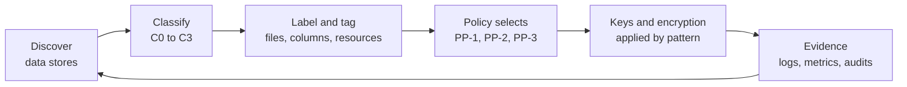

# Data protection and post-quantum encryption architecture
{: .fs-9 }

A phased, technology-level reference architecture for protecting the data of a global hospitality
organization: guest identities, payment cards, loyalty profiles, employee records, and the files
and exports that surround them. It covers structured and unstructured data, on-prem and in AWS,
Microsoft Azure, Google Cloud, and Oracle Cloud Infrastructure, and the migration to
post-quantum cryptography.
{: .fs-6 .fw-300 }

[Start here](){: .btn .btn-primary .fs-5 .mb-4 .mb-md-0 .mr-2 }
[Phased roadmap](){: .btn .fs-5 .mb-4 .mb-md-0 .mr-2 }
[Executive briefing (slides)](slides/){: .btn .fs-5 .mb-4 .mb-md-0 }

---

## The problem this architecture solves

A global hotel company holds some of the most sensitive consumer data in any industry: passport
and national ID scans required by local registration laws, payment cards taken at the front desk,
the restaurant, and the web, loyalty profiles that record where and when people travel, and health
or accessibility information shared for a stay. That data sits in property systems, corporate data
centers, SaaS platforms, and several public clouds, and it is handled by owned, managed, and
franchised properties with different levels of control.

Encryption is the control that regulators, card brands, and customers expect, but encryption only
works when three conditions hold:

1. **The data has been found, classified, and labeled**, so the right control is applied to it.
2. **Keys are managed properly**, with separation of duties, rotation, and logging, so encryption
   actually limits who can read the data.
3. **The algorithms remain strong for as long as the data must stay confidential**, which is why
   post-quantum cryptography is a data protection issue and not only a research topic.

This site works through each condition in order, then shows how engineering teams apply it to
real systems.

## How the site is organized

The content follows the program phases. Each phase page lists its entry criteria, activities,
deliverables, and exit criteria.

| Phase | Section | What it covers |
|:--|:--|:--|
| 0 | [Start here]() | Scenario, business objectives, threats and regulations, hospitality data landscape |
| All | [Phased roadmap]() | Timeline, workstreams, deliverables, and exit criteria for every phase |
| 1 | [Know the data]() | Data asset inventory, discovery, classification, labeling and metadata, label-to-control mapping, data flows, cryptographic inventory |
| 2 | [Standards and keys]() | Cryptographic standard, key management, key custody (BYOK, HYOK), HSMs, PKI, secrets |
| 3 | [Structured data]() | Encryption layers, tokenization, FPE, masking, PCI DSS, on-prem and cloud databases, analytics platforms |
| 4 | [Unstructured data]() | Persistent label-based encryption, Microsoft 365, file shares and NAS, object storage, email, backups, logs, DLP |
| 5 | [Transit and in use]() | TLS 1.3, mTLS, confidential computing, retention, crypto-shredding |
| 6 | [Post-quantum cryptography]() | Threat, standards and timelines, migration program, crypto agility, vendor readiness, hands-on lab |
| Ref | [Cloud provider playbooks]() | AWS, Azure, Google Cloud, OCI, and multi-cloud key management, each with Good, Better, Best options |
| 7 | [Engineering enablement]() | Design review, decision trees, reference architectures, policy as code, code lab |
| 7 | [Govern and measure]() | Operating model, monitoring, compliance mapping, metrics, risks |

## Good, Better, Best

Every control area is presented as three protection profiles. The profile is selected by the data
classification, which is why classification and labeling come first.

| Profile | Rating | Applies to | In short |
|:--|:--|:--|:--|
| PP-1 Baseline | Good | Public, Internal | Provider-managed keys, platform encryption at rest, TLS 1.2 or later, logging |
| PP-2 Enhanced | Better | Confidential | Customer-managed keys per data domain, rotation, separation of duties, TDE with CMK, masking, DLP |
| PP-3 Maximum | Best | Restricted | Field-level encryption or tokenization in the application, HSM or externally held keys where justified, persistent file encryption, mTLS, crypto-shredding, PQC priority |

## Proof, not only diagrams

The [`code/`](https://github.com/steven-smith-itnet/data-protection-pqc-security-architecture/tree/main/code)
directory contains working, tested tools that implement the architecture:

- A discovery scanner that finds card numbers (with Luhn validation), IBANs, and identity data and
  recommends a classification, label, and protection profile.
- A machine-readable label-to-control policy and a resolver that turns resource tags into required
  controls.
- Envelope encryption with an algorithm-agile header and adapters for AWS KMS, Azure Key Vault,
  and Google Cloud KMS.
- Vault tokenization, keyed-hash surrogates, and per-subject crypto-shredding.
- A TLS and certificate scanner that emits a CycloneDX cryptographic bill of materials and flags
  quantum-vulnerable algorithms.
- Terraform modules for AWS, Azure, Google Cloud, and OCI, and guardrails as SCPs, Azure Policy,
  GCP organization policies, and OPA/Rego with tests.
- An OpenSSL 3.5 lab that runs ML-KEM, ML-DSA, SLH-DSA, and a hybrid `X25519MLKEM768` TLS
  handshake, with the captured output.

See the [Code and tooling lab]() and the
[Hands-on PQC lab]().

## Companion guides

Deeper, command-level key management guides for each major cloud:

- [AWS KMS and CloudHSM key management guide](https://steven-smith-itnet.github.io/aws-kms-cloudhsm-key-management-guide/)
- [Azure Key Vault and Managed HSM key management guide](https://steven-smith-itnet.github.io/azure-key-vault-managed-hsm-key-management-guide/)
- [Google Cloud KMS and Cloud HSM key management guide](https://steven-smith-itnet.github.io/gcp-cloud-kms-hsm-key-management-guide/)

{: .note }
The organization described here is a composite scenario. Nothing on this site describes the
internal environment of any real company. Cloud features, preview status, and regulatory timelines
change often; items marked **Verify before use** should be checked against current official
documentation.
